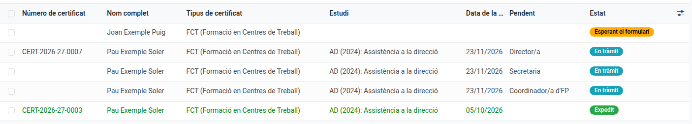
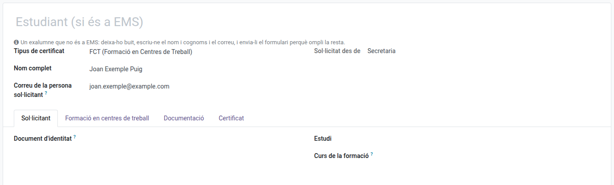
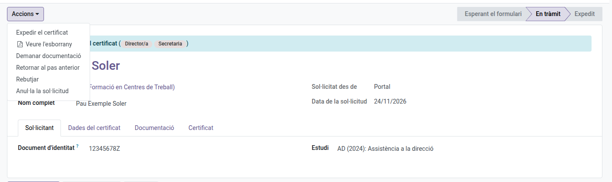

[Català](../../ca/secretary/certificates.md) | [Castellano](../../es/secretary/certificates.md) | [English](certificates.md)

---

# Certificates: registering, issuing and following up requests

Register the certificate requests that reach the secretariat (for example, from a former student), issue the certificates and follow up every request.

**Required role:** Secretariat. Issuing a certificate requires holding the Secretary position.

---

## How a request works

Each certificate is of a **type** (for example, *FCT (Formació en Centres de Treball)*), and each type has its **approval circuit**: the steps each position does, in order. The FCT certificate's is:

1. **Complete the data** — the VET coordinator or the secretariat's staff (Secretary technician position) complete the certificate details: the company, the dates, the hours and the agreement.
2. **Issue the certificate** — the secretariat issues it: it gets its number (for example `CERT-2026-27-0001`) and the EMS stamp.
3. **Approve** — the Director approves it. The PDF is generated and emailed to the applicant.

Each step is a task for whoever holds one of its positions, who finds it in their daily summary and under the **Pending for me** filter.

A request arrives in one of two ways:

- **From the portal:** current students (or their family) file it from the portal, and it goes straight to the first step.
- **From the secretariat:** you register it, usually for a former student, who has no portal access.

---

## Access

Navigate to: **Academic management → Certificates**. The list opens with the **Pending for me** filter; remove it to see every request. The **Pending for** column shows whose position the current step belongs to.

---

## Registering a former student's request

1. Click **New**.
2. Choose the **Certificate type**.
3. If the former student is in EMS, choose them in **Student (if in EMS)**: their details fill in by themselves, with their personal email (not the centre's). If the email stays empty, write their personal one. If they are not, leave it empty and write their **Full name** and the **Applicant's email**.
4. Save.
5. Open **Actions → Send form**. The former student gets an email with a link to the form, where they fill in the missing details and attach whatever documentation they have, without logging in.

If you already have every mandatory detail (identity document and study in the **Applicant** tab, and the mandatory ones of the **Certificate details** tab, such as the academic course for FCT), **Send form** also moves the request to its first step. The former student may still complete or correct their details from the link until someone of the centre changes the request or acts on it.

If the request reaches you on paper and nothing needs to be sent, fill in every detail and click **Actions → Start the request**.

The study must belong to one of the certificate type's levels (CFGM or CFGS for FCT): the dropdown only offers those.

---

## Issuing a certificate

1. Open the request from the **Pending for me** filter.
2. Check the details in the **Applicant** and **Certificate details** tabs.
3. In the **Documentation** tab, check that every required document (in green) has files.
4. Open **Actions → Issue the certificate** and confirm.

If a detail or a required document is missing, EMS says so and does not let you issue it.

### Issuing it without waiting for the earlier steps

Sometimes you already have every detail and document of a request that is still with an earlier step (for example, waiting for the VET coordinator to complete the certificate details). You don't need to wait:

1. Open the request. It is not under **Pending for me** yet: remove that filter to find it.
2. Fill in whatever is missing in the **Applicant** and **Certificate details** tabs, and attach the required documents in **Documentation**.
3. Open **Actions → Issue it now** and confirm that you have every mandatory detail and document.

The earlier steps are skipped and their pending tasks closed, and the request's history records who skipped them. The certificate gets its number and your stamp, and goes on to the Director's approval as usual. The same checks apply as when issuing it at its step: if anything mandatory is missing, EMS says what and does not issue it. The button is also available on a request you have just registered, before sending the form or starting it.

---

## Other actions

In the request's **Actions** menu:

- **Request documentation** — write what is missing; the applicant gets it by email with a link to answer and attach it. When they answer, the request goes back to its step.
- **Documentation received** — if the documentation reaches you some other way (on paper, by email), sends the request back to its step.
- **Return to the previous step** — write the reason; whoever did the previous step has it pending again.
- **Reject** — write the reason; the applicant gets it by email.
- **Cancel request** — only before the certificate is issued (for example, a duplicate). A cancelled request can be **Reopen**ed.

The **Certificate** tab holds the issued PDF and the stamps (who did each step, under which post, and when). The certificate names whoever issues it and whoever approves it by their post in EMS: if someone other than the Secretary issues it (for example, the Director while the Secretary is away), it shows that person's post.

---

## Documentation

The **Documentation** tab has:

- **Required documentation** — the documents the certificate type requires (the **FCT agreement** for FCT). The **Attached by** column shows who may attach them. Open the line to attach files (a PDF or photos of its pages).
- **Other documentation** — any other file, optional. It is not added to the certificate.

The certificate's PDF ends with the pages of the required documents marked to be added to the certificate.

---

## Collaborating companies

The companies where students do their training are in **Educational Community → Collaborating companies**. From a request's **Certificate details** tab you can choose one, or create it with **Create company** from the name and VAT number the student wrote.
