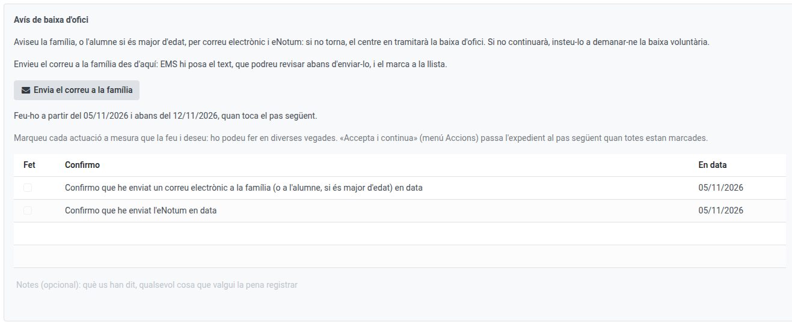
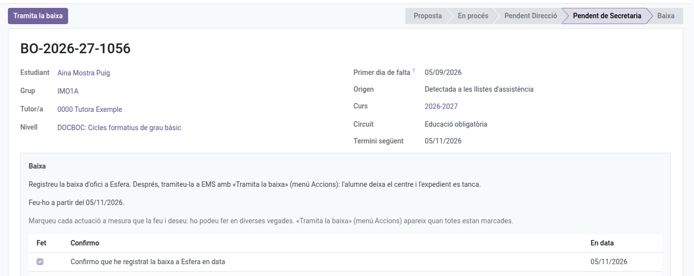

[Català](../../ca/secretary/ex-officio-withdrawal.md) | [Castellano](../../es/secretary/ex-officio-withdrawal.md) | [English](ex-officio-withdrawal.md)

---

# Ex Officio Withdrawal: the Secretariat's Steps

This guide explains the steps the Secretariat takes in an ex officio withdrawal case file: the notices to the family and, once Direction has given the green light, processing the withdrawal.

**Required role:** Secretariat (also the Administrator)

---

## Contents

1. [Where to find the case files](#where-to-find-the-case-files)
2. [The notices to the family](#the-notices-to-the-family)
3. [Processing the withdrawal](#processing-the-withdrawal)

---

## Where to find the case files

Go to: **Academic management → Ex officio withdrawals**. You see every case file of the centre. When a step is yours, you get the task on its day and the case file shows you what to do and by when; at the other steps you only see whose turn it is.

How a case file starts and what the tutor and Direction do is explained in the [tutor's manual](../tutors/ex-officio-withdrawal.md) and [Direction's](../head_of_studies/ex-officio-withdrawal.md).

---

## The notices to the family

Depending on the circuit, the Secretariat notifies the family:

- **Post-compulsory, on the 10th school day (Ex officio withdrawal warning):** an email to the family and an eNotum: if the student does not come back, the centre will process their ex officio withdrawal.
- **Compulsory, after a month (Notice to the family) and a month and a half (Ex officio withdrawal warning):** the email and, in the last one, the eNotum.

To send the email, click **Send the email to the family**: EMS writes the text, which you can review before sending it, and ticks it in the list with the date. The eNotum is done outside EMS and you tick it yourself, with the day you sent it. Once everything is ticked, **Actions → Accept and continue**.

---

## Processing the withdrawal

Once Direction has given the green light, the student becomes an **Expected withdrawal** (they no longer appear in the roll-calls) and the last step reaches you:

1. Register the withdrawal in Esfera, outside EMS, and tick it in the list.
2. In post-compulsory, you also register it in SAGA and send the eNotum (tick them the same way) and the withdrawal-done email to the family, with **Send the email to the family**.
3. Click **Process the withdrawal**: the withdrawal wizard opens, already filled in as an ex officio withdrawal. Applying it, the student leaves the centre and the case file closes.

If the student asks for a voluntary withdrawal while the case file is open, process it as usual ([Marking a graduation and registering a withdrawal](graduation-withdrawal.md)): the case file closes on its own.
