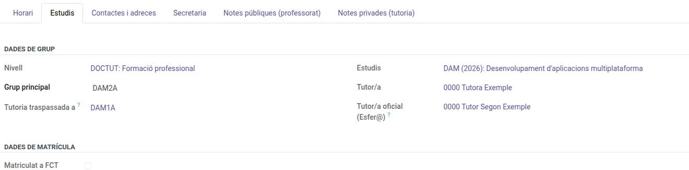

[Català](../../ca/secretary/tutorship-transfer.md) | [Castellano](../../es/secretary/tutorship-transfer.md) | [English](tutorship-transfer.md)

---

# Transferring a Student's Tutorship

A student enrolled in 2nd year with 1st-year subjects pending sometimes drops every 2nd-year subject and attends only 1st. In Esfer@ they stay in their 2nd-year group, with its tutor, who still enters their grades there. In EMS, though, the 1st-year tutor takes over the follow-up: the family, absences, strikes, student walkouts and the daily summary. Transferring the tutorship records this.

**Required role:** Secretary

---

## How to transfer the tutorship

1. Open the student's form (**Educational Community → Students → Student list**).
2. Go to the **Studies** tab.
3. In **Tutorship transferred to**, choose the group the student now attends (for example, the 1st-year group). Only groups of the student's own study are offered: from SMX2A to SMX1C, never to DAW2A. Leave **Main Group** as it is: it is the group in Esfer@.
4. Save. **Tutor** now shows the new group's tutor, and **Official tutor (Esfer@)** shows the main group's tutor.

To undo it, empty **Tutorship transferred to** and save.

## What changes

- The new tutor finds the student among their own students (**My students**), and can manage their data and their family's, as with any student of their group. They receive the student's attendance issues, strike notices and the rest of the tutor notices.
- The student takes part in the student walkouts of the group their tutorship was transferred to.
- The official tutor keeps what goes by group: the evaluation sessions and the academic record of their group. They no longer manage the student's data nor receive notices about them.
- The main group, the enrollment and the schedule declaration don't change.

## The student's schedule

The schedule shows the subjects the student is enrolled in. So that only the 1st-year tutorship appears, drop the 2nd-year tutorship (along with the rest of the 2nd-year subjects) and enroll the student in the 1st-year tutorship, in the 1st-year group.

## When it ends

The transfer ends by itself when the course changes, when the student leaves the centre, and when their main group changes to the group the tutorship was transferred to or to a group of another study.

---

[← Back to Secretary manuals](index.md)
