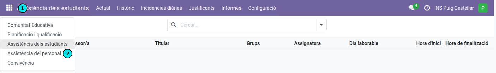
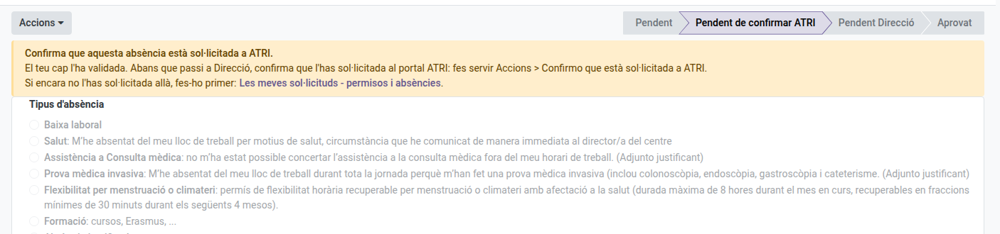
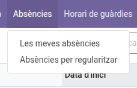
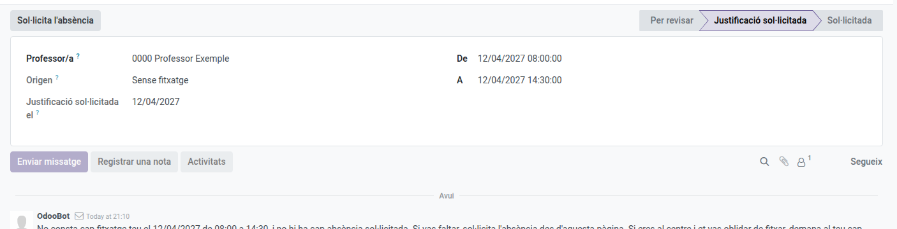
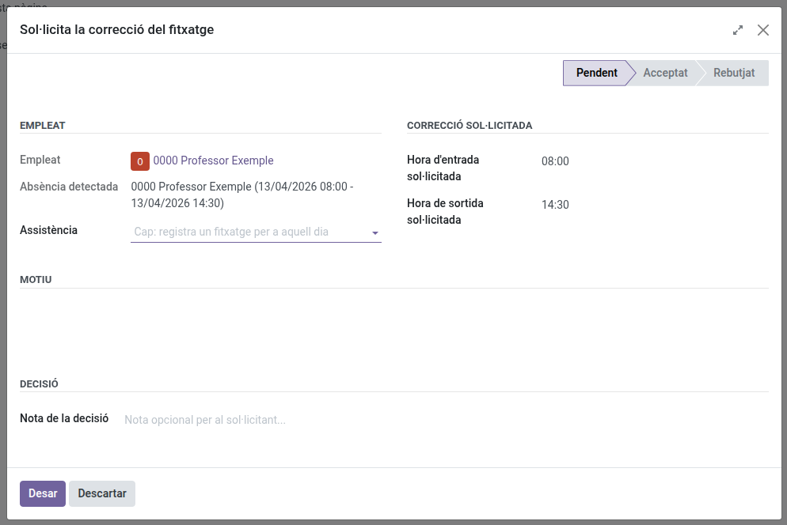

[Català](../../ca/teachers/absences.md) | [Castellano](../../es/teachers/absences.md) | [English](absences.md)

---

# Requesting an absence

**Role required:** anyone at the centre, teaching or administrative staff

---

## Contents

1. [Where to request one](#where-to-request-one)
2. [Absence type](#absence-type)
3. [Dates and times](#dates-and-times)
4. [Responsible declaration](#responsible-declaration)
5. [Supporting document](#supporting-document)
6. [Sending the request](#sending-the-request)
7. [Checking its status](#checking-its-status)
8. [Reminders of a missing document](#reminders-of-a-missing-document)
9. [Detected absences](#detected-absences)
10. [Health absence allowance](#health-absence-allowance)

---

## Where to request one

**Employee Attendances > Absences**, then the **New absence** button.

---

## Absence type

**Required.** No option is preselected: you have to choose one.

| Type | When to use it |
|---|---|
| **Sick leave** | Officially filed medical leave |
| **Health** | Absence for health reasons without medical leave, reported to Direction immediately |
| **Medical appointment** | An appointment you could not arrange outside your working hours |
| **Invasive medical test** | Colonoscopy, endoscopy, gastroscopy or catheterisation. Takes the whole day |
| **Menstrual or climacteric flexibility** | Recoverable flexible hours, up to 8 hours a month, to be made up within 4 months |
| **Training** | Courses, Erasmus+ and training in general |
| **Justified absence** | Other justified absences that fit none of the above |
| **Service assignment** | Field trips, travel and representing the centre |
| **ATRI** | Leave you file on the Generalitat's ATRI portal |

Choosing the **ATRI** type shows the portal links on the form. The request has to be filed there as well:

- [My requests - leave and absences](https://atriportal.gencat.cat/ATRI-ng/#/meves-sollicituds/permisos-absencies)
- [ATRI leave and absences manual (PDF)](https://atriportal.gencat.cat/ATRI-web/gestor-continguts/2011.pdf)

Direction checks that you filed it on the portal before approving it on its side (**Direction status** `Done`).

Each option shows the full wording of the leave. Read it before choosing: ticking it declares that it applies to you.

---

## Dates and times

The **Whole day?** checkbox decides what you fill in:

| Whole day? | You give | What is counted |
|---|---|---|
| Unticked | One day, a start time and an end time | The time you were away |
| Ticked | A start date and an end date | 7.5 hours per working day |

Tick it if you are not coming in at all: it counts 7.5 hours even if you only had one lesson that day. Leave it unticked if you come in and have to leave, or arrive late.

**Not coming in at all is always a whole day**, whatever the type of absence and however you write it. If you leave the box unticked and give times that cover your whole timetable for that day (from the start of your first lesson to the end of the last one), the form ticks it for you and tells you so: those 7.5 hours are what is counted, not the hours of your lessons. Untick it again only if you really do come in that day (for example, because your lesson has been moved to another time).

To request more than one day, tick it and change the end date. For a single day the end date fills itself in.

`Health` and `Invasive medical test` open with the box ticked, because being away for one of those reasons normally means the whole day. If you did come in and were only away for part of the day, untick it and give the times.

---

## Responsible declaration

**Required for every type.** The request cannot be sent without it.

---

## Supporting document

**You can attach one to any absence, of any type, at any time.** Every type *requires* one except **Health** and **ATRI** (ATRI is justified on the Generalitat's portal itself); for those two it is optional.

For a medical appointment, the document must expressly state the patient's first name and surname and the time of entry to and exit from the centre or medical practice.

**A certificate that arrives later is filed on the same request.** You do not need to have it when you request the absence: your Head marks the request as received and it waits for the document (**Awaiting documentation**). Once you have it, open the absence, attach the file in **Supporting document** and save. That is all: the request goes back to your Head on its own to validate it, you do not have to request the absence again or press anything else.

If your Head or Direction find the document is not valid, the request goes back to **Awaiting documentation** and you receive a message with the reason. The reason is also shown at the top of the request until you attach a new document: attach a valid one the same way.

If your Head decides the document is not needed, they can waive it: the request goes on to Direction, you stop receiving reminders and you get a message telling you so.

To remove one, click the cross on the file and confirm.

---

## Sending the request

The **Send request** button at the bottom of the form. Until you press it and confirm, the request is not filed.

The button stays disabled while something is missing. Hover over it and it will tell you what:

- Choose the absence type.
- Give the times, with the end later than the start (unless it is a whole day).
- Accept the responsible declaration.

If you leave the form without sending it, EMS tells you and lets you discard it.

When you send it, your Department Chief and, if your department has one, your Seminar Chief receive an email with the absence type, the dates and the hours, but not the reason, so they can arrange the guard duty that covers you. After that they only hear about it again if the absence will not take place (refused, cancelled, or deleted while still pending), goes ahead again, or its dates or type change.

**Messages on the request.** What you write in the request's message history (**Send message**) reaches whoever has the request in hand, and nobody else: your Head (Deputy Head of Studies, Head of Studies or Secretary) until they validate it and pass it on to Direction, and the Director from then on. Their answers reach you the same way.

---

## Checking its status

**Absences** shows your own list. Your absence goes first to your Head (Deputy Head of Studies, Head of Studies or Secretary) and then to Direction.

**Status**

| Value | Means |
|---|---|
| Pending | Your Head has not seen it yet |
| Awaiting documentation | Your Head has received it and it is waiting for your supporting document: attach it to the same request |
| Pending validation | You have attached the document and your Head has to validate it |
| Pending ATRI confirmation | Only ATRI absences. Your Head has validated it and you have to confirm it is requested in ATRI (see below) |
| Pending Direction | Your Head has validated it, Direction has not reviewed it yet |
| Approved | Granted by both |
| Refused | Denied. If it was a mistake, your Head or Direction can undo it; otherwise, to insist, file a new request |
| Cancelled | Withdrawn |

The **My pending supporting documents** filter lists the requests waiting for a document from you.

**ATRI absences: confirming the request.** An ATRI absence is granted on the Generalitat's portal, not in EMS. So once your Head has validated it, the request always stops at **Pending ATRI confirmation** before it is passed on to Direction. It does not mean anybody has found it missing in ATRI: it only asks you to confirm that you have requested it there.

- If you have already requested it in ATRI, open the request and use **I confirm it is requested in ATRI**, at the top of the form, straight away. It then goes on to Direction.
- If you have not, request it on the portal first (the notice at the top of the request has the link) and then confirm.

While it is not confirmed, once the absence is over you receive a reminder every day, and your Head is told after a few days. The **My pending ATRI confirmations** filter lists the requests waiting for it. If Direction then finds the absence is not in ATRI, or that the documentation you provided there is not sufficient, it sends the request back to this status and you receive the reason, which is also shown on the request. Whatever is missing is solved on the ATRI portal, not by attaching a supporting document in EMS; once done, confirm it again.

Once your Head receives it, the absence already counts in the absence calendar and the guard duty board, even while the document is still missing.

If your Head or Direction corrects something in your request (the absence type, the dates or the times), you receive a message on the request with what was changed, its new status and, when they have written one, their explanation.

If your request is refused and whoever refused it wrote the reason, you receive it in a message and it is shown in red at the top of the request.

---

## Reminders of a missing document

If the absence is over and it is still **Awaiting documentation**, EMS reminds you by message every day, when your working day starts, until you attach the document. You also have a pending activity ("Attach the absence's supporting document") that turns red the day after the absence.

A few days after the absence (three, unless the centre has set otherwise), your Head is told as well that the document is still missing.

---

## Detected absences

Sometimes EMS knows about an absence of yours that you have not requested yet. It happens in two cases:

- **You did not check in.** Once the day is over, if you did not check in at all, or checked in after your first lesson had ended, EMS records a *detected absence* from your first lesson to your last one (or to the time you checked in). This only happens in the areas where the centre has switched it on.
- **Somebody announced it.** You warned your Department Chief or the Head of Studies that you would be away, and they entered it so your classes could be covered.

Either way, your Head of Studies reviews it first, and you are only told if they ask you to justify it. Often it is nothing (you were at a meeting, or a training, and checked in later): then they correct your check-in or discard it, and you hear nothing about it. They can also prepare the absence request for you: then you are told, and you open it already filled in, check it, accept the responsible declaration and send it as usual. Until you send it, nothing is requested.

If they ask you to justify it, at the start of your next working day you receive a message with the day and the hours, and a link to it. Until you deal with it, you are reminded every day (unless the centre has set otherwise), and a few days later your Head of Studies is told too. You never get these messages outside your working hours.

You don't need to wait for the message: as soon as you are asked, the absence shows under **Absences → Absences to regularize**, with every other one still waiting for you. Once you deal with it, it leaves the list (remove the **To regularize** filter to see the ones already resolved).

The absence itself tells you, in a blue notice at the top, what is expected of you (or that your check-in correction is being reviewed). What to do:

- **If you were absent**, open the link and use **Request the absence** (at the top of the form). It opens a new absence request with the day and the hours already filled in (and the type, if your Head of Studies prepared it): choose the type, add what is missing and send it as usual (see [Sending the request](#sending-the-request)). Once sent, the detected absence is linked to your request and the reminders stop.
- **If you were at the centre and forgot to check in** (or checked in later than you arrived), open the link and use **Request check-in correction** (at the top of the form, once the absence is over). If you checked in that day (late, for instance), that check-in is the one corrected; if you have none, a check-in is recorded for that day. Type the times you arrived and left (`9:15`, `9.15`, `9,15` and `915` all mean 9:15), say why and save. While your Head of Studies decides, the reminders stop. If they accept it, your check-in is recorded and the detected absence is corrected; if they reject it, you are reminded again and can request the absence instead.

---

## Health absence allowance

**Health** absences count against an allowance of **15 hours per course**.

If a request takes you over it, you are warned as you file it. The warning does not stop you sending it: the request goes through and is flagged in the Head of Studies' list.

The hours you have used so far are shown on the form itself once you choose the `Health` type.
