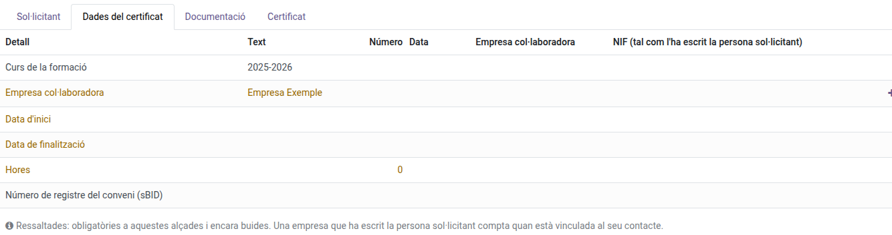
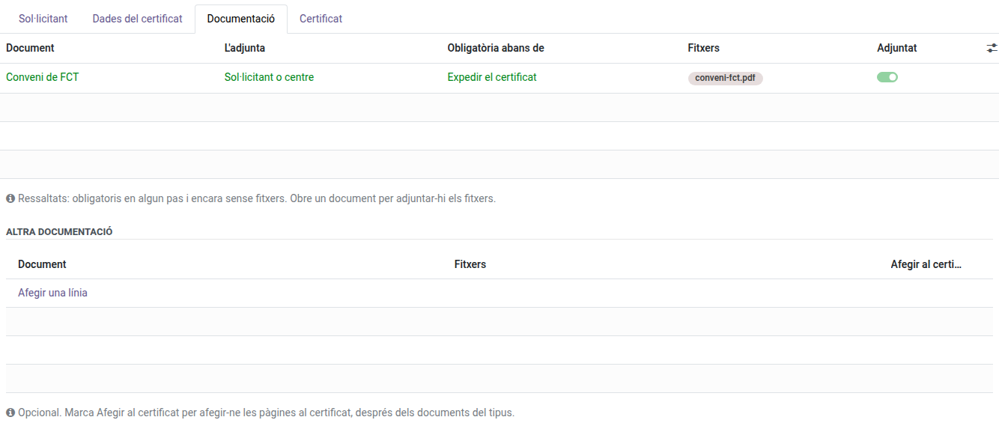

[Català](../../ca/teachers/certificates.md) | [Castellano](../../es/teachers/certificates.md) | [English](certificates.md)

---

# FCT certificates: completing the training (VET coordination)

Complete the workplace training details of FCT certificate requests and hand them over to the secretariat to be issued.

**Required role:** the VET coordinator position. If an administrator puts another position in a certificate type's circuit, whoever holds it does their step the same way.

---

## When it is your turn

When the student (or the secretariat, for a former student) submits the request, the first step is yours: you find it as a task in your daily summary and in **Academic management → Certificates**, under the **Pending for me** filter.

The student may have written the company's name and VAT number and attached the agreement, but often does not have everything: your step is to complete it.

As long as you change nothing, the student may still complete or correct their details from the link. As soon as you make any change or action, the student's form closes.

---

## Completing the training

1. Open the request.
2. In the **Certificate details** tab, each line is a detail of the certificate: its name, a **Hint** on what to write and how, and its **Value**. Click a line to fill it in: a dialog opens with its input, and **Save & Close** keeps it.
   - In **Collaborating company**, choose the company. If it does not exist and the student wrote its name, click **Create company** in the dialog: it is created with the name and VAT number they wrote (if there is already one with that VAT number, that one is linked).
   - Fill in **Start date**, **End date**, **Hours** and the **Agreement registration number (sBID)**. The end date cannot be earlier than the start date.
3. In the **Documentation** tab, check the **FCT agreement**. If it is missing, open the line, attach it (a PDF or photos of its pages) and save.
4. Open **Actions → Done: send to the next step**. The request moves on to the secretariat.

Before handing it over, **Actions → See the draft** shows the certificate as it stands, marked **DRAFT**, with the details still empty in red.

Without the company, the dates and the hours, EMS does not let the request move on: the lines still missing are highlighted.

---

## If information is missing

- **Actions → Request documentation** — write what you need; the applicant gets it by email with a link to answer and attach documents. When they answer, the request comes back to you.
- **Actions → Reject** — if the certificate cannot be issued; write the reason, which the applicant gets by email.

If the secretariat or the Director returns the request to you, the reason shows at the top of the form.

---

## Collaborating companies

**Educational Community → Collaborating companies** holds the companies where students do their training. You can create them and edit their details (VAT number, address, contacts such as the company tutor).
