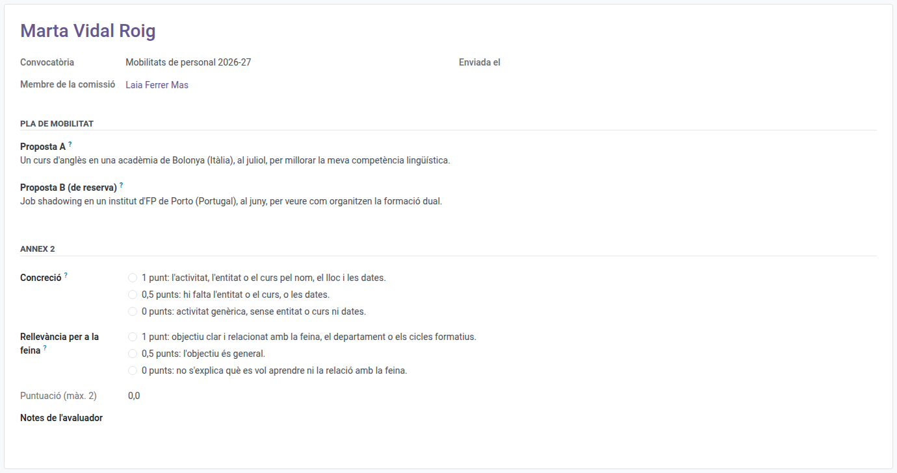

[Català](../../ca/teachers/erasmus-plan-ratings.md) | [Castellano](../../es/teachers/erasmus-plan-ratings.md) | [English](erasmus-plan-ratings.md)

---

# Rating Erasmus+ mobility plans

As a member of the panel of the Erasmus+ staff call, you rate in EMS the mobility plan of every candidate with the rubric of the call.

**Who:** the panel members the Erasmus team adds to the call (the management and the heads and seminar chiefs of the departments).

---

## 1. Find the plans

When the Erasmus team sends the plans to the panel you receive a task in EMS for each one, due on the call's score correction deadline (two weeks after it closes). It appears in your daily summary of pending tasks until you do it. In the **Erasmus+** menu you have **My participation > Plans to rate**: the plans assigned to you.

Each rating shows the candidate's **mobility plan** on screen, as they wrote it in the application form: proposal A (the main one) and proposal B (in case A can't be done), in their own words, each with the activity, the entity or course, where, when and what they want to learn, under its title and at full width. Rate both proposals together, with one score. You see nothing else of the application. The dissemination is not rated: it is the same obligation for everyone.

## 2. Rate the rubric

For each aspect, choose the description that fits the plan best: they are the ones of annex 2 of the call, and each one starts with the points it gives (1, 0.5 or 0).

| Aspect | 1 point | 0.5 points | 0 points |
|---|---|---|---|
| Concreteness | The activity, the entity or course by name, the place and the dates | The entity or course, or the dates, are missing | A generic activity, without entity or course or dates |
| Relevance to the job | A clear objective, related to the job, the department or the training cycles | The objective is general | It doesn't say what they want to learn or the relation with the job |

You can write your own notes in **Evaluator's notes**.

## 3. Submit it

Click **Actions > Submit**, or **Actions > Submit and next** to submit it and open the next plan you still have to rate. Until the call's **score correction deadline** you can **Reopen** it and change it; afterwards, if there is a mistake, tell the Erasmus team.

**If you are a candidate in the call, or you have a conflict of interest with a candidate**, you don't rate: tell the Erasmus team, who will record the abstention: the rating is shown as *Abstention*. The plan's score is the mean of the other members.

**Your rating is independent:** as a member of the Direction you can open the staff applications, but their **Scoring** tab says the points are hidden until every plan of the call is rated, so you never see the other members' mean before giving yours.

---

[← Back to teachers' manuals](index.md)
