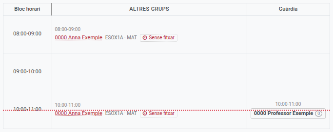
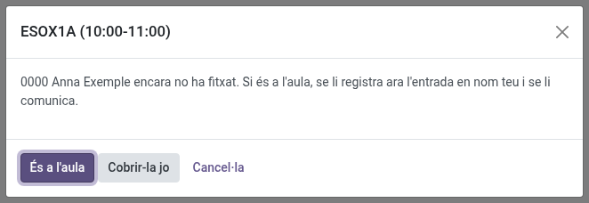

[Català](../../ca/teachers/guard-duty-schedule.md) | [Castellano](../../es/teachers/guard-duty-schedule.md) | [English](guard-duty-schedule.md)

---

# Guard Duty Schedule

See where every teacher is, and who is on guard duty, in each time block of the week — not just your own schedule.

**Required role:** Teacher (read-only; schedules are configured by a Department Chief or above from the corresponding teacher's own weekly schedule). Organising an absence from the Absences table is up to the absent teacher's Department or Seminar Chief and those above them (see [Organising an absence](#organising-an-absence)), who can also enter a detected absence for a teacher of their department (see [Entering a detected absence](#entering-a-detected-absence)); a teacher on guard duty can also take a class left without a teacher themselves (see [Covering a class yourself](#covering-a-class-yourself)). When the group's study has a department that manages it, that department's chiefs can organise it too.

---

## Access

Navigate to: **Employee Attendances → Guard schedule**

The board opens on today's own weekday and shift (morning before 15:00, afternoon from 15:00 on) — not always Monday morning — so you land straight on whatever's relevant right now.

---

## Choosing the Day and the Week

Click **Monday** to **Friday** at the top to switch days. Each tab also shows the day of the month it stands for in the week on screen.

Use the **‹** and **›** arrows to move to the previous or next week, or the date box next to them to jump to any date — the tabs move to that date's week and the board opens on its weekday.

Morning and afternoon are different shifts — use the dropdown to switch between them; only one is shown at a time.

---

## The Two Views

The two buttons on the right of the toolbar switch between the two ways of reading the same day and shift. The board opens on the **Absences table**:

- **Absences table** — one row per time block: who is missing and what has to be covered, against who is on guard duty to cover it.
- **Guard duty schedule** — the timetable, with everybody who is away marked on it.

When the board shows today, a **dotted red line** crosses both views at the current time, at its exact height within the time block it falls in (at 16:40, two thirds of the way down the 16:00-17:00 block), so you can see at a glance which classes are on now. It moves down as the time goes by, and is not drawn on another day or outside the shift on screen.

---

## Reading the Timetable

The table's columns are the groups with a class in that shift, grouped by **area** (for example ESO / BTX and VET): each area has its own time framework, and the table's header shows it with one band per area.

Since each area starts and ends its lessons at different times (ESO has its break at 10:00 and VET at 11:00, for example), the table's rows are the stretches between every start and end time of the shift, and each class spans the stretches it lasts: a class from 10:25 to 11:25 spans the 10:25-11:00 and 11:00-11:25 stretches. Both areas line up by clock without bending anybody's lessons, and a longer stretch is a taller row.

Each cell shows its own start and end time, the subject (as its short code, e.g. "MP 0440"), the teacher(s) — more than one if the class is co-taught — and the classroom for that group's class at that time. An empty cell simply means nothing is scheduled there for that group.

The **Guard duty** column on the right lists every teacher on guard duty, grouped by the time of their guard duty (also shown at the top of each block), each in a thin-bordered box. When two guard duties overlap in time (the ESO break guard and a 10:00-11:00 VET guard, for example), they sit side by side. A guard-duty teacher has no group of their own at that moment (that's the whole point of guard duty), so they only ever appear here, never in a group's column. A teacher on a **Guard (WC)** duty specifically shows a **"(WC)"** tag right after their name — worth calling out because, unlike a break-time guard (see below), a WC guard duty can fall at any time of day, so there's no other way to tell it apart from a plain guard duty at a glance.

The small number in a circle after each name is how many classes that teacher has been sent to cover this course (including covers already planned for a coming day). Several groups looked after together in the same room at the same time count as a single cover; groups in different rooms count separately. It helps share the covers out fairly.

Each group's break shows as a block of its own, with its time and a **"Break"** label, and a brown accent on its left edge, so it doesn't read as a gap in the schedule. Break-time guard duties in the Guard duty column carry the same accent.

---

## Filtering by Area

Next to the shift dropdown there's an **area filter** button (it reads "All areas" until you check something). Click it to open a checklist of every area — for example ESO / BTX and VET — and check as many as you need. Leave everything unchecked to see every area at once.

Once one or more areas are checked:
- Only the groups of the checked area(s) become columns, including the reinforcement groups of their groups.
- The **Guard duty** column keeps listing every teacher on duty in a visible time block, regardless of what they otherwise teach — being on duty is what matters, not which area a guard happens to teach in that day. A guard duty on another area's break is left out.
- A guard duty on the checked area's own break gets its own "Break" row, even though no group has a class then.

A group's area is that of the study managing it (the **Managed by the department** field on the study's form, or the top-level department above it).

> The area filter replaced the level filter in version 18.0.0.38.0.

---

## Reading the Absences Table

The table uses the same stretches of time as the timetable, with one column per area:

- **One column per area** — one line per class left without a teacher in that area: who is away, and the group, subject and classroom that needs covering, in a block carrying the class's time. The area's break shows as a "Break" block.
- **Guard duty** — the teachers on guard duty, grouped by the time of their guard duty, the same ones the timetable shows.

So you can see at a glance which guard duties line up with each class to cover, even when the two areas run their lessons at different times. A stretch where nobody is missing has empty area columns.

In a co-taught class (two teachers in the same classroom) where only one of them is away, their line is **struck through**: it stays there so you know who is missing, but no guard is needed because the other teacher is taking the class. Hover over the line or click it to see why; the **ⓘ** icon on its left shows there is an explanation.

Every struck-through line has that icon, whatever the reason: a co-teacher is in the class, a guard teacher has already been sent to it (their name appears next to it), or the families were told the students can stay at home for it (see [Organising an absence](#organising-an-absence)). If both are away, or each teacher has half of the group in a different classroom, the line is not struck through and the class does need covering.

---

## Absences

A teacher who is away is shown in red wherever their name appears — in their own cell on the timetable, and in the Guard duty column when they were the one on guard:

- **Bold red** — the absence is approved.
- **Lighter italic red** — the absence has been requested and is still awaiting approval.

Refused and cancelled requests are not shown.

An absence their chief or the Head of Studies already knows about, but the teacher has not requested yet (a *detected absence*, see below), is also shown as awaiting approval. So is a day already over on which the teacher did not check in, once EMS has detected it.

A teacher on an ordinary guard duty who is away is marked in the Guard duty column, and produces no line in the Absences column: they have no class of their own for anyone to cover. A guard duty that is a fixed post, like the WC or the break guard, is different: somebody has to be there, so when its teacher is away it gets its own line in the **Guard duty** column of the Absences table, under the guards of its own block, with the guard duty's name (for example **Guard (WC)**) where a class shows its group, to be covered like a class (see [Covering a WC or break guard](#covering-a-wc-or-break-guard)).

Only the fact that somebody is away is shown here. The type of absence, its reason and any supporting document are not.

---

## Teachers who have not checked in

Today, as soon as a class starts, if its teacher has not checked in it appears in the **Absences table** like an absence, so a guard teacher can cover it. Their name is shown in red with a dotted underline and the tag **Not checked in**. The same goes for a teacher on guard duty: they are marked in the Guard duty column and cannot be sent to cover anything until they check in.

- The class leaves the table as soon as the teacher checks in, and so do their next classes. The classes that ended before they checked in stay, so a guard already sent to them is still correct.
- An absence (approved, requested or detected) always takes precedence: the line then shows the absence.
- Such a class is only covered with a guard. The schedule does not propose telling the families or rearranging lessons, because the teacher may still be in the centre.
- Only today's classes count. On another day nobody is checked in or out yet.

### The teacher is in the classroom

Sometimes the teacher is in the classroom and has only forgotten to check in. If you are on guard duty at that time, or you organise that teacher's absences (their department or seminar chief, Head of Studies, Deputy Head of Studies, Direction or the administrator), you can say so:

1. In the **Absences table**, click the line of the class in progress (its tooltip says that the teacher **has not checked in yet. Click if they are in the classroom, or to cover the class.**).
2. Click **They are in the classroom**.

The teacher's check-in is registered at the current time, the class leaves the table, and the teacher receives a message saying who registered it. On the check-in's own form, **Check-in registered by** shows your name. If the time is not right, the teacher can request a correction as with any other check-in.

The same dialog also offers what you could otherwise do with the line: **Cover it myself** if you are on guard duty, or **Send a guard teacher** if you organise the absence. A class that has already ended cannot be resolved this way: checking the teacher in now would not change it.

### The schedule updates itself

While it is open, the schedule updates itself, without reloading the page, only when something it shows changes: when a lesson starts or ends, when somebody checks in, sends or releases a guard, or when an absence or a notice to the families changes. So you see at once what a colleague has just organised. If a dialog is open or the browser tab is in the background, it waits and updates as soon as you close it or come back.

---

## Covering a class yourself

If you are on guard duty in a time block, you don't have to wait for somebody to send you: you can take a class that is still left without a teacher yourself.

1. In the **Absences table**, click the line of the class (lines you can take show a hand pointer and the tooltip **Click to cover this class yourself**).
2. Click **Cover it** to confirm.

The class is then struck through with your name next to it, the same as when you are sent to it. Nobody receives a message: the board itself shows who covers what. If your guard duty only coincides with part of the class, you take that part (the dialog tells you which), and someone else can cover the rest. Only a class, or your part of it, with no guard yet can be taken, and only in a time block you are on an ordinary guard duty (not a WC or break guard, and not while you are away yourself). The same goes for the line of a WC or break guard who is away: you can take it yourself the same way.

Lines you cannot take because you are not on guard duty at that time show the hand pointer too, with the tooltip **You cannot cover this teacher: you are not on guard duty at this time** (and the same when you click them), so you know why you cannot take them.

If you change your mind, click the line again and then **Stop covering this class**: the class is left without a guard again. You can only do this with a class you took yourself; if somebody sent you to it, ask them to change it. Whoever organises the absence can still change or remove a guard who took a class on their own.

## Entering a detected absence

Who can do this: **Seminar Chiefs** and **Department Chiefs**, for the teachers of their own department, as well as the Head of Studies or Deputy, Direction and the administrator. They can also do it for a teacher of another department who teaches a group their department manages, or who names their department in the **Also managed by the departments** field (see [Organising an absence](#organising-an-absence)).

The normal way is always that the teacher requests the absence themselves. Use this only for the exceptional case of a teacher who phones or writes to warn they will be away and cannot use EMS: entering it puts their classes on the schedule straight away, so you can organise the cover.

1. Go to **Employee Attendances > Absences > Management > Detected absences** and click **New**.
2. Choose the **Teacher**. Only the teachers of your own department are offered.
3. Set **From** and **To**, date and time. They start out as today, 08:00 to 15:00. An absence can span several days.
4. Optionally, add **Notes** for your own reference. The teacher can open the entry, but never sees the notes.
5. Save.

The absence then appears on the schedule as awaiting approval (lighter italic red), and you can organise it as described below. When the teacher requests the absence themselves, the detected absence is linked to it automatically and whatever you organised stays as it is. If the teacher turns out not to be absent after all, delete the entry.

---

## Organising an absence

Who can do this: the absent teacher's **Seminar Chief** or **Department Chief**, and those above them in the hierarchy (Head of Studies or Deputy, and Direction), as well as the administrator. What counts is the department the teacher teaches in: its chiefs and the manager of the area it belongs to organise the absences of everyone in it, members of the management team (such as the Secretary) included. Everybody else sees the result but cannot change it, and the absent teacher cannot organise their own absence. It makes no difference whether the absence was requested by the teacher or entered by their chief or the Head of Studies as a detected absence: both are handled the same way. When the teacher later requests a detected absence, whatever was already organised stays as it is, and only the extra days or hours of the request appear as new lines to decide on. **Teachers shared between departments:** besides whoever answers for the teacher, a class can also be organised by whoever answers for the students who lose it: when the group's study names a department that manages it (the **Managed by the department** field on the study's form), that department's Department Chief and Seminar Chief, and those above them, can organise the classes of its groups, whatever department the teacher belongs to. For example, if a teacher of the Foreign Languages department misses a lesson with a Computer Science group, the Computer Science chiefs can assign the guard; if she misses a lesson with an Administration group, the Administration chiefs can; and in both cases so can her own Department Chief. A reinforcement group follows the studies of its main groups. For a teacher who in practice works for another department or area than their own, their form lets you say so in the **Also managed by the departments** field (below **Manager**): the chiefs of those departments, and those above them, can organise everything of theirs, fixed guard duties included (toilets, break), which have no students.

> The **Managed by the department** and **Also managed by the departments** fields were introduced in version 18.0.0.36.2. Nobody who could already organise an absence has lost that.

Everything is done from the **Absences table**, and nothing happens on its own: each step waits for you to press its button. A day that is already over can no longer be changed.

### Sending a guard to a class

1. Click the line of the class to cover (lines you can organise show a hand pointer).
2. If the dialog offers possible arrangements (see [Rearranging the lessons instead of sending a guard](#rearranging-the-lessons-instead-of-sending-a-guard)), choose **Send a guard teacher**. Then choose the **Guard teacher**. Only the teachers on an ordinary guard duty during the class are offered (never those on a WC or break guard, who are needed at their post), except those who are away themselves. Those who can cover the whole class come first, then those who can only cover part of it, with the part they would cover (see [Covering a class between several guards](#covering-a-class-between-several-guards)). Next to each name you see how many classes they have covered this course, so you can choose whoever has covered the fewest.
3. Optionally, write a **message**: what the students have to work on, where the materials are...
4. Click **Assign and notify**.

The guard teacher receives an Odoo message (in their inbox, or by email, depending on their own notification preference) with the date, time, group, subject, classroom, the absent teacher and your message. If they reply to that email, the answer reaches you.

The class is then struck through, the guard's name appears next to it, and the line and the guard's box in the Guard duty column share the same colour. The colour belongs to the class covered: when several guards cover different classes at the same time, each class has its own colour, so you can see at a glance who is covering what. A guard can cover more than one class: all of them take the same colour. Their box only takes it in the hours they are covering a class: on guard from 10 to 12 and covering a class from 10 to 11, their 11-12 box stays uncoloured.

To change the guard, click the line and then **Change or remove the guard** (only shown to whoever organises the absence), and choose another one: the previous guard is told they are no longer needed. To write a new message to the same guard, choose them again and click **Assign and notify**. To take a guard off the class, click **Remove assignment** next to their name, at the top of the dialog: they are told so.

### Covering a class between several guards

When the areas run different timetables, no guard may coincide with a whole class. For example, an ESO class from 10:25 to 11:25 and two VET guards, one from 10:00 to 11:00 and the other from 11:00 to 12:00. The dialog then also offers those who coincide with part of the class, with the part they would cover (*"… - 10:25-11:00, part of the class"*), and each guard covers exactly that part.

While a part is still missing, the line is not struck through: it shows the guard with their part and a dashed red tag with what is missing (*"Missing 11:00-11:25"*), so you can send someone else. Once together they cover the whole class, the line is struck through.

Every guard covering the same class shares its colour. A dotted border (on the line, the tag and the guard's box) means a partial cover; a solid one, a class covered in full.

### Covering a WC or break guard

When the teacher of a WC or break guard is away, their guard duty appears as a line in the **Guard duty** column of the Absences table, under the guards of its own block, with the guard duty's name instead of a group. It is covered exactly like a class: click it, choose one of the teachers on an ordinary guard duty in that time block, and click **Assign and notify**. The message they receive says it is a guard duty to cover. If the absence is cancelled afterwards, the guard is offered for release like any other.

### Rearranging the lessons instead of sending a guard

Often no guard is needed, because the teachers can rearrange their lessons that day. The board works this out for every class still left without anybody and proposes it in the **Proposals for the absences** box, above the table (only visible to whoever can organise the absence); those lines also show a tag such as **3 possible arrangements**.

The box has one section per group, headed with its name. Groups that share a lesson that day (two groups taught together) share their section, because rearranging a shared lesson changes all their days. In each section come first what is waiting (an arrangement waiting for its notice), then the proposals, numbered from the best one, and last **Only tell the families** (see [Late entry, early leave or no classes](#late-entry-early-leave-or-no-classes)).

A group whose families must be told a correction is not in this box but in a red one above it: **Corrections to absences already organised** (see **When the absence changes afterwards**).

Each proposal is a list of steps, one per line, always between teachers of those groups and within the same day:

- **Moved lesson**: a teacher who is free at that time teaches then one of their lessons with the group from another time. The lesson they leave becomes a gap, which another step can fill in turn: one teacher brings a lesson forward, another fills the gap it leaves, and so on, until what is left free is at the start or the end of the day (or next to a break).
- **Swap**: another teacher of the group teaches then, and the absent teacher, who is in at another time, teaches that teacher's lesson with the group.
- **Joined groups**: for the two halves of a split group. The teacher who teaches the same subject to the other half at that time teaches both halves together, in the other half's room, and the lesson they had with this half at another time is left free, as in a moved lesson. It often lets both halves leave an hour earlier. Two groups are halves when the **Joins with** field of their form says so (see [Groups](../admin/groups.md)): sharing a lesson is not enough, since two whole groups can also share some. If the lesson has several teachers, those who are not with the other half at that time stay on guard at its usual time.
- **Notice to the families**: the group comes in later, leaves earlier or has a longer break, for the lessons left free at the start or the end of the day. A notice that only makes the break longer goes to the students alone.

A lesson shared by several groups is moved for all of them, as long as all of them have the same gap, and the notice then goes to each group.

A lesson given by two teachers together (co-teaching) moves with both of them: they both teach it at the new time. If one of them cannot (they have a class or a duty then, they are away, or their working day would get longer), the proposal is still offered, after any that moves both, with a warning such as **⚠ Anna cannot follow the lesson (busy then): on guard at 11:00 instead.** If you apply it, that teacher has no class at the lesson's usual time: they appear in the **Guard duty** column of that time with the tag **(lesson moved)**, and you can send them to cover a class like any other guard teacher. If you remove the arrangement, they go back to their lesson and whatever they had been sent to cover is released. **Other arrangement (described by hand)** is how to split the two teachers on purpose (one covers a guard while the other stays with the group).

Proposals come in this order: first those where the students lose fewer lessons; among those, the ones where they spend fewer hours in the centre without class (with a guard or in a longer break); then those that need fewer notices and fewer teachers moving lessons, that keep two hours of the same subject together, and that change fewer entry or exit times. Up to three proposals per group are shown.

**Nobody's working day gets longer.** A proposal only includes a step if no teacher involved ends up with a longer day (counted from their first period to their last, lessons, guard duties and any other duty alike): whoever would come in earlier must leave earlier, and whoever would leave later must come in later. When a step changes somebody's entry or exit time, an orange line under it says exactly whose and how (*"… leaves at 20:20 instead of 21:20"*).

**Applying a proposal.** Click **Apply the checked steps** on its right, or click the class and choose the proposal in the dialog, where the proposals that solve that class come first, above sending a guard. Every step starts checked: uncheck those you do not want. A step that needs another one is unchecked along with it (a move into the gap another one leaves, a notice that only makes sense because of a move), and checking a step checks what it needs.

- A **swap**, and a **moved lesson** that does not depend on a notice, take effect at once: the class is struck out with the teacher who is with the group, and the teachers involved receive an Odoo message with the change (and their new entry or exit time, if it changes).
- The **notices** are sent straight away: checking the step is the confirmation, there is no draft to review. Each group gets **one single notice** for the whole day, with every change the proposal brings to it (for example, that it comes in later *and* leaves earlier), so its families receive one email instead of one per change. The moves the notice frees the group from take effect as soon as it is sent, and the teachers involved receive their Odoo message then. Once it is sent, the class shows both tags: who is with the group and, in green, what the families were told (*"Leaves at 12:25"*).
- **If a notice cannot be sent** (the group has nobody to send it to, for example), it stays as a draft and opens with a message saying why. Check it and send it from that form. Until then, **the moves it frees the group from do not count**: those classes are not struck out, and the group's section shows them as waiting for their notice, with **Open draft** to open it again. The teachers are told when it is sent. If you delete the draft, those moves are discarded and you can apply the proposal again.
- **If you leave the notice out**, the moves are applied without it, and the lesson a move leaves free appears as one more line of the table, with the tag **Lesson moved to 15:00**: cover it like any other (with a guard, another arrangement or one described by hand), or send the notice later from **Only tell the families**. Whoever organises the original absence organises it too.

**The students are told which lessons change time.** A swap or a moved lesson changes when the group has a subject, which the notice to the families does not say (it only says when the group starts or finishes). So applying one also sends a notice **to the group's students only** (never their families), one per group and day, listing every lesson that changes time that day: *"Mathematics: from 11:00-12:00 to 08:00-09:00"*. It is sent straight away too, and if it cannot be sent it stays as a draft that opens for you to review and send (you also find it in **Communications → Notices**); the arrangement does not wait for it, it is already in effect. Until it is sent, the board keeps that draft up to date: applying another arrangement for the same group and day adds its lessons, and removing one takes them out (or deletes the draft, if nothing is left). If the notice was already sent and you remove an arrangement afterwards, a new draft starting with **Correction:** lists the lessons as they are now and those back at their usual time. That correction is not sent on its own: review it and send it from its form.

**The group's tutor gets a copy.** When a notice from the board is sent, to the families (comes in later, leaves earlier, longer break, no classes) or to the students (lessons that change time), the group's tutor receives an Odoo message with a copy of it, so they know how their group's day changes. For a reinforcement group, which has no tutor, the tutors of its main groups receive it. If a scheduled notice is cancelled before it goes out, they are told too.

Once an arrangement is in effect, the **Guard duty schedule** shows who really teaches each lesson involved, and a teacher who was on guard duty at a time they now teach is struck out of the **Guard duty** column there: they cannot be sent to cover anything else then, and nobody can take that class on their own. With joined groups, both halves show **Together with** and the other one's name.

**Other arrangement (described by hand)**, the last option of the dialog, is for whatever the board cannot work out, so that it is on record: two groups joined for the same subject, a teacher of another group... Describe it and, if a teacher is involved, choose them (they receive a message). No guard is then needed for that class.

To change your mind, click the line and then **Change or remove the arrangement**: **Remove arrangement** takes it back (the teachers are told), and choosing a guard or another arrangement replaces it. A lesson moved for several groups is taken back from all of them.

### Late entry, early leave or no classes

The schedule only proposes these changes, and the longer break below, if the administrator has switched them on (each one separately, see [Configuring staff absences](../admin/absences.md#timetable-changes-on-the-guard-duty-schedule)). With them off, the lessons without a teacher are covered with a guard, as any other.

When the lessons without a teacher are the first ones of the group's day (one, two or more in a row), the students could come in later; when they are the last ones, they could leave earlier; when every lesson of the day is without a teacher, the group could have no classes. A lesson where somebody is with the students (a co-teacher who is not away, the other half of a split group, an optional subject or a guard already sent) breaks the run.

Those lines show a dashed tag such as **Could start at 10:00**, and the group's section of the **Proposals for the absences** box, above the table (only visible to whoever can organise the absence), offers that change as its last proposal, **Only tell the families**. Sending the notice strikes those lessons off the table, so no guard teacher has to cover them.

The selector next to each step lets you tell the families about less than the absences allow: with two lessons without a teacher, you can choose **Starts at 09:00** instead of **Starts at 10:00**. Only the first lesson is then struck out; the second still needs a guard, sent as usual. Choosing the smaller change is your decision: nothing will ask you to correct it.

On the current day, the board only proposes changes still to come: from 09:00 on, it no longer offers **Starts at 09:00** (the families would find out too late), and a proposal or a correction whose time has passed disappears. If the board has been open for a while, reload it to see the current proposals.

Each change is a step with its checkbox, checked by default, like those of an arrangement: uncheck the ones you do not want and click **Apply the checked steps**. **One notice per group** goes to its students and families straight away, with the text the board suggests: applying the steps is the confirmation. If it cannot be sent (the group has nobody to send it to, for example), it stays as a draft and opens with a message saying why: check it and send it from that form as any other notice (the groups of a timetable change notice cannot be changed). While it stays a draft, the step shows an **Open draft** button.

Once the notice is sent (or scheduled), those lines are struck through with a tag such as **Starts at 10:00**: nobody needs to be sent to them.

### A longer break

When the empty lessons are right before or right after a break (or on both sides) of the group's level, with class further out on that side, the students could have a longer break instead. With the break at 18:00-18:20 and the 17:00 lesson empty, for example, the break could start at 17:00; with the 18:20 lesson empty, it could end at 19:20. The selector offers every combination (earlier, later, or both, hour by hour), and the notice reads *"…group X will have a longer break, from 17:00 to 19:20, on …"*. Only the **students** receive it (never their families), and it reminds them that those under 18 cannot leave the centre during the break. That is why, unlike the other changes, it does **not** strike those lessons off: they show the break as a tag (*"Break from 17:00 to 19:20"*) and still need a guard teacher, who looks after the students in the centre. If the same notice also changes when the group comes in or leaves, it goes to the families too, break included. In the proposals box, a group whose only possible change is a longer break shows it as **Only tell the students**.

This is never confused with coming in or leaving: if the empty lessons reach the start of the day, it is a late entry (e.g. coming in after the break, at 18:20); if they reach the end, an early leave (e.g. going home at the break, at 18:00).

### Changing a notice already sent

A notice already sent cannot be taken back, but it can be changed until its time comes: for instance, if the families were told the group starts at 10:00 and a guard turns out to be free for the first lesson, or if you would rather rearrange the lessons than have a longer break.

1. In the **Absences table**, on the line the notice struck out, click **Change proposal** (next to the green tag with what was told). Only whoever organises the absence sees it.
2. Choose what to change it for:
   - **Change it for**: another change the absences allow (starting at another time, a shorter break...) or the **Usual timetable**, the option chosen by default.
   - **Or rearrange the lessons**: the possible arrangements of the group's day, planned as if nothing had been told, with their steps checked (you can uncheck some). Each one includes the correction to the families as a step.
3. Click **Send correction**.

Whichever you choose, the group's students and families get **one correction notice** with the new situation, never a cancellation and a new notice apart. The lessons that take place again are no longer struck out, and you can send a guard to them as usual.

### When the absence changes afterwards

If an absence is refused, cancelled or shortened, or a co-teacher turns out to be in, what was organised may no longer be needed. Nothing is undone automatically: the boxes above the table tell you, and you decide.

- **A guard who is no longer needed** (box **Guards no longer needed**): click **Release guard**. They are told they no longer need to cover the class.
- **An arrangement that no longer applies** (same box): the class no longer needs covering, or one of the teachers it relies on is now away at that time. Click **Remove arrangement**; the teachers are told.
- **A notice that no longer matches** (more was told than the absences now allow): a notice already sent cannot be taken back, so the group moves to the red box **Corrections to absences already organised**, above the proposals box, because it is urgent. Every proposal of the group there includes the correction as a step, and so does **Only tell the families**. What you apply goes out in **one notice per group**: for instance, that the group leaves at 11:00 and starts at the usual time. To send only the correction, uncheck the other steps.

---

## Coming Back to Where You Were

The board's address keeps the week, day, shift, view and areas you are looking at. Going back to it from a notice - with the breadcrumbs or the browser's back button - or reloading the page returns you to the same place, and you can copy the address to send a colleague straight there. Opening it from the menu always starts at today's day and shift.

---

## Exporting to PDF

Click **PDF** in the toolbar to download the day and shift currently shown (not the whole week) as a printable document — whatever area filter is currently checked is applied to the PDF too, which uses the same stretches of time and the same columns as the screen. The PDF prints whichever of the two views is on screen: the timetable if **Guard duty schedule** is active, or the Absences table if **Absences table** is active, with its guards, colours and struck-through lines as on screen.

---

[← Back to main index](index.md)
