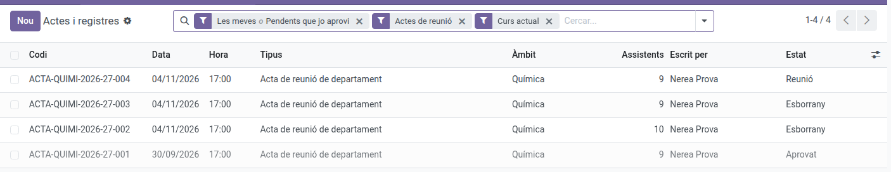
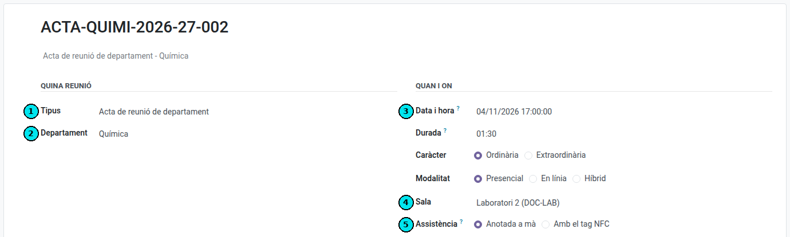
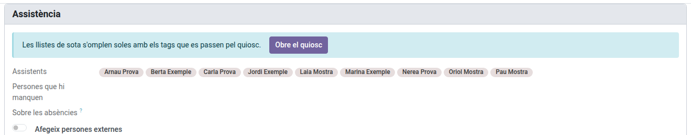
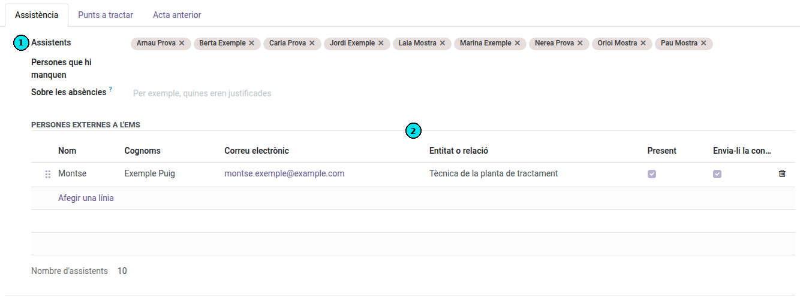
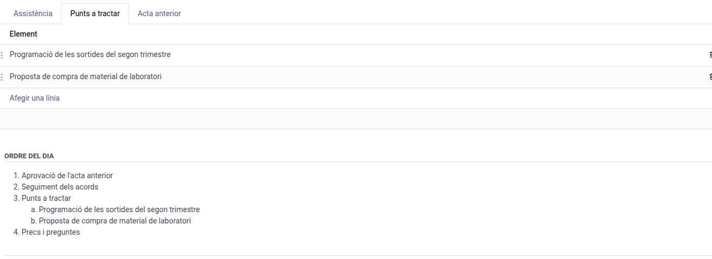
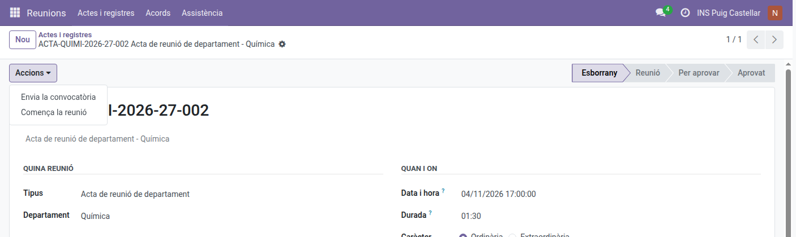
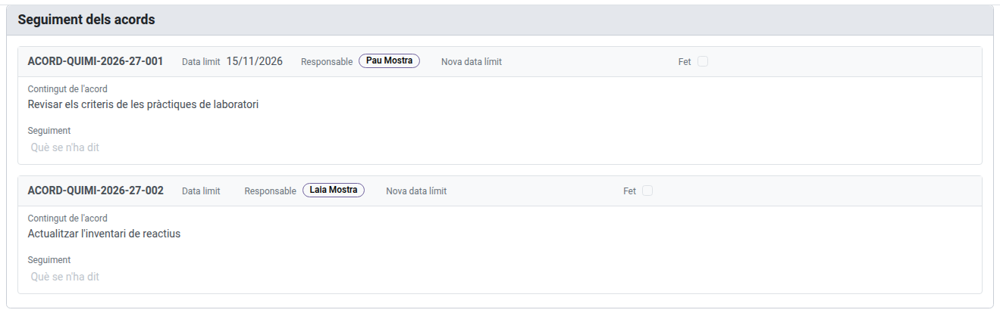
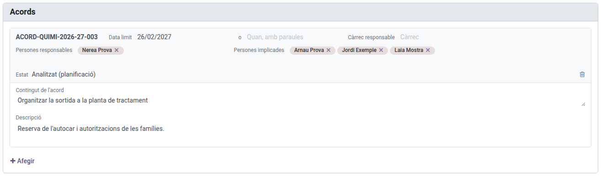
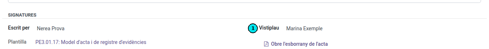

[Català](../../ca/teachers/minutes.md) | [Castellano](../../es/teachers/minutes.md) | [English](minutes.md)

---

# Meeting minutes

Minutes are written in **Meetings → Minutes and records**. The screen opens on yours: the
ones you wrote, the ones of meetings you attended and the ones awaiting your approval, for the current
year. Removing a facet in the search bar shows more.

If you are a Department or Seminar Chief, or Head or Deputy Head of Studies, you also see the minutes of the
departments and groups that hang from you.

Only whoever writes a minute and whoever approves it can change it, and so can their chiefs (for instance
the Seminar Chief of whoever writes it); if whoever approves it is away, their
chiefs (Department Chief, Head or Deputy Head of Studies, Director) can approve it in their place. Any other minute you can see (one of
a meeting you attended, one of your department) opens **read-only**, with no actions.

---

## Writing a minute

1. **New**.
2. Choose the **minute type**. It is the first thing the form asks for and the step that matters: the
   type decides which sections appear, so a department minute and a staff-meeting minute do not ask for
   the same things.

   Only the types you can start are listed:

   | Type | Who can start it |
   |---|---|
   | Acta de reunió genèrica | Anybody |
   | Acta de reunió de departament | The Department or Seminar Chief, and those above them, only for their own department |
   | Acta de claustre | The management team: Director, Head of Studies, Deputy Head of Studies and Secretary |
   | Acta d'equip docent | The group's tutor, those above them and the teachers who teach the group |
   | Acta de constitució d'equip de millora / Acta de finalització d'equip de millora | The quality coordinator |
   | Acta de reunió d'equip de millora | The quality coordinator and the team's members |

   Whoever administers the quality system sets this up in **Meetings → Configuration → Minute types**.
3. Right after, the form asks **whose meeting it is**, depending on the type: the department, the
   workgroup or the group. A staff-meeting minute asks for nothing; a generic minute lets you choose
   the scope.
4. Check the **date and time** (the next full hour comes proposed), the nature and the modality, and
   set the **room**. If the meeting is not in person, write where it takes place in **Place** (a video
   call, a mailing list...).

   

   (1) The minute type, (2) whose meeting it is, (3) the date and time, (4) the room and (5) how attendance is taken.
5. Choose how **attendance** is taken:
   - **Written by hand:** the **Attendance** tab already holds the list **filled in**, taken from the
     scope (the department's members, the workgroup's, or the group's teachers and its tutor). Just move whoever
     did not come to **Absentees**.
   - **With the NFC tag:** set the **duration** and save the minute. The kiosk is offered once the meeting
     has started (see "Holding the meeting and writing the minute" below): then, in the **Attendance** block, **Open the kiosk** opens the
     screen where each person passes their tag; **Close attendance** ends it and
     fills both lists: whoever passed the tag attended, everybody else is recorded as absent. If someone
     left their tag at home or it failed, **Actions → Correct the attendance** opens the session: if it
     is already closed, **Reopen** it, mark them by hand (present, or justified with a note) and close it
     again. The minute's lists update by themselves. It can be done until the minute is approved.

     

   If somebody from outside EMS comes to the meeting (a student's family, a teacher from another school...),
   switch on **Add people from outside EMS** and add them to the table that appears: first name, surname, email and, if useful, their organisation
   or relationship. Untick **Present** for somebody who was invited but did not come. The minute names
   them with their organisation; their email is not printed. Tick **Send them the call** for them to get
   it: it reaches them in a message of their own, never together with the staff's.

   

   (1) The list of attendees, already filled in from the department. (2) The people from outside EMS, with the box to send them the call.
6. In the **Items to discuss** tab, add the meeting's own topics. The **agenda** is not typed in: it is
   put together below, with the approval of the previous minute (when there is one), the follow-up of the
   agreements (when some are still open), your items and any other business.

   
   In the **Content** tab, fill in each section the type asks for. The ones marked as
   required have to be filled in before the minute can be approved.
7. In **Agreements**, add what was agreed: the commitment, who is responsible (who carries its progress), who is involved
   (who has to do something, without managing it) and by when. Use the **description** to explain how to
   carry it out (links, instructions); the PDF prints it. Once the minute is approved, the responsible people
   keep it up to date from the agreement's form. Each
   agreement's code is issued automatically.
8. Save. The minute's **code**, which you saw build up at the top of the form as you filled in the type,
   the scope and the date, is now issued.

## What fills in by itself

- **The attendee list.** It comes from the scope: the department's members (including the departments
  under it), the workgroup's, the teachers of the group together with its tutor, or the whole teaching staff.
  You can add or remove anybody by hand, and add people from outside EMS.
- **Copying the open agreements of the previous meeting.** The **Previous minute** tab already holds the
  agreements that are not closed yet, ready to review.
- **The pending topics.** Whatever the previous minute left unticked arrives loaded too. Tick **Dealt
  with** on those now resolved; the rest carry over to the next one.
- **Numbering.** Neither the minute nor the agreements: the application issues the codes, and they run
  consecutively within your scope, so a missing number shows.

## Calling the meeting

Until the minute is sent for approval, **Actions → Send the call** emails everybody convened (the people in the
attendee list) the date, time, place and modality of the meeting, its agenda and a link to the minute of
the previous meeting, so they can read it before approving it.

If anything changes afterwards (the date, the time, the place or the items), **Actions → Send the call
again** sends it once more, saying it replaces the earlier one. The minute keeps the date it was last sent.

If you created a meeting by mistake, **Actions → Delete** removes it with everything written in it. This
only works while the minute is a draft: once the meeting starts, it can no longer be deleted.

## Holding the meeting and writing the minute

When the meeting starts, **Actions → Start the meeting**. The minute moves to the **Meeting** state and
the screen changes: no more tabs, but the blocks of the agenda one under another, to fill in as the
meeting goes on.

- **Attendance:** who attended and who is missing (or the kiosk, when it is taken with the NFC tag).
- **Approval of the previous minute:** open its PDF, mark whether it is approved and note any amendment.
- **Follow-up of the agreements:** each agreement still open has its card. Write what was said about it, set
  a **new deadline** if needed and tick **Done** when it is closed. What you write goes to the agreement's
  own follow-up, and a closed agreement is not brought to the next meeting.

  
- **Items to discuss:** each item has its own text box, with the formatting toolbar above it (bold,
  underline, lists). Type `/` to insert a table. A long item scrolls inside its own box. **Add an item** adds one that was not planned.
- **Any other business:** another text box.
- **Agreements:** each new agreement is a card, with its content at full width and, in the header, the
  deadline and who is responsible (by default, the department's chief and its seminar chief).

  
- **Pending topics:** at the end, as a list.

The minute saves itself while you write, in your pauses. **Open the draft of the minute**, at the top and
at the bottom of the screen, shows the PDF as it would come out, marked as a draft, while the minute is in
the meeting or waiting for approval. To change the date or the people convened again, **Actions → Back to preparing
the meeting**.

## Approving

Under **Signatures**, the **Approved by** field says who will approve the minute. Whoever answers for the
scope that meets comes proposed (the department's chief, the group's tutor, the director) and the dropdown
shows those people first; anybody else can be chosen by typing their name or with **Search more**.

(1) Who will approve the minute.

When the minute is ready, **Actions → Send for approval**. Whoever gives the approval finds it on their own screen
under the *Awaiting my approval* facet, and approving it:

- Records **who approved it and when**.
- Generates the **PDF**, kept as an attachment on the minute.
- Makes the minute **read-only**. If something needs correcting, a new version is produced; what was
  approved is not rewritten.

## Evidence records

The same screen holds the papers that only need to be on record (a cash count, a key handover, a delegate
election). They are minute types with their own sections, so they **will not ask you for an agenda or
agreements**: only what that record needs. To see them, remove the *Meeting minutes* facet from the search
bar.
