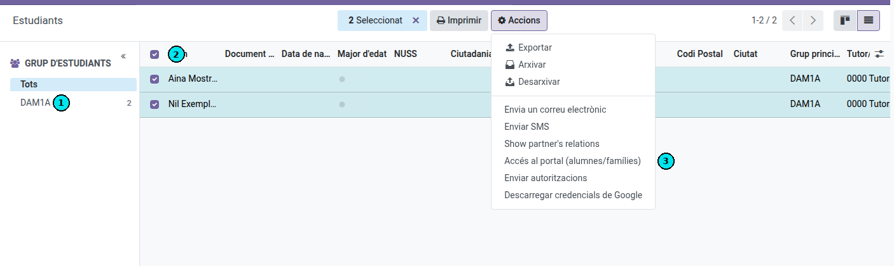
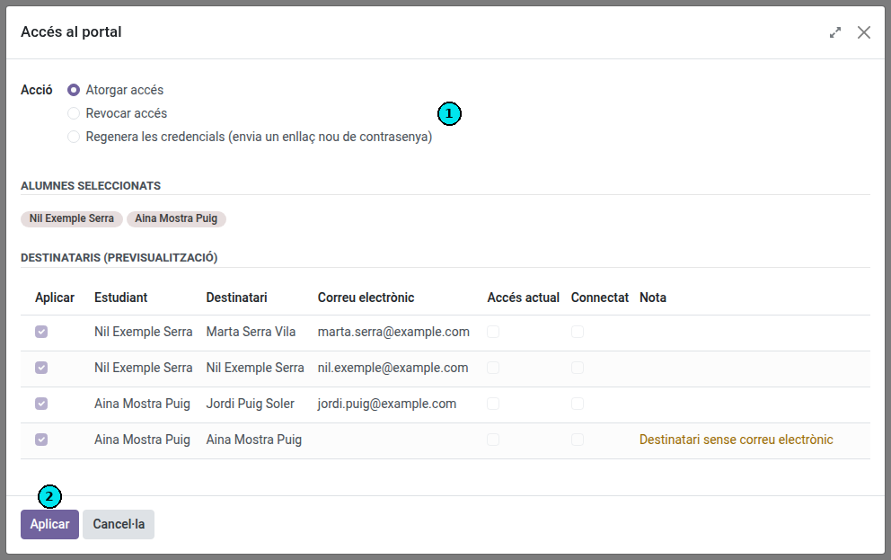
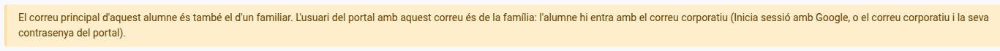

[Català](../../ca/tutors/acces-portal.md) | [Castellano](../../es/tutors/acces-portal.md) | [English](acces-portal.md)

---

# How to manage portal access for students and families

This guide explains how a tutor can **grant**, **revoke** or **regenerate** portal access credentials for their students and, for minors, for their families.

The portal is the space where students and families review and confirm the student's information (enrollments, authorizations, etc.). To access it, each recipient receives an invitation email with a link to set their password. This link **expires after a few days**, so if someone does not use it in time you will need to send them the invitation again.

---

## Index

1. [Access](#access)
2. [Step 1 — Select the students](#step-1--select-the-students)
3. [Step 2 — Choose the action](#step-2--choose-the-action)
4. [Available actions](#available-actions)
5. [The recipients preview](#the-recipients-preview)
6. [Who receives access: students and families](#who-receives-access-students-and-families)
7. [When the student and the family share an email](#when-the-student-and-the-family-share-an-email)

---

## Access

**Educational Community → Students → Student list**

---

## Step 1 — Select the students

In the left panel **(1)**, select the group of students you want to work with (for example, ESO1E).

In the list, tick the checkbox **(2)** for the students whose portal access you want to manage. You can tick the header checkbox to select them all at once.

Once selected, open the **Actions** menu in the top bar and click **Portal access (students/families)** **(3)**.

> **Note:** you can also open this dialog for a single student from their own form, in the **Actions** menu of its header.

> **Note:** as a tutor, you will only see and be able to manage your own students. Even if you select students from other groups, the dialog will only show those that belong to you.

> **Note:** the dialog only handles current students and applicants. For a student who left in a previous course, send them their new enrollment first: sending it turns them into an applicant, and they can then receive portal access like anyone else.

---

## Step 2 — Choose the action

The **Portal access** dialog will open.

1. In the **Action** section **(1)**, choose what you want to do: **Grant access**, **Regenerate credentials** or **Revoke access**.
2. In the **Recipients (preview)** list, tick or untick the **Apply** box of each person. By default the ones the action makes sense for are ticked.
3. Click **Apply** **(2)** to run the action.

When finished, a summary message will show the number of accesses granted, revoked or password links sent, along with any warnings (for example, recipients without an email address).

---

## Available actions

- **Grant access** — Creates the portal user (if it does not exist yet) and sends the invitation email to set the password. Those who already have access are skipped.
- **Revoke access** — Removes portal access from recipients who had it.
- **Regenerate credentials (send a new password link)** — Sends a new email with a link to set the password, to the recipients who already have access, whether or not they ever connected. Use it when a family member or a student has forgotten the password (a student signs in with their personal email) or the invitation expired.

---

## The recipients preview

The **Recipients (preview)** table shows, for each student, who will receive the action:

| Column | Meaning |
|--------|---------|
| **Student** | The selected student. |
| **Recipient** | The person who will receive or lose access (the student themselves or a family member). |
| **Email** | The address the invitation will be sent to. |
| **Current access** | Indicates whether the recipient **already has** portal access. |
| **Connected** | Indicates whether the recipient **has ever connected** to the portal. |
| **Note** | Warnings, for example if the email is missing or no family member was found. |

> **Tip:** the **Current access** and **Connected** columns let you see at a glance who has access but has not activated it yet (access ✔, connected ✘): these are exactly the candidates for a re-invitation.

---

## Who receives access: students and families

The system automatically decides the recipients based on the student's age:

- **Adult student** → access is sent to the **student themselves** (to their main email). When a student turns 18, their family stops seeing them on the portal (unless the student authorizes sharing with the family, and then only to consult) and the student manages everything. If the student had no portal account of their own yet, grant it to them with this same action.
- **Minor student** → access is sent to the **family members** associated with the student **and to the student themselves**. The family manages enrollment, authorizations, convalidations and documentation. The student's own account shows their schedule, the communications addressed to them, their profile and their convalidations, only to check them.
- **Minor applicant with no family on file** (straight from the GEDAC preinscription) → access is sent to the applicant, who manages their own enrollment, since there is nobody else yet.

If a recipient is missing an email address, the warning appears in the **Note** column and nothing is sent to them; the rest of the recipients are still processed. If a minor student has no associated family member, the student still receives their own access and the **Note** column warns that no family member was found.

Students can sign in with their main email and password, or with their school account (`@elpuig.xeill.net`) through **Log in with Google**. This is useful when a student has lost the portal password: the school account opens the same portal.

---

## When the student and the family share an email

At enrollment the centre often receives a single email for the whole family, so the student's main email is the same as a family member's. A portal user can only have one email as its login, and that one is always the **family's**. The student then signs in with their **school account** (`@elpuig.xeill.net`): with the **Log in with Google** button, or by typing the school account and the portal password set from their invitation.

- The student's form shows a yellow warning at the top saying so. It is only a warning: you can keep the shared email, nothing is blocked.

  

- In the recipients preview, the student's **Note** column shows the school account they will sign in with.
- If the student has no school account yet, they don't get a portal user and the **Note** column says so. Their access opens on its own when the school account is created (the family must already have access), and the invitation is sent to the shared email.
- The emails with the school account's credentials (new account or new password) are still sent to the shared email, as always.

If the student gets an email of their own later, change it on their form: their portal access moves to that email.

---

[← Back to the tutors index](index.md)

## When the email cannot be used

A portal login is unique. If a recipient cannot get access because another contact already has that email as login, a window explains which contact holds it (name, contact type, login, active or archived) and whether it is assigned to the student. If it is **not** assigned, it is probably a duplicate or a stray contact: merge or archive it, or give one of the two a different email. If it **is** assigned (for example a parent and a guardian sharing a mailbox), they cannot share a login: give one of them a different email.

## Changing an email

When you save a new main email of a student or family contact, a window asks what to do with the portal access. If they **have access**, choose **Update the portal access** (the old email's access is revoked and an invitation to set the password goes to the new one) or **Don't change the access** (nothing is revoked or sent). If they **have no access, or it was revoked**, choose **Give portal access** (an invitation goes to the new email) or **Not now** (the email is saved and access can be given later from **Actions > Portal access**). Closing the window cancels the save. Revoking an access unticks **Current access** in the list.

## Emails

A student and their family must have **different emails**, and a family contact can never use a centre (corporate) address: the form refuses to save otherwise. The student keeps access with their personal email even after their corporate account is removed.
