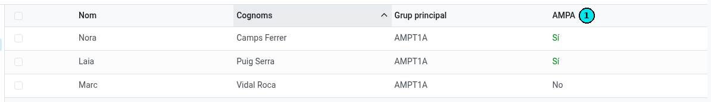
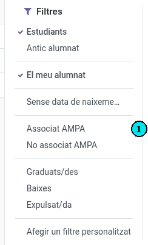

[Català](../../ca/tutors/ampa.md) | [Castellano](../../es/tutors/ampa.md) | [English](ampa.md)

---

# AMPA members among your students

You can see which of the students you tutor are AMPA members and list both the members and the non-members.

**Role required:** Tutor. Your Seminar Chief, your Department Chief and your Head of Studies also see it for your students, and the Director for every tutor's students. The secretary's office and the administration see it for every student of the centre.

---

## Who is an AMPA member

A student is an AMPA member when their confirmed enrollment of the current course includes the **AMPA fee** and its **first installment has been collected** (the fee is billed in it).

The fee is paid once per family: if a sibling is a member (shares a family contact with the student), the student is a member too.

## Seeing it in the Students list

1. Open **Educational Community → Students** and switch to the list view.
2. The **AMPA** column **(1)** reads **Yes** or **No** for each student.

If you don't see the column, turn it on in the column selector (the icon at the right end of the list header).

The column stays empty for students who are neither yours nor in your area.

## Listing the members or the non-members

1. Open the search bar's filter menu (the arrow on its right).
2. Choose **AMPA member** **(1)** to see only the members, or **Not an AMPA member** to see the others.

The filters combine with **My students** and with the groups panel on the left: for instance, select your group in the panel and apply **Not an AMPA member**.

## Seeing it on the student form

On the student form, next to **Benefits**, the **AMPA** badge reads **Yes** or **No**.

## If a family says they have already paid

The student shows as a member once the collection of the first installment is registered. If a family says they have paid and the student reads **No**, refer them to the secretary's office.

---

[← Back to the tutors index](index.md)
