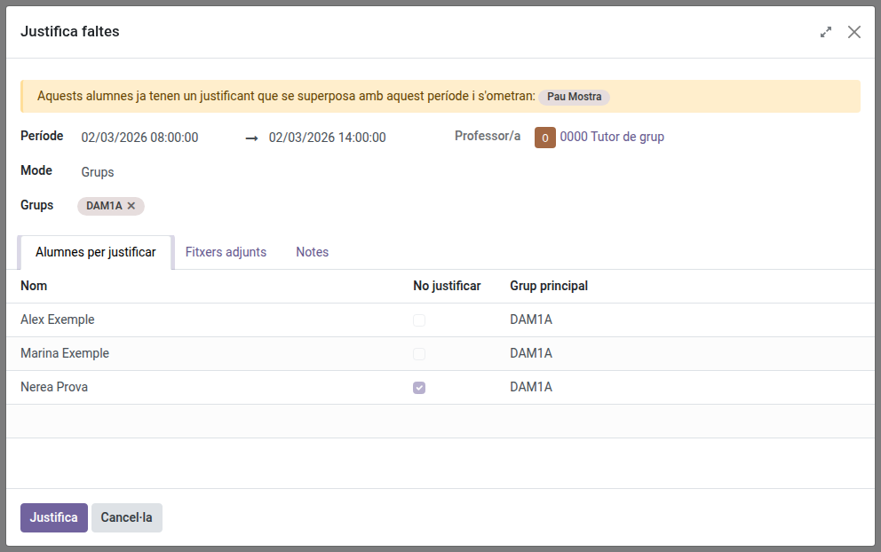
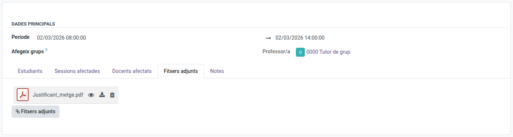
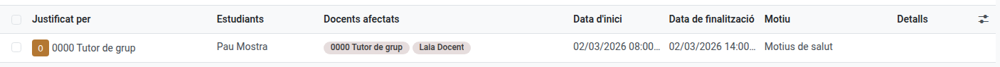

[Català](../../ca/tutors/attendance-justifications.md) | [Castellano](../../es/tutors/attendance-justifications.md) | [English](attendance-justifications.md)

---

# Justifying Your Students' Absences

A justification covers a period (start and end date and time) for one or several students: one student with a medical appointment, or a whole group on strike or at a competition. Every absence within that period becomes a **Justified Miss**, whichever teacher recorded it, and every **Severe Delay** (which counts as an absence) becomes a **Minor Delay**. The justification has a single reason and a single set of attached files, shared by all its students.

Unless the centre allows it in its settings, a justification is the only way to justify an absence: teachers can't mark a student as Justified Miss when taking the roll-call.

**Required role:** Tutor

---

## Recording a justification

1. Go to **Student's Attendances → Justifications** and click **New**.
2. In **Reason**, pick why (by default, **Health reasons**). Then:
    - For most reasons, set the start and end date and time in **Period**.
    - For a **Labour strike**, pick the **Day** instead: the justification covers the student's whole day.
    - For **Other reasons**, describe it in **Details**, which only appears for that reason.
3. In **Justify**, choose who the justification is for:
    - **Student** (the default): pick the student in **Student**. Only that student is justified.
    - **Group:** pick the group in **Add groups**. All its students are added to the **Students** tab, which shows each student's name and main group. You can add several groups, one after another, or click **Add a line** to add one more student.

    Only your groups and their students are offered.
4. Remove from the list, with the cross (×), anyone who must not be justified (for example, during a strike, the students who didn't sign the document).
5. If you want, attach the document in the **Attached files** tab and add a comment in **Notes**.
6. Save. The absences of every student in the list within the period become **Justified Miss**, whichever teacher recorded them, and their severe delays become **Minor Delay**.

The **Affected sessions** tab lists, for every student, the sessions within the period where they had an absence or a severe delay.

In the roll-call, the justified lines show a shield and can no longer be changed by the teacher. Their note says who justified them ("Absence justified by: ..." or "Severe delay justified by: ...").

A student cannot have two justifications with overlapping periods. When you add a group, the students who already have one are not added, and a message names them. If you add one by hand, a yellow notice names them: remove them from the list to save.

### Days still to come

The period can include future days (for example, a planned hospital stay). When a teacher takes attendance in a session within that period, the student already appears as **Justified Miss**, and the session is added to the justification's **Affected sessions**.

---

## Attaching the document

You can also attach files to a justification after creating it:

1. Open the justification from the **Justifications** list.
2. In the **Attached files** tab, click the **Attached files** button and choose the file (for example, the medical certificate). You can choose several at once; each one is named after its file.
3. Save the justification.

The eye icon previews the file without leaving EMS (PDFs, images and text files); the download icon downloads it; the bin deletes it once you save the justification. Use the **Notes** tab to add a comment.

The attached files can be opened by everyone who can see the justification: the teachers of the affected sessions, Head of Studies and the academic administration.

---

## Checking, changing or deleting a justification

**Student's Attendances → Justifications** lists your students' justifications, with the teachers of the affected sessions.

- **Changing the period or the reason:** open the justification, change the **Period** (or the **Day**, for a strike) or the **Reason** and save. Absences left outside it go back to **Miss** (or **Severe Delay**, if they were one), and the new ones are justified.
- **Adding or removing students:** add them or remove them from the **Students** tab and save. The absences of a removed student go back to **Miss** (or **Severe Delay**).
- **Deleting it:** the absences it covered go back to **Miss**, and the delays to **Severe Delay**.

A justification that includes students from groups you aren't the tutor of can only be changed or deleted by someone responsible for all of them (Head of Studies, or the academic administration). You can still open it.

The list shows each justification's reason and details. You can search it by student, by group or by reason, and group it by reason.

---

[← Back to Tutor manuals](index.md)
