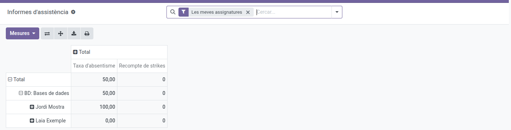
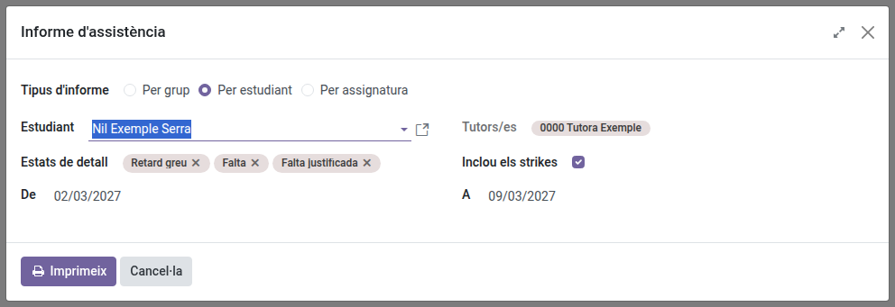

[Català](../../ca/tutors/attendance-reports.md) | [Castellano](../../es/tutors/attendance-reports.md) | [English](attendance-reports.md)

---

# Attendance Reports

**Attendance → Reports** opens the **Attendance reports** screen: a pivot table you can explore and export
yourself, plus 3 printable PDF reports (by group, by student, by subject) reachable from its header.

**Required role:** Teacher (group tutors use the same reports as any teacher)

---

## Exploring Attendance Reports

1. Navigate to **Attendance → Reports**. It opens directly on a **pivot table** with the **My subjects**
   filter on, showing only the subjects you teach. Remove that filter (the **×** on it in the search bar)
   to see **all your tutees in every subject**, whoever teaches it, together with your own students.
2. The table groups by **subject, then student**. Click the **Expand all** icon (top-right, next to Flip
   axis) twice: once to unfold the subjects, once more to unfold each subject's students. The main number
   is the **% of absences per student** — **Count** (number of sessions counted) and **Strike count** are
   shown alongside it, so you can tell whether a 33% comes from 3 sessions or from 30, and whether it comes
   with disciplinary strikes attached. A subject your schedule splits into parts taught apart (its
   **topic**, e.g. the Physical Education of a CFGB module) is listed as a subject of its own, as
   "Subject - Topic".

   
3. Use the search bar to filter further (by student, group, subject or status), and **Group By** to change
   how the table is folded. The group is the student's own group on the date of each session: a session shared by several groups counts each student only in their own group.
4. Use the **spreadsheet/download icon** in the header to export the current pivot to Excel.
5. Switch to the **graph** view (top-right icons) for a visual breakdown — by default it shows the
   **% of absence per subject**, so you can spot which subjects have the highest absenteeism at a glance.
   The graph shows one measure at a time — use the **Measures** dropdown in its header to switch to
   **Strike count** if you want to see disciplinary strikes per subject instead.

---

## From a Student's File

To look at a single student's attendance, open their file and click the **Attendance** button at the top, next to **Meetings** and **Relations**. It opens the same pivot table, already filtered on that student (the **Student** filter in the search bar, which you can remove with its **×**). For one of your tutees you'll see **every subject**, whoever teaches it; for any other student, only the subjects you teach them. The graph view and the PDF reports work exactly as described in this manual.

---

## Printing a PDF Report

On the **Attendance reports** screen, click the **printer** button, the last one in the row above the table
(next to the download one), also in the graph view. It's also in the **⚙ (gear)** menu, as **Print attendance
report**. If the table is filtered on a student, a group or a subject (in the search bar), the form opens on
that report with it already selected: from a student's file, for instance, it's that student's report. In the form, pick the **Report type** — by group, by student, or by subject — and the fields adapt
to your choice. The lists offer exactly the students, groups and subjects you see on the pivot table
(current course only), and the PDF covers the same sessions as the table.

**Attendance report (by group):**
1. Pick a **Group** — the dropdown shows the groups of your students and of your tutees.
2. The **Tutor** and the **From**/**To** dates fill in automatically from the group and its full session
   range.
3. Click **Print**. The PDF opens with an overall assistance/absence breakdown, a per-status count, and any
   session notes recorded for the period. For a group you tutor it includes **every subject**, whoever
   taught the session; for any other group, only the subjects you teach. It covers the group's students, in the group each one belonged to on the date of each session.

**Attendance report (by student):**
1. Pick a **Student** — the dropdown shows the students you've taken the roll-call of in **your subjects**
   and **all your tutees**, even the ones you don't teach.
2. The **Tutor** and the **From**/**To** dates fill in automatically from the student and their full
   session range.
3. Click **Print**. The PDF opens with an overall assistance/absence breakdown, a per-status count, and any
   session notes recorded for the period. For your tutees it includes **every subject**, whoever taught
   the session; for any other student, only the subjects you teach.

   

The Department or Seminar Chief, the Head of Studies above you and the Director see the same as you: your
tutees on the **Reports** screen, and the full PDF reports of your tutees and of the groups you tutor. The
Department or Seminar Chief of the department that manages your group's study, and the Head of Studies of
its area, see every student of that study as well.

**Attendance report (by subject):**
1. Pick a **Subject** — the dropdown shows the subjects you teach and every subject of your tutees, each
   topic as a subject of its own.
2. The **Groups** field fills in automatically with every group of the students you see with that subject,
   and
   **Tutors** shows their tutors for reference (this is where you can actually see who tutors each group —
   not by picking the group yourself first). If you only want some of those groups in the report, remove
   the others from the **Groups** field — it stays editable.
3. The **From**/**To** dates fill in automatically to cover the full session range for your selection.
4. Click **Print**. The PDF opens with an overall assistance/absence breakdown, a per-status count, and any
   session notes recorded for the period. For your tutees it includes every session of the subject,
   whoever taught it.

**For any report type**, two controls govern the per-line detail in the PDF:
- **Detail statuses** — which statuses appear in the "Details" tables. It defaults to absence-related
  statuses only (**Miss**, **Justified Miss**, **Severe Delay**) so the report stays a manageable size;
  add more and a warning appears that the report may become slow to generate or fail for large selections.
- **Include strikes** (on by default) — adds tables of the disciplinary strikes recorded during the period.

The downloaded PDF is named after the report and the selected student, group or subject (e.g. `Attendance report_ by student_Name_Surname.pdf`), so several downloads can be told apart.

> For a broader, per-course view of a tutee's attendance across their whole record, see
> [Academic history of your students](academic-history.md) instead.

---

[← Back to Tutors manuals](index.md)
