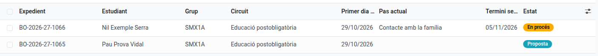
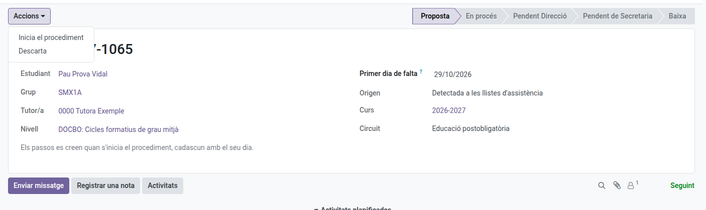
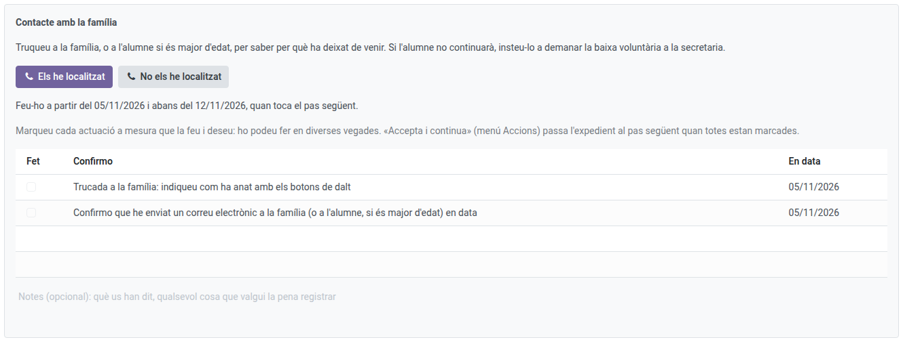
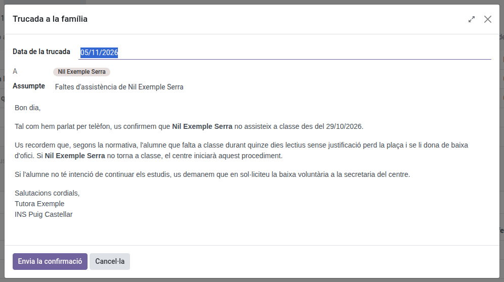
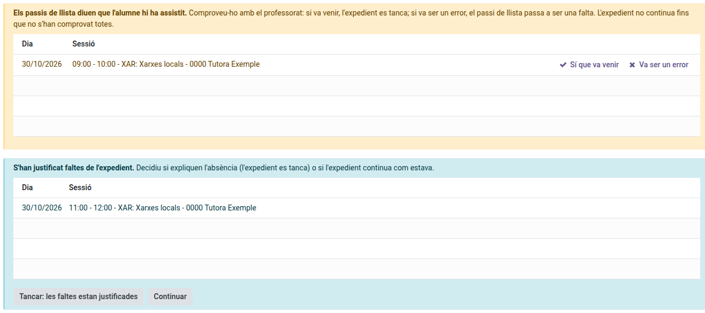

[Català](../../ca/tutors/ex-officio-withdrawal.md) | [Castellano](../../es/tutors/ex-officio-withdrawal.md) | [English](ex-officio-withdrawal.md)

---

# A Student's Ex Officio Withdrawal

This guide explains what to do when one of your students stops coming to class: how the ex officio withdrawal proposal arrives, how you start or dismiss it, how you do your step (the phone call to the family and, if needed, the email) and what happens if the roll-calls say otherwise while the case file is open.

**Required role:** the student's tutor (also the Department or Seminar Chief and the Head of Studies above you, Direction and the Administrator)

---

## Contents

1. [What it is for](#what-it-is-for)
2. [Where to find the case files](#where-to-find-the-case-files)
3. [The proposal](#the-proposal)
4. [Your step: contact with the family](#your-step-contact-with-the-family)
5. [If the roll-calls say otherwise](#if-the-roll-calls-say-otherwise)
6. [What happens next](#what-happens-next)

---

## What it is for

A student who stops coming to the centre loses their place after a set term. EMS opens a **case file** that walks every step of the centre's protocol, with who did each step and when:

- **Post-compulsory** (CFGM, CFGS, specialisation courses, PFI): 15 school days without coming. On the 5th day it is your turn; on the 10th, the Secretariat's; on the 15th, Direction gives the green light and the Secretariat processes the withdrawal.
- **Compulsory** (CFGB): 2 calendar months, with a call from you in the first week, one from Coexistence after 15 days, the Secretariat's and Social Services' notices after a month, the withdrawal warning after a month and a half and Direction's green light after 2 months.

Each step gives you a **task** on its day, which you see in your daily summary.

---

## Where to find the case files

Go to: **Academic management → Ex officio withdrawals**. You see your students' case files, the step each one is at and when the next deadline ends.

---

## The proposal

A proposal arrives in two ways:

- **EMS detects it:** when a student has missed 5 school days in a row, unjustified, at every roll-call. Days without a roll-call or with justified absences neither count nor break the count; any attendance or delay starts it again.
- **You request it:** on the student's form, **Actions → Request ex officio withdrawal**, giving the first day of absence.

You get the task of deciding on it. Open the case file and, in the **Actions** menu:

- **Start the procedure:** the steps are created with their days.
- **Dismiss:** if the student has a reason (an illness, for instance), write it and the proposal closes. It is only proposed again if they miss 5 days in a row later on.

---

## Your step: contact with the family

On its day, the case file shows you what to do and by when. Phone the family (or the student, if of age) and say how it went with the buttons:

- **I reached them** or **I did not reach them:** a window opens with the day of the call and, in post-compulsory, the email EMS has prepared for the family (a confirmation or a notice), which you can review before sending it.
- **I will try again tomorrow** (if you did not reach them): nothing is sent and the step moves to the next school day.

The call and the email are ticked on their own in the list, with the date, and the text sent is kept in the case file's history. Once everything is ticked, **Actions → Accept and continue** hands the case file over to the next step.

---

## If the roll-calls say otherwise

While the case file is open (a proposal too), EMS reviews the roll-calls of the case file's days once each session is over:

- **The student is marked as present** (or late): the case file stops and you get the task **Check an attendance**. Check it with the teachers and click **They did come** (the case file closes: the student is back) or **It was a mistake** (that roll-call becomes an absence, with a note). If the teacher corrects the roll-call themselves, the notice goes away on its own.
- **Absences of the case file have been justified:** you get the task **Review justified absences**. Decide whether they explain the absence (**Close: the absences are justified**) or the case file goes on as it was (**Go on**). This does not stop the case file.

---

## What happens next

When you accept your step, the case file goes to the next responsible (Coexistence, the Secretariat or Direction), who gets their task on its day. You can still see the case file and its **History**, with every step done, who did it and when.

If the student asks for a voluntary withdrawal or is expelled, the case file closes on its own.
