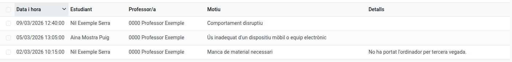
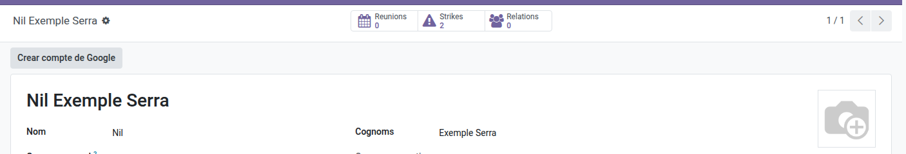

[Català](../../ca/tutors/strike.md) | [Castellano](../../es/tutors/strike.md) | [English](strike.md)

---

# Strikes: Consulting Your Group's Records

As a group tutor, you're notified by email whenever any of your students receives a strike, from any teacher. This page explains where to consult that history.

**Required role:** Tutor

---

## Consulting Strikes

- **Convivencia → Strikes** lists every strike you have issued yourself, plus every strike issued to any student in your group(s) — regardless of which teacher put it.

  Each row shows the student's group, and the subject and classroom of the session where the strike was issued. A strike issued outside class (with **New strike**) shows the student's main group, with no subject or classroom.

  
- From a student's own form, a **Strikes** button appears in the header showing their accumulated count (0 if they have none yet) — click it to see the full history for that student and, from there, issue a new one for them with **New strike**.

  

You do not need to do anything else: the notification email you receive on every strike already tells you who issued it, when, why, and whether the student was kicked out of class or not.

## Deleting a Strike

You can delete a strike you issued yourself (for example, if it was a mistake) and any strike given to one of your students, whoever issued it: in the **Strikes** list, select it, open the **⚙ Actions** menu and choose **Delete**. The Department/Seminar Chief and the Head of Studies above you can do the same for your students.

Deleting a strike does not undo what already happened: the emails to the student, the family and the tutor, and the notice to the Coexistence coordinator when the count reached the threshold, have already been sent.

---

[← Back to Tutors manuals](index.md)
