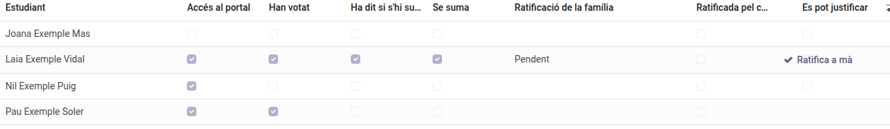
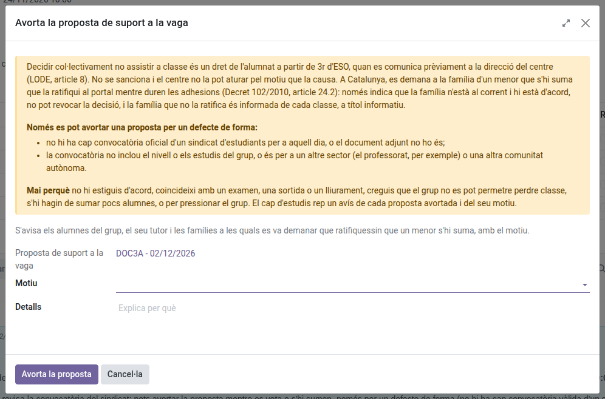

[Català](../../ca/tutors/student-walkout.md) | [Castellano](../../es/tutors/student-walkout.md) | [English](student-walkout.md)

---

# Student walkouts: watching over your group's proposal

When your group's delegate proposes on the portal that the group supports a student walkout, you watch over the proposal: you are told of every step and you can stop it if it has a formal defect. The Head of Studies only steps in at the end, to validate it or not. How students and families take part is in the [families' manual](../families/manual-vagues.md).

Not to be confused with **Strikes** (Coexistence), the disciplinary record.

---

## What you are told

You get an email, at the same time as your group, every time something happens:

| When | What the email says |
|------|---------------------|
| The delegate proposes the vote | Who proposed it, for which day, and until when the group votes |
| The group supports it | The vote count, and until when each student says whether they join |
| Joining is extended | Until when each student can now say whether they join; you can still abort the proposal until then |
| The proposal closes | Whether the group supports it and how many students join it |
| The Head of Studies validates it | That the walkout is validated: those who join it stay off the roll-calls of that day |
| It is aborted or not validated | Who did it, and the reason |

If you tutor a split group, every co-tutor is told. A group with no tutor goes to the Head and Deputy Head of Studies.

The emails reach you when they reach your group: at once when the centre counts the hours from the moment of the proposal (whatever the time), otherwise during the group's classes or at the start of the next ones.

---

## Looking at a proposal

**Student's Attendances > Student walkouts** lists your groups' proposals. The form shows the proposal (calendar, reason and supporting document) and then the two phases apart. **Phase 1, group vote**: where it is (in progress or closed), its dates, the vote count, how many have voted and its result, which stays pending until the vote ends. **Phase 2, individual joining**: where it is, its dates, how many join and how many have answered and, for the minors who join, how many families agree, do not agree or have not answered. Until the group supports the proposal this phase shows as not started or not opened. On the **Students** tab you see who voted (never what), who joins it, and the family's answer for the minors.

The family of a minor who joins it is asked on the portal, while joining lasts, to acknowledge receipt and to say whether it agrees. The answer only tells the school that the family has been informed: it is a collective decision of the students that nobody can revoke, the family included.

**The roll-call of the walkout day.** Once joining closes and the group supports it, the students who join it show greyed out on the roll-calls of that day, as "Not required to attend: student walkout": neither absent nor present, and nothing to justify. When a minor joins and the family has not said it agrees, the label says so and the family gets, for information, the notice of each class they do not attend. If the student comes to class, the teacher puts them back on the list; if that was a mistake and the teacher removes them again, the "student walkout" reason comes back (and so does the family's notice). If the walkout is not validated, those classes count as absences.

If a minor's family cannot use the portal and tells you (or the centre) that it has received the notice and agrees, click **Family agrees (by hand)** on that student's row of the **Students** tab and confirm. You can do it from when students join until the Head of Studies validates the walkout, only for families that have not answered (never to override a "does not agree"). The row then shows who marked it, and the change is logged in the chatter.

---

## Aborting a proposal

While the group is voting or joining, you can stop the proposal: **Actions > Abort the proposal**. Choose a **Reason** (and explain it in **Details** if the reason asks for it) and click **Abort the proposal**.

**Only for a formal defect.** Collectively deciding not to attend class is a right of students from the 3rd year of ESO onwards (LODE, article 8): the school cannot stop it because of its cause. You can abort it when:

- the attached document does not support the proposal (it does not explain why the group walks out, or it is for another day). It may be a students' union's call, the minute of the group's assembly or any document that explains the decision.

Never because you disagree with its cause, with who calls it or where (a union, an assembly, another sector or another territory), it coincides with an exam, an outing or a deadline, you think the group cannot afford to miss class, or few students would join it.

The students of the group are told, with the reason, and the Head of Studies gets a notice of every aborted proposal in their daily summary. Once the proposal has closed, only the Head of Studies decides.

Whoever is above you in the hierarchy (Department or Seminar Chief, Head or Deputy Head of Studies, Director) and the administrator can abort it too.

An aborted proposal no longer counts: the group can propose another walkout for the same day.

---

## Extending the joining

If students need more time to say whether they join, **Actions > Extend the joining** gives them one phase more (the time set for each phase in the centre's settings), or less if the Head of Studies would then not get the minute in time: as far as possible. It is counted from the end of joining, or from now if it has already ended. You can do it at any time and as many times as needed, as long as the Head of Studies still gets the minute with the notice before the walkout: when it is not possible, the action does not appear. Every student is told.

- The delegate and sub-delegate can extend it once by themselves, from the portal.
- If the proposal had already closed, it opens again: the minute that went to the Head of Studies is withdrawn (they get a notice in their daily summary) and a new one is sent when it closes again.
- Only a proposal the group supports can be extended: not one the group did not support, an aborted one or one already validated.

---

[← Back to the tutors' manuals](index.md)
