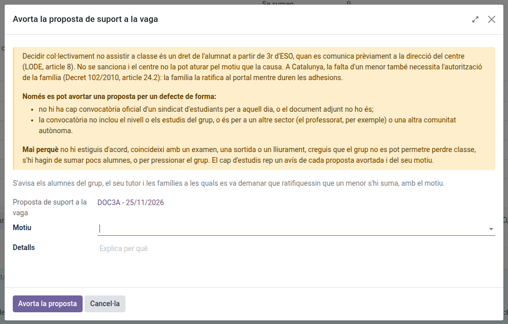

[Català](../../ca/tutors/student-walkout.md) | [Castellano](../../es/tutors/student-walkout.md) | [English](student-walkout.md)

---

# Student walkouts: watching over your group's proposal

When your group's delegate proposes on the portal that the group supports a student walkout, you watch over the proposal: you are told of every step and you can stop it if it has a formal defect. The Head of Studies only steps in at the end, to validate it or not. How students and families take part is in the [families' manual](../families/manual-vagues.md).

Not to be confused with **Strikes** (Coexistence), the disciplinary record.

---

## What you are told

You get an email, at the same time as your group, every time something happens:

| When | What the email says |
|------|---------------------|
| The delegate proposes the vote | Who proposed it, for which day, and until when the group votes |
| The group supports it | The vote count, and until when each student says whether they join |
| The proposal closes | Whether the group supports it and how many students join it |
| The Head of Studies validates it | That the absences of those who join it are justified |
| It is aborted or not validated | Who did it, and the reason |

If you tutor a split group, every co-tutor is told. A group with no tutor goes to the Head and Deputy Head of Studies.

---

## Looking at a proposal

**Student's Attendances > Student walkouts** lists your groups' proposals. The form shows the calendar, the union's call, the vote count and, on the **Students** tab, who voted (never what), who joins it, and the family ratification of the minors.

A minor who joins it needs their family's ratification on the portal while joining lasts (Decret 102/2010, article 24.2): without it, their absence is not justified. The **Can be justified** column tells you who will be justified if the walkout is validated.

---

## Aborting a proposal

While the group is voting or joining, you can stop the proposal: **Actions > Abort the proposal**. Choose a **Reason** (and explain it in **Details** if the reason asks for it) and click **Abort the proposal**.

**Only for a formal defect.** Collectively deciding not to attend class is a right of students from the 3rd year of ESO onwards (LODE, article 8): the school cannot stop it because of its cause. You can abort it when:

- there is no official call of a students' union for that day, or the attached document is not one;
- the call does not cover the group's level or studies, or is for another sector (teachers, for instance) or another autonomous community.

Never because you disagree with its cause, it coincides with an exam, an outing or a deadline, you think the group cannot afford to miss class, or few students would join it.

The students of the group are told, with the reason, and the Head of Studies gets a notice of every aborted proposal in their daily summary. Once the proposal has closed, only the Head of Studies decides.

Whoever is above you in the hierarchy (Department or Seminar Chief, Head or Deputy Head of Studies, Director) and the administrator can abort it too.

---

[← Back to the tutors' manuals](index.md)
