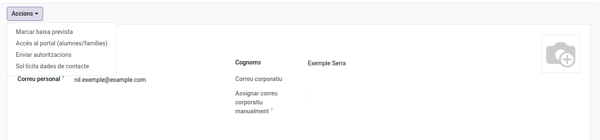
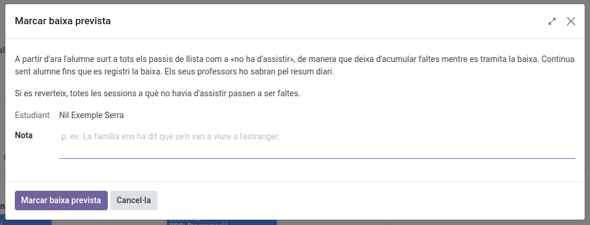
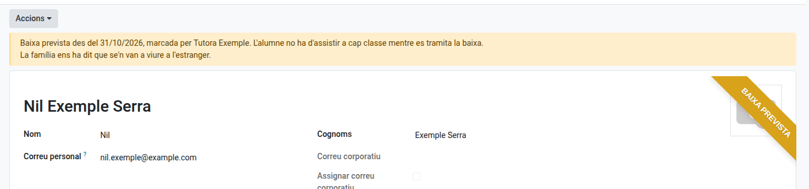
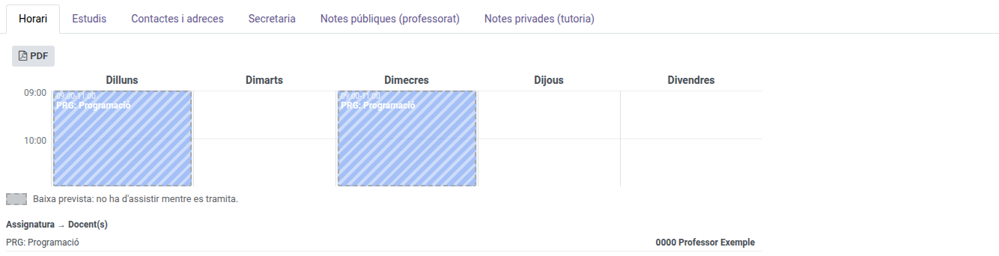

[Català](../../ca/tutors/withdrawal-expected.md) | [Castellano](../../es/tutors/withdrawal-expected.md) | [English](withdrawal-expected.md)

---

# A Student's Expected Withdrawal

This guide explains how to mark that a student of yours is leaving the centre while their withdrawal is processed, so they stop piling up absences, and how to undo it if they don't leave after all.

**Role required:** the student's tutor (also the Department or Seminar Chief, the Head of Studies and the Deputy Head of Studies above them, the Director, the secretariat and the administrator)

---

## Contents

1. [What it is for](#what-it-is-for)
2. [Marking the expected withdrawal](#marking-the-expected-withdrawal)
3. [What changes while it lasts](#what-changes-while-it-lasts)
4. [Reverting it](#reverting-it)
5. [When the withdrawal is registered](#when-the-withdrawal-is-registered)

---

## What it is for

When you know a student won't come back, you ask for their withdrawal, but processing it takes a few days. Meanwhile the student would keep appearing in every roll-call and piling up absences. With an **expected withdrawal**, the student stays in the group, but is no longer expected in class.

---

## Marking the expected withdrawal

1. Open the student's file.
2. Open the **Actions** dropdown and choose **Mark expected withdrawal**.

   

3. Optionally write a note with the reason, and click **Mark expected withdrawal**.

   

---

## What changes while it lasts

- **The file** shows the **Expected withdrawal** ribbon and a notice with the date, who marked it and the note.

  

- **Roll-calls:** from then on, the student appears greyed out, at the bottom of the list, with *Not required to attend: expected withdrawal*. It counts neither as attendance nor as an absence, and the family is not notified. If they turn up anyway, the teacher can put them back on the list. Roll-calls already taken that same day for later classes take them off too.
- **The student's schedule** shows the classes dashed, with a legend explaining why.

  

- **The student's teachers and you** get a notice in your [daily summary](../teachers/daily-summary.md), so you know why they appear greyed out.

---

## Reverting it

If the student doesn't leave after all, open the **Actions** dropdown and choose **Revert expected withdrawal**. EMS asks for confirmation, because:

- The student appears in the roll-calls again.
- **Every session they were not required to attend since it was marked becomes an absence.** The ones you had justified stay justified.
- **The family is not notified** of these absences: you already know the situation. They appear in the attendance issues section of your daily summary.
- The student's teachers get a notice in their daily summary.

---

## When the withdrawal is registered

When the secretariat registers the withdrawal (see [Marking a Graduation and Processing a Withdrawal](../secretary/graduation-withdrawal.md)), the expected withdrawal disappears by itself. The sessions the student was not required to attend stay as they were.

---

[← Back to index](index.md)
