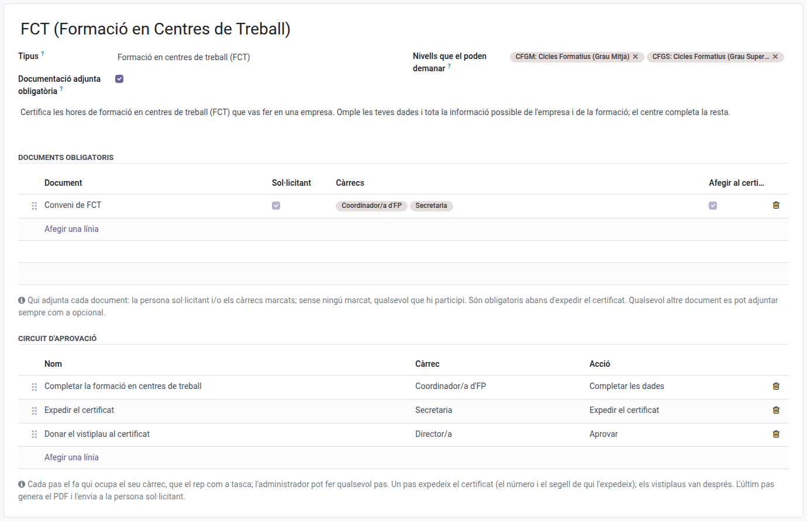

[Català](../../ca/admin/certificate-types.md) | [Castellano](certificate-types.md) | [English](../../en/admin/certificate-types.md)

---

# Tipos de certificado y circuitos de aprobación

Configura qué certificados puede pedir el alumnado, qué documentación exigen y quién hace cada paso hasta que se expiden.

**Rol necesario:** Administrador.

---

## Acceso

Navega a: **Gestión académica → Configuración → Certificados → Tipos de certificado**.

EMS ya incluye el tipo **FCT (Formació en Centres de Treball)**. Los cambios que hagas se mantienen al actualizar EMS.

---

## Campos del tipo

- **Tipo** — qué certifica y, por tanto, qué datos pide la solicitud y qué texto tiene el certificado.
- **Niveles que pueden pedirlo** — el alumnado actual de estos niveles puede pedirlo desde el portal, y la solicitud solo admite estudios de estos niveles. Si se deja vacío, el tipo no aparece en el portal y las solicitudes solo se registran desde secretaría.
- **Descripción** — el texto que lee la persona solicitante encima del formulario.

---

## Documentación adjunta obligatoria

Marca **Documentación adjunta obligatoria** y añade una línea por cada documento que se debe adjuntar antes de expedir el certificado:

- **Documento** — el nombre del documento (por ejemplo, *Convenio de FCT*).
- **Solicitante** — la persona solicitante puede adjuntarlo desde el portal o desde el enlace.
- **Cargos** — quien ocupa estos cargos puede adjuntarlo (solo se pueden elegir cargos del circuito).
- **Añadir al certificado** — las páginas del documento se añaden al final del PDF del certificado.

Si no se marca ni **Solicitante** ni ningún cargo, puede adjuntarlo cualquiera que participe. El administrador siempre puede adjuntarlo.

Además de los documentos obligatorios, cualquier solicitud admite **Otra documentación** opcional, que no se añade al certificado.

---

## Circuito de aprobación

Cada línea es un paso, por orden:

- **Nombre** — lo que ve quien tiene que hacer el paso.
- **Cargo** — quien lo ocupa recibe la tarea y hace el paso. Los cargos y quién los ocupa se configuran en [Cargos](teacher-roles.md).
- **Acción**:
  - **Completar los datos** — completa la información y pasa la solicitud al paso siguiente.
  - **Expedir el certificado** — da el número al certificado y pone el sello de expedición.
  - **Aprobar** — pone el sello de visto bueno.

El circuito debe tener exactamente un paso **Expedir el certificado**, y los pasos **Aprobar** van después de este. El último paso genera el PDF y lo envía a la persona solicitante.

El administrador puede hacer cualquier paso de cualquier solicitud.
