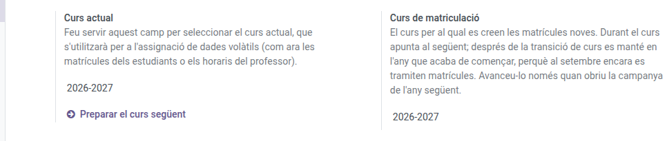

[Català](../../ca/admin/course-settings.md) | [Castellano](course-settings.md) | [English](../../en/admin/course-settings.md)

---

# Curso Actual

El ajuste **Curso actual** controla qué año académico (p. ej., `2025-2026`) se utiliza para las operaciones del día a día: asistencia, calificaciones y seguimiento de incidencias.

**Rol requerido:** Administrador

---

## Acceso

Navega a: **Ajustes → Gestión EMS → Ajustes de gestión de cursos**

---

## Cambiar el curso actual

1. Abre **Curso actual** y elige el año académico de la lista.
2. Guarda. El cambio tiene efecto inmediato en toda la aplicación — las sesiones de asistencia, las nuevas sesiones de calificación y el seguimiento de incidencias pasan todos al año seleccionado.

---

## Gestionar los cursos

Cada marca se cambia con **su propio desplegable** en esta misma pantalla:

| Marca | Qué significa |
|---|---|
| **Curso actual** | El año del día a día: asistencia, calificaciones e incidencias |
| **Matriculación por defecto** | El año al que se crean las matrículas nuevas |

Las dos son únicas: solo un curso puede llevar cada una.

### Cuándo mover la marca de matriculación

Durante el curso apunta al año siguiente, que es donde se van registrando las matrículas. **Después de la transición de curso sigue apuntando al año que acaba de empezar**, porque en septiembre se siguen tramitando matrículas de ese año.

Muévela al siguiente solo cuando abras la campaña de matriculación del año que viene. Basta con elegir el curso en el desplegable: la marca se quita del anterior automáticamente.

### Crear un curso nuevo

Si el año que necesitas no está en la lista, escríbelo en cualquiera de los dos desplegables y usa **Crear y editar…**: se abre un formulario donde solo hay que indicar el año de inicio y el de fin. El nombre (`2029-2030`) se compone solo.

> Si mueves esta marca sin querer, las matrículas nuevas se crearán en el año equivocado y no hay ningún aviso. Vale la pena comprobarla si notas matrículas apareciendo donde no tocan.

---

## Periodo de preinscripción

Los tutores solo usan **Gestión académica → Matrícula → Propuestas de matrícula** durante la preinscripción, así que fuera del **Periodo de preinscripción** no la ven. Tampoco la ven los jefes de departamento y de seminario, ni orientación ni convivencia, que ya tienen toda la información del alumno en su ficha. La administración académica, la secretaría, los jefes de estudios, los jefes de estudios adjuntos y el director siempre la ven.

1. En **Periodo de preinscripción**, indica el día, el mes y la hora de **Apertura** y de **Cierre**, en hora local del centro. No hay año: las mismas fechas se repiten cada año.
2. Guarda. El menú aparece y desaparece solo en esos momentos.

Por defecto va del 1 de mayo a las 08:00 al 31 de julio a las 23:59. Si un tutor abre las propuestas desde un enlace guardado fuera del periodo, un mensaje le indica cuándo se volverá a abrir.

---

[← Volver al índice de Administrador](index.md)
