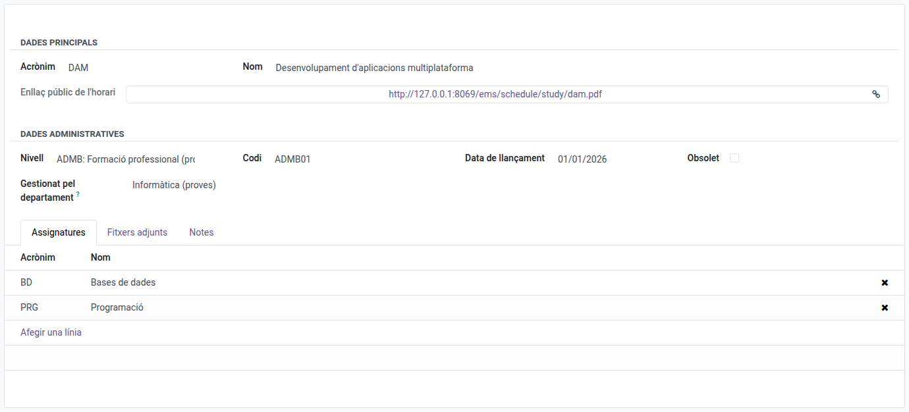

[Català](../../ca/admin/curriculum-studies.md) | [Castellano](curriculum-studies.md) | [English](../../en/admin/curriculum-studies.md)

---

# Estudios

Los estudios representan los **programas de estudio concretos** que ofrece el centro (p. ej., DAM, DAW, ASIX). Cada estudio pertenece a un nivel y agrupa las asignaturas que lo componen, junto con sus documentos curriculares oficiales.

**Rol requerido:** Administrador

---

## Acceso

Navega a: **Comunidad Educativa → Configuración → Currículum → Estudios**

---

## Consultar todos los estudios

Al abrir el menú se muestra una lista de todos los estudios ordenada por código. Cada fila muestra el código, el acrónimo y el nombre.

---

## Crear un estudio

1. Haz clic en **Nuevo**.
2. Rellena los campos obligatorios:
   - **Acrónimo** *(obligatorio)*: Código corto que se utiliza en todo el sistema (p. ej., `DAM`, `DAW`).
   - **Nombre** *(obligatorio)*: Nombre descriptivo completo.
   - **Nivel** *(recomendado)*: El nivel educativo al que pertenece este estudio.
   - **Código** *(obligatorio)*: Código oficial, debe ser único (p. ej., `CFGS_ICB0`).
   - **Fecha de publicación** *(obligatorio)*: Fecha de publicación del currículum.
   - **Obsoleto**: Déjalo sin marcar para un estudio activo; márcalo para retirar un estudio sin eliminarlo.
   - **Gestionado por el departamento**: el departamento responsable de los alumnos de estos estudios. Su jefe de departamento y su jefe de seminario, y quienes tienen por encima, pueden organizar las ausencias de las clases de los grupos de estos estudios (guardias, arreglos, entradas más tarde y salidas antes de hora), sea cual sea el departamento del docente ausente, además de la cadena de mando del docente; ver [Horario de guardias](../department_chiefs/absences.md#organizar-una-ausencia). Si lo dejas en blanco, solo puede hacerlo esa cadena: el jefe de departamento del docente y su JE o JEA. El jefe de departamento y el jefe de seminario del mismo departamento, y la JE o JEA de su área, ven a todo el alumnado de estos estudios en los informes de asistencia; unos estudios gestionados por toda un área (por ejemplo, ESO o Bachillerato) pueden indicar el departamento de la propia área. Si lo dejas en blanco, la asistencia de su alumnado solo llega por el tutor/a de cada alumno y quienes tiene por encima. El área de este departamento es también la de los grupos de estos estudios en el [Horario de guardias](../teachers/guard-duty-schedule.md#filtrar-por-area): los agrupa bajo su área y el filtro de área los muestra; un grupo de unos estudios sin departamento aparece en "Otros grupos".
3. En la pestaña **Asignaturas**, añade las asignaturas que componen este estudio.
4. En la pestaña **Archivos adjuntos**, pulsa el botón **Archivos adjuntos** y elige los documentos de referencia curricular (publicaciones oficiales, documentos de orientación, etc.); cada uno se llama como su fichero. Los puede abrir cualquiera que pueda ver el estudio: el profesorado, la secretaría y la administración académica. Con el icono del ojo previsualizas un fichero sin salir del EMS (PDF, imágenes y ficheros de texto); con el icono de descarga lo descargas; con la papelera lo borras al guardar el estudio.
5. Opcionalmente, añade notas libres en la pestaña **Notas**.
6. Haz clic en **Guardar** (o usa las migas de pan para navegar — Odoo guarda automáticamente).

---

## Editar un estudio

1. Abre el estudio desde la lista.
2. Haz clic en cualquier campo para editarlo en línea, o haz clic en **Editar** si es necesario.
3. Realiza los cambios.
4. Haz clic en **Guardar**.

---

## Enlace público a los horarios del estudio

Cada estudio con grupos activos tiene un enlace público a un único PDF con el horario semanal de
todos ellos, uno detrás de otro por curso y grupo (p. ej. SMX1A, SMX1B... y después SMX2A,
SMX2B...). Cualquier persona puede abrirlo sin iniciar sesión en EMS, así que la web del centro
puede enlazar un PDF por estudio.

1. Abre **Comunidad Educativa → Configuración → Currículum → Estudios → [un estudio]**.
2. En el campo **Enlace público del horario** (p. ej. `.../ems/schedule/study/smx.pdf`), haz clic
   en el enlace para abrir el PDF en una pestaña nueva, o haz clic en el botón de la derecha para
   copiarlo.

El PDF incluye siempre los grupos activos del estudio en cada momento, cada uno con el horario tal
como aparece en su propio enlace público (ver [El horario semanal de un grupo](group-schedule.md#enlace-público-al-pdf-del-horario)),
así que no hace falta sustituir el enlace cuando los grupos cambian de un curso a otro. El enlace
se construye a partir del acrónimo del estudio: si el acrónimo cambia, el enlace también cambia.

---

## Retirar un estudio

Hay dos maneras, para dos situaciones distintas:

- **Obsoleto**: el currículo ya no está vigente, pero todavía hay alumnos que lo terminan. El estudio sigue visible y se puede usar. Abre el estudio, marca **Obsoleto** y haz clic en **Guardar**.
- **Archivar**: el estudio ya no se usa en absoluto (por ejemplo, un currículo nuevo lo ha sustituido y nadie cursa ya el antiguo). Desaparece de las listas y de los desplegables, y sus matrículas, grupos y calificaciones lo conservan.

---

## Archivar o eliminar un estudio

1. Abre el estudio (o selecciónalo en la lista).
2. Haz clic en el menú **Acción** (⚙) y selecciona **Archivar**.

Un estudio archivado ya no aparece en las listas ni en los desplegables, pero todo lo que ya lo usa lo sigue mostrando. Para volver a verlo, abre las opciones de búsqueda (▾ a la derecha del cuadro de búsqueda) y elige el filtro **Archivado**; ábrelo y usa **Acción** (⚙) → **Desarchivar** para recuperarlo.

Solo puedes **Eliminar** un estudio que todavía no use nada (por ejemplo, uno creado por error). Si algo lo usa, EMS no lo permite y te indica qué lo usa.

---

[← Volver al índice de Administrador](index.md)
