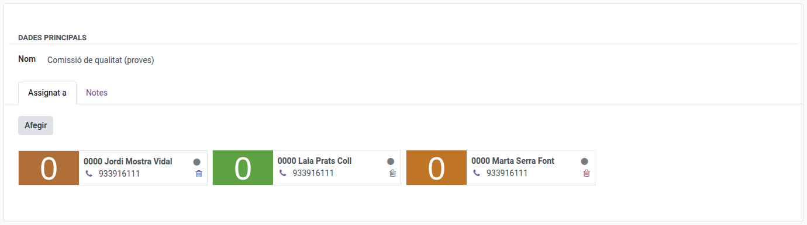

[Català](../../ca/admin/workgroups.md) | [Castellano](workgroups.md) | [English](../../en/admin/workgroups.md)

---

# Grupos de trabajo

Los grupos de trabajo son agrupaciones libres de empleados — un equipo de proyecto, una comisión interdepartamental, o cualquier grupo de profesores, proveedores o personal PAS que necesites seguir en conjunto. Uno de ellos, **Quality Comission**, es la comisión de calidad: sus miembros ven el menú **Calidad**, y lo dejan de ver cuando salen del grupo de trabajo.

**Rol requerido:** Administrador

---

## Acceso

Navega a: **Comunidad Educativa → Configuración → Profesorado → Grupos de trabajo**

---

## Crear un grupo de trabajo

1. Haz clic en **Nuevo**.
2. Rellena el **Nombre**.
3. En la pestaña **Asignado a**, añade los profesores que pertenecen a este grupo.
4. Opcionalmente, añade notas libres en la pestaña **Notas**.
5. Haz clic en **Guardar**.

---

## Editar o eliminar un grupo de trabajo

Ábrelo desde la lista, edita cualquier campo y guarda — o selecciónalo en la lista y usa el menú **Acción** (⚙) para eliminarlo.

---

[← Volver al índice de Administrador](index.md)
