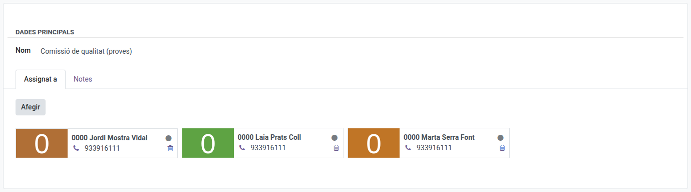

[Català](../../ca/admin/workgroups.md) | [Castellano](workgroups.md) | [English](../../en/admin/workgroups.md)

---

# Grupos de trabajo

Los grupos de trabajo son agrupaciones libres de empleados — un equipo de proyecto, una comisión interdepartamental, o cualquier grupo de profesores, proveedores o personal PAS que necesites seguir en conjunto. Uno de ellos, **Comissió de Qualitat**, es la comisión de calidad: sus miembros ven el menú **Calidad**, y lo dejan de ver cuando salen del grupo de trabajo. Puedes cambiarle el nombre: sigue siendo la comisión de calidad y las actualizaciones de EMS respetan el nombre nuevo.

**Rol requerido:** Administrador

---

## Acceso

Navega a: **Comunidad Educativa → Configuración → Profesorado → Grupos de trabajo**

---

## Crear un grupo de trabajo

1. Haz clic en **Nuevo**.
2. Rellena el **Nombre**.
3. En la pestaña **Asignado a**, añade los profesores que pertenecen a este grupo.
4. Opcionalmente, añade notas libres en la pestaña **Notas**.
5. Haz clic en **Guardar**.

---

## Editar, archivar o eliminar un grupo de trabajo

Ábrelo desde la lista, edita cualquier campo y guarda. Un grupo de trabajo que ya no se reúne se archiva, no se elimina: sus actas, asistencias a reuniones y acciones de calidad lo conservan.

1. Abre el grupo de trabajo (o selecciónalo en la lista).
2. Haz clic en el menú **Acción** (⚙) y selecciona **Archivar**.

Un grupo de trabajo archivado ya no aparece en las listas ni en los desplegables, pero todo lo que ya lo usa lo sigue mostrando. Para volver a verlo, abre las opciones de búsqueda (▾ a la derecha del cuadro de búsqueda) y elige el filtro **Archivado**; ábrelo y usa **Acción** (⚙) → **Desarchivar** para recuperarlo.

Solo puedes **Eliminar** un grupo de trabajo que todavía no use nada (por ejemplo, uno creado por error). Si algo lo usa, EMS no lo permite y te indica qué lo usa.

---

[← Volver al índice de Administrador](index.md)
