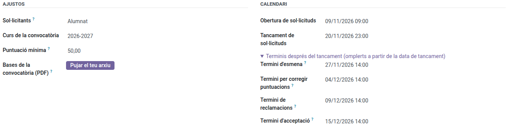
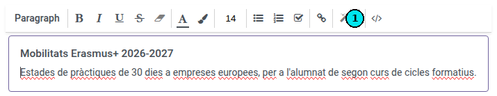

[Català](../../ca/erasmus/calls-and-applications.md) | [Castellano](calls-and-applications.md) | [English](../../en/erasmus/calls-and-applications.md)

---

# Convocatorias y solicitudes Erasmus+

Crea y publica una convocatoria Erasmus+, revisa las solicitudes que el alumnado envía desde el portal, pide subsanaciones y admite o excluye cada solicitud.

**Rol necesario:** *Coordinador/a Erasmus* o *Técnico/a de movilidad Erasmus* (Erasmus+ > Gestor/a).

---

## 1. Crear la convocatoria

Ve a **Erasmus+ > Convocatorias > Convocatorias** y haz clic en **Nuevo**:

> **Fechas y horas:** las listas y las fechas que no se pueden editar muestran solo el día. Un plazo que puedes editar conserva la hora, porque es la hora lo que decide cuándo acaba: *20/11/2026 23:59* cierra al final de ese día. También la conservan la fecha de una entrevista, el turno para elegir destino y el plazo para responder una oferta.

| Campo | Qué hay que poner |
|---|---|
| Nombre | Por ejemplo, *Prácticas Erasmus+ 2026-27* |
| Curso | El curso escolar de la convocatoria |
| Convocatoria publicada | El PDF de la convocatoria, que el alumnado puede descargar desde el portal |
| Apertura / Cierre de solicitudes | Cuándo puede solicitar el alumnado. Después de la fecha de cierre nadie puede modificar su solicitud |

La parte de arriba de la convocatoria tiene dos bloques: **Ajustes** (para quién es, el curso, la puntuación mínima y el PDF de la convocatoria) y **Calendario** (las fechas, en el orden del proceso). EMS rellena los cuatro plazos posteriores al cierre a partir de la fecha de cierre, a las 14:00, y los muestra plegados en **Plazos después del cierre**: haz clic para verlos o cambiarlos.

| Plazo | Cuándo lo pone EMS | Convocatoria 2026-27 (cierra el viernes 20/11) |
|---|---|---|
| Plazo de subsanación | 7 días después del cierre | Viernes 27/11, 14:00 |
| Plazo para corregir puntuaciones | 14 días después del cierre | Viernes 04/12, 14:00 |
| Plazo de reclamaciones | 19 días después del cierre | Miércoles 09/12, 14:00 |
| Plazo de aceptación | 25 días después del cierre | Martes 15/12, 14:00 |

Un plazo que cae en fin de semana, festivo o vacaciones escolares pasa al siguiente día lectivo. Si cambias la fecha de cierre, los plazos la siguen, salvo los que hayas cambiado a mano. Si las fechas no siguen el orden del proceso (por ejemplo, un plazo de reclamaciones anterior al cierre de solicitudes), la convocatoria te avisa arriba; te deja guardarla igualmente.

> Las respuestas a los correos que EMS envía sin que nadie del equipo los mande (acuses de recibo y recordatorios) llegan al buzón de Erasmus+ que está en **Ajustes > Gestión del EMS > Datos del centro > Erasmus+** (erasmus@elpuig.xeill.net), el mismo para todas las convocatorias. EMS escribe al alumnado a su dirección del centro (la del Puig), no a la personal (solo va allí la petición de firma electrónica, ver [Preparar las movilidades](mobility-preparation.md)): quien no la tiene no recibe ningún correo de Erasmus+, y la solicitud lo indica en su historial. La familia recibe sus copias en su dirección.

Las pestañas de la convocatoria están en dos bloques: **Selección** (modalidades, documentos, información para las personas solicitantes, comisión y resoluciones) y **Movilidad** (destinos, documentos de la movilidad, carta de compromiso, lista de pasos y autoevaluación semanal). El bloque **Movilidad** solo aparece una vez publicada la resolución definitiva: es para las personas seleccionadas, y una convocatoria nueva ya trae lo necesario, así que para abrir una convocatoria solo ves **Selección**. Los botones de arriba siguen la fase de la convocatoria, la más reciente primero: antes de la resolución definitiva, la clasificación y las entrevistas (o las valoraciones de los planes); después, las movilidades y las ofertas de plaza; las reclamaciones, a partir de la resolución provisional. Un empate por sortear se avisa arriba del todo de la convocatoria.

Pestaña **Modalidades**: una línea por cada lista de selección con plazas propias, por ejemplo *GM* y *GS*. En **Niveles** elige los niveles del alumnado que solicita en esa modalidad (por ejemplo *CFGM* para GM, y *CFGS* y los cursos de especialización para GS, porque ese alumnado va al proyecto de educación superior). Cualquier alumno cuyo grupo principal sea de uno de esos niveles puede solicitar, sea del curso que sea. Rellena también las plazas. EMS pone el proyecto a partir de los niveles (CFGM en el KA121-VET; CFGS y los cursos de especialización en el KA131-HED); el proyecto concreto de cada persona se elige en su movilidad. Los destinos reales, con sus fechas y plazas, van en la pestaña **Destinos** del bloque **Movilidad**, antes de abrir la elección de destino.

Pestaña **Documentos**: una línea por cada documento que pide la convocatoria, con su **Carácter**:

- *Obligatorio*: la solicitud no se puede enviar sin él.
- *Opcional*.
- *Obligatorio para menores de edad*: solo se pide al alumnado menor de 18 años (por ejemplo, la autorización familiar).
- *Obligatorio si se declaran menos oportunidades*: el portal lo muestra justo debajo de la casilla de menos oportunidades, solo cuando el alumno la marca, y entonces es obligatorio.

**Se entrega como**: *Ficheros* (cualquiera), *Solo PDF* (el currículum: se rechazan los demás ficheros) o *Un enlace* (el vídeo de presentación: el alumno pega el enlace de Google Drive en lugar de subirlo). Las **Instrucciones** y el **Enlace de las instrucciones** (por ejemplo, el editor de Europass) se muestran al alumno con el documento. Una convocatoria de alumnado nueva ya trae el currículum (PDF), el vídeo (enlace), los certificados de idiomas y la acreditación de menos oportunidades, con sus instrucciones. Para solicitar no se pide autorización familiar: el justificante de la solicitud de un menor también llega a la familia, y la familia acepta la carta de compromiso cuando se acepta la plaza, y con ello autoriza su participación.

Marca **Confidencial** en los documentos que solo puede ver el equipo Erasmus, como la acreditación de menos oportunidades.

**Un solo archivo** (marcado por defecto): solo cuenta el archivo más reciente que sube el alumno; los anteriores se conservan y se muestran como *Versión anterior*, y el justificante solo muestra el más reciente. Desmárcalo para un documento con varios archivos, como los certificados de idiomas (uno por idioma). **Modelo para descargar**: un archivo que el alumno (y la familia de un menor) descarga desde el portal, rellena y entrega, por ejemplo la autorización familiar.

Los documentos por defecto, la lista de comprobación y las preguntas ya aparecen en una convocatoria nueva antes de guardarla; si cambias **Solicitantes**, cambian por los de la convocatoria de personal (o de alumnado). Estos textos por defecto (documentos, pasos, preguntas, carta de compromiso) se guardan en catalán, castellano e inglés, sea quien sea quien crea la convocatoria: cada alumno, familia o docente los lee en su idioma. Las convocatorias creadas antes mantienen sus textos como estaban.

> **Atención:** cuando edites uno de estos textos, revisa también los otros idiomas con el botón de idioma del campo (por ejemplo, **CA**). Si no, quien lee en catalán o en inglés seguirá viendo el texto antiguo.

Pestaña **Información para los solicitantes**: el texto que se muestra en el portal encima del formulario. Haz clic dentro del texto y aparece la barra del editor. Para pegar una ficha informativa preparada en otro sitio (por ejemplo, con los colores y los recuadros del portal), usa el botón **`</>`** (vista de código) del final de la barra (1), pega ahí el código HTML y vuelve a pulsar el botón para volver al editor: la ficha conserva el diseño. Si la pegas directamente en el editor, lo pierde.

> **Consejo:** el año que viene, abre esta convocatoria y usa **Duplicar**: se copian las modalidades y los documentos.

## 2. Publicarla

En **Acciones**, haz clic en **Publicar**. La convocatoria aparece en el portal de todo el alumnado que puede solicitarla. Mientras no se haya enviado ninguna solicitud, todavía puedes **Volver a borrador**.

## Avisar a quien puede presentarse

Publicar no avisa a nadie. Para avisar a todas las personas que pueden presentarse, haz clic en **Acciones > Avisar a quien puede presentarse**: EMS te muestra cuántas personas lo recibirán y lo envía cuando haces clic en **Enviar el aviso**. Es la misma regla que el portal: en una convocatoria de alumnado, el alumnado de los niveles de sus modalidades; en una de personal, el profesorado de sus niveles y la dirección que valida las actividades.

- **Convocatoria de alumnado:** cada alumno recibe su propio correo, con las fechas de la convocatoria y el enlace para solicitarla, en su dirección del centro (la del Puig), nunca en la personal. Quien no tiene dirección del centro no lo recibe: el asistente te dice cuántos hay. La familia no lo recibe.
- **Convocatoria de personal:** no se envía ningún correo aparte. El aviso va en el próximo [resumen diario](../teachers/daily-summary.md) de cada persona, a la hora que ha elegido en su perfil (por defecto, al inicio de su jornada), con la fecha de cierre y dónde presentar la solicitud.

Puedes enviarlo antes de que se abra la convocatoria; si lo vuelves a enviar (por ejemplo después de añadir un nivel), todo el mundo lo vuelve a recibir: el asistente te avisa.

**Recordatorio antes del cierre:** en **Recordatorio (días antes del cierre)** (3 por defecto), EMS se lo recuerda a quien puede presentarse y aún no ha enviado la solicitud (un borrador no cuenta), tantos días antes del cierre y a partir de las 9:00, igual que el aviso. Se envía una sola vez, y solo si el aviso se ha enviado desde EMS. Pon 0 para que no haya. La convocatoria muestra cuándo se ha enviado cada uno y a cuántas personas.

## 3. Revisar las solicitudes

Ve a **Erasmus+ > Convocatorias > Solicitudes**, agrupadas por convocatoria, con la puntuación y la posición de cada solicitud cuando ya las hay (o al botón **Solicitudes** de la convocatoria, que las agrupa por modalidad). Filtros: *Por revisar*, *Subsanación requerida*, *Admitida*, *Excluida*. **Documentos por revisar** cuenta los archivos que esperan vuestra comprobación (un borrador aún no enviado no cuenta).

Abre una solicitud:

- Pestaña **Documentos**: cada documento con su **Estado** (*Por entregar*, *Pendiente de revisión*, *Hay que corregir*; en gris, los opcionales y los que no se aplican, como la autorización familiar de un adulto), sus **Archivos** (los que cuentan) y, si es un enlace, el **Enlace** mismo. Se conservan todos los archivos que ha subido el alumno: la columna opcional **Todas las versiones** muestra también los anteriores. Márcalos como **Válido** (✓) o **Hay que corregir** (✗), y escribe un **Comentario para el solicitante** cuando haya que corregirlo. Un documento sin ningún archivo no se puede marcar como válido.
- Mientras la solicitud es un borrador, el alumno puede quitar desde el portal un archivo subido por error. Una vez enviada, solo lo quitas tú, con **Quitar un archivo** y el motivo.
- Pestaña **Admisión**:
    - **Requisitos**: matriculado en un nivel de la convocatoria y ninguna práctica Erasmus+ anterior en este ciclo (para solicitar, un menor no necesita autorización familiar). EMS registra quién lo ha comprobado y cuándo.
    - **Conducta este curso**: las **amonestaciones** que el alumno tiene en EMS durante el curso de la convocatoria. Si tiene tantas como las que hacen saltar el aviso a convivencia (3, el ajuste de EMS) o más, se marca **Conducta por revisar** y la ficha lo avisa arriba. No lo excluye: oídos el equipo docente y el equipo de convivencia, puedes **excluir** la solicitud indicando el motivo (artículo 6 de la convocatoria). Si sigue adelante, cada amonestación resta puntos (criterio F).
    - **Motivo de exclusión**, si la solicitud queda excluida.
- Pestaña **Respuestas**: lo que el alumno ha respondido en el formulario.

## 4. Pedir subsanaciones

Cuando hay que corregir un documento o falta uno obligatorio, márcalo y haz clic en **Acciones > Pedir la subsanación**. La convocatoria debe tener un **Plazo de subsanación** aún por llegar: sin él, EMS no te deja pedirla. El alumno recibe un correo con la lista y ese plazo, y solo puede subir esos documentos. Cuando vuelve a enviar la solicitud, esta vuelve a *Enviada*, los archivos nuevos quedan pendientes de revisión y cada miembro del equipo Erasmus recibe una tarea para revisarla (también en su resumen diario de tareas pendientes). La tarea se cierra sola al admitirla, excluirla o pedir otra subsanación.

## 5. Admitir o excluir

- **Admitir**: los requisitos deben estar en *Cumple* y todos los documentos obligatorios en *Válido*.
- **Excluir**: primero escribe el motivo de exclusión. También funciona con una solicitud admitida, por ejemplo cuando el alumno no se presenta a la entrevista.
- **Volver a revisión** deshace cualquiera de las dos decisiones.

## 6. Cerrar la convocatoria

Cuando termine el plazo de solicitud, haz clic en **Acciones > Cerrar las solicitudes**. Las solicitudes que nunca se enviaron quedan como *No presentada*, y EMS guarda la nota media del expediente y los avisos de conducta del resto para la baremación: consulta [Baremación y entrevistas](scoring-and-interviews.md).

---

[← Volver a los manuales del equipo Erasmus+](index.md)
