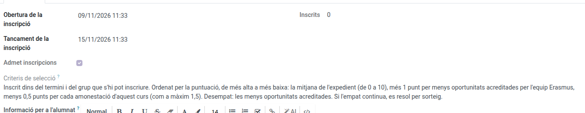
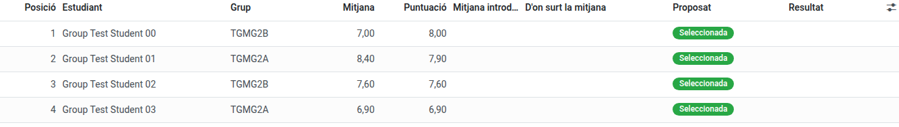

[Català](../../ca/erasmus/group-mobilities.md) | [Castellano](group-mobilities.md) | [English](../../en/erasmus/group-mobilities.md)

---

# Movilidades de grupo

Las movilidades de grupo (KA121-VET) son estancias de un grupo de alumnos de uno o varios grupos del centro, con dos docentes acompañantes, uno de los cuales es el **docente responsable**. El alumnado se inscribe desde el portal con un solo clic, EMS hace la clasificación al cerrar la inscripción, el docente responsable prepara la propuesta y la coordinación Erasmus la aprueba.

**Rol necesario:** *Coordinador/a Erasmus* o *Técnico/a de movilidad Erasmus*. Solo la coordinación aprueba la selección, las excepciones y las sustituciones.

---

## Crear una movilidad de grupo

1. Ve a **Erasmus+ > Movilidades > Movilidades de grupo** y haz clic en **Nuevo**.
2. Rellena el nombre (p. ej. *SMX2 mañana*), el **proyecto** KA121-VET, el **turno** (solo sirve para encontrar los grupos) y los **grupos que pueden inscribirse** (los grupos reales del centro, p. ej. SMX2A y SMX2B).
3. Indica las plazas de alumnado (8 por defecto), los docentes acompañantes (2), el **docente responsable** y el otro docente acompañante.
4. En la pestaña **Inscripción**, pon el periodo de inscripción, revisa los **criterios de selección** (se publican en el portal, en el idioma de cada familia: una movilidad de grupo nueva los trae, como sus documentos, en catalán, castellano e inglés) y, si hace falta, la información para el alumnado (para pegar una ficha preparada en otro sitio, usa el botón **`</>`**, como en la información para los solicitantes de la convocatoria).

   

5. El destino, la entidad de acogida y las fechas pueden quedar pendientes hasta que estén confirmados.
6. En **Acciones**, haz clic en **Abrir la inscripción**.

Los docentes no pasan por ninguna convocatoria de personal: al guardarlos, ya ven la movilidad en **Erasmus+ > Mi participación > Mis movilidades de grupo**.

## Clasificación y selección

La pestaña **Selección** empieza por la tabla del alumnado: orden, nombre, grupo, la **Media** utilizada, la **Puntuación** y el resultado propuesto y el definitivo.

 Las otras columnas (media del expediente, amonestaciones, menos oportunidades, excepción, media introducida a mano, posición de reserva...) se añaden desde el selector de columnas, en el extremo derecho de la cabecera de la tabla. Las fechas de cada paso, las notas y las listas publicadas están al final de la pestaña.

- Durante la inscripción, la pestaña **Selección** ya muestra quién se ha inscrito (solo lo ve el equipo Erasmus).
- Al acabar el periodo de inscripción (o con **Cerrar la inscripción ahora**), EMS congela los datos de cada inscripción: el grupo, la **nota media del expediente** (la misma fórmula que la convocatoria de prácticas) y las amonestaciones de este curso. Queda excluido quien no es de un grupo que puede inscribirse. Las amonestaciones no excluyen a nadie por sí solas: con incidencias graves de convivencia, la coordinación puede excluir al alumno con una **Excepción**, indicando el motivo, oídos el equipo docente y el equipo de convivencia.
- Si un alumno tiene tantas amonestaciones este curso como el número que lleva el caso al equipo de convivencia, o más, la movilidad muestra un aviso y la columna *Conducta por revisar* lo marca. Es un aviso, no una exclusión: lo decide la coordinación.
- El orden es por **puntuación**, de mayor a menor: la nota media del expediente (de 0 a 10, también una media introducida a mano), más 1 punto por menos oportunidades acreditadas por el equipo Erasmus, menos 0,5 puntos por cada amonestación de este curso (como máximo 1,5), como dice el artículo 16 de la convocatoria. Por ejemplo, una media de 7,5 con menos oportunidades acreditadas y una amonestación tiene 8,0 puntos. En caso de empate (la misma puntuación), pasa delante el alumno con menos oportunidades acreditadas. Una movilidad clasificada antes de que existiera la puntuación mantiene la clasificación por media. Si alguien ha declarado menos oportunidades, revísalo en la pestaña **Selección** (columna *Menos oportunidades acreditadas*). Si aún hay un empate, se resuelve por **sorteo**: EMS lo señala y no deja enviar la propuesta hasta que el coordinador Erasmus, en **Acciones**, hace clic en **Sortear los empates**. EMS ordena al azar solo a los alumnos empatados. Cada sorteo queda en la pestaña **Selección**, en **Sorteos**: quién lo ha hecho, cuándo, en qué estaban empatados y el orden sorteado. Nadie puede modificarlo ni eliminarlo. Si otro alumno se suma a un empate ya sorteado (por ejemplo, al introducir su media), hay que volver a sortearlo, y se conservan los dos sorteos.
- **Alumnos sin notas:** si un alumno que puede inscribirse no tiene ningún módulo evaluado, EMS no le pone un 0: queda fuera de la clasificación y la movilidad muestra un aviso rojo. No se puede enviar ni aprobar la propuesta hasta que se resuelve, en la pestaña **Selección**: marca *Media introducida a mano* y escribe la media y *De dónde sale la media* (por ejemplo, del expediente académico), o bien el coordinador excluye al alumno con una *Excepción* y su motivo.
- El docente responsable revisa la clasificación y envía la propuesta. Si pide una excepción, la coordinación recibe una tarea que queda pendiente hasta que pone la excepción o aprueba la selección. Recibirás una tarea: publicar las listas o, en **Acciones**, **Devolver la propuesta** con el motivo.
- **Lista provisional:** en la pestaña **Selección**, pon el *Plazo de reclamaciones*. Después, en **Acciones**, **Publicar la lista provisional**: cada alumno recibe su resultado provisional por correo y puede reclamar desde el portal hasta ese plazo. Cada reclamación llega con sus archivos, todo el equipo Erasmus recibe una tarea para responderla, y aparece en la pestaña **Selección** (*Reclamaciones*) y en **Erasmus+ > Convocatorias > Reclamaciones**: escribe la *Respuesta* y haz clic en **Resolver**; el alumno la recibe por correo. La lista solo muestra cuatro cifras del documento de identidad de cada alumno, con la posición, la puntuación y el resultado (seleccionado, reserva o excluido). EMS no la publica mientras algún alumno no tenga el documento de identidad registrado.
- Para hacer una excepción a la clasificación (por ejemplo, después de aceptar una reclamación), en la pestaña **Selección** pon la *Excepción* y el *Motivo de la excepción* (añade las dos columnas desde el selector de columnas) antes de aprobar. Si una reclamación muestra que una media era errónea, corrígela con *Media introducida a mano* y *De dónde sale la media*, también para un alumno que tiene notas: la puntuación usa la columna *Media aplicada*. Un alumno excluido con una excepción sale de la clasificación y su plaza pasa al siguiente. Si, en cambio, seleccionas a alguien con una excepción, tienes que pasar a otro a reserva: EMS no deja aprobar más seleccionados que plazas, y la movilidad te avisa mientras haya más.
- **Lista definitiva:** en **Acciones**, **Aprobar y publicar la selección** publica la lista definitiva, envía a cada alumno su resultado por correo y abre los expedientes. No se puede hacer hasta que la lista provisional está publicada, su plazo de reclamaciones ha terminado y todas las reclamaciones están respondidas. Las dos listas quedan en la pestaña **Selección** (*Listas publicadas*), en el portal del alumnado que se inscribió, en PDF y en la exportación de los documentos.

## Renuncias y sustituciones

Si un alumno seleccionado renuncia (desde el portal, o diciéndoselo al docente responsable o a ti, que lo registráis con el botón **Renunciar** de su inscripción en la pestaña **Selección**, con el motivo), la plaza queda libre y la movilidad muestra la siguiente reserva. El docente responsable la propone y tú la apruebas o la rechazas en la pestaña **Selección**; si la rechazas, el docente responsable recibe una tarea para volver a proponer un sustituto. Si esa reserva no quiere la plaza, regístralo de la misma manera, con **Renunciar** en su inscripción: sale de la lista de reserva y la movilidad muestra la siguiente. La clasificación fijada no cambia y los documentos ya entregados se conservan.

## Expedientes y documentos

Al aprobar la selección se abre el expediente de cada alumno seleccionado y de los dos docentes. En la pestaña **Documentos** están los **documentos compartidos** del grupo (el acuerdo de aprendizaje del grupo, previsto y ejecutado; acuerdos, viaje, la póliza de seguro colectiva, inclusión —confidencial—, Green Travel y evidencias) y la lista de **documentos pedidos**, que puedes adaptar a cada movilidad: para quién es cada documento (el grupo, cada alumno, cada docente o todos), si es obligatorio o solo para menores, quién lo firma y el plazo. Cuando guardas un cambio en la lista, los documentos añadidos llegan a todos los expedientes, y el que quitas desaparece de los expedientes donde nadie lo ha entregado; uno que alguien ya ha entregado no se puede quitar (ponlo como *Opcional*).

Un documento completo ofrece **Reabrir** en lugar de **Hay que corregir**: hace lo mismo, lo devuelve para que se corrija.

Cada documento tiene una **categoría del expediente** (01 Datos y autorizaciones, 02 Antes de la movilidad, 03 Durante la movilidad, 04 Después de la movilidad), igual que en las movilidades individuales, y un **estado**: falta, pendiente de revisión, hay que corregir, completo, opcional o no aplicable. Un documento que alguien tiene que firmar (por ejemplo el acuerdo de aprendizaje del grupo, que firman la coordinación y la entidad de acogida) **no queda completo solo por haberlo subido**, aunque lo suba el equipo: hay que revisar sus firmas y marcarlo como **Válido**. Los documentos que proporciona el equipo y que no firma nadie (por ejemplo la póliza de seguro) quedan completos al subirlos.

Todos los documentos Erasmus+ se preparan fuera de EMS: EMS guarda sus ficheros, las firmas, la revisión y el expediente. Un documento con **plantilla de firma** se puede enviar a firmar electrónicamente desde EMS, como en las movilidades individuales (ver [Preparar las movilidades](mobility-preparation.md)). Por defecto, una movilidad de grupo pide:

- **Acuerdo de aprendizaje del grupo**, en dos versiones firmadas por los dos centros (la coordinación y la entidad de acogida). La **prevista**, antes de salir: objetivos, resultados de aprendizaje, calendario, actividades y participantes. La **ejecutada**, después de la estancia: las fechas reales, las actividades realizadas, las metodologías y la lista definitiva de participantes (alumnos y docentes acompañantes de todos los centros). Si no ha cambiado nada, ratifica la prevista con las fechas y los participantes reales. No hay acuerdo de aprendizaje individual ni una lista de participantes aparte.
- **Póliza de seguro** de cada alumno y de cada docente acompañante. Si una **póliza colectiva** cubre a todos los participantes o a una parte, súbela a la *Póliza de seguro colectiva* del grupo y marca *Cubierto por la póliza colectiva* en cada participante que cubra (ficha del participante): ya no se le pide la suya.
- **Convenio de subvención** de cada participante: el equipo lo prepara fuera de EMS (con los servicios que paga el centro, si los hay) y lo sube para que lo firmen. Para subirlos todos desde una sola pantalla, usa el botón **Documentos pendientes** de la movilidad: los documentos de todos los participantes en una lista, agrupados por documento.
- **Green Travel: declaración jurada y evidencias**, opcional: solo cuando se declara Green Travel.
- **Documentación de inclusión del grupo**, opcional y confidencial: la acreditación de las menos oportunidades y, cuando hay costes reales de inclusión, por qué hacía falta la ayuda. Sus facturas van en la pestaña **Gastos colectivos**.
- **Documento de movilidad Europass** (alumnos) y **Certificado de estancia** (docentes): opcionales, nunca impiden cerrar la movilidad.
- Los **derechos de imagen** no se vuelven a pedir: la columna *Derechos de imagen* de la pestaña **Participantes** (selector de columnas) muestra la autorización del curso de cada alumno, la misma que ya usa EMS. La **tarjeta sanitaria europea** es confidencial, como en las convocatorias: solo la ve el equipo Erasmus. Los ficheros de un documento válido o de una movilidad cerrada no se pueden eliminar (se sube una versión nueva), y cada revisión queda escrita en el chat de la movilidad.

La pestaña **Participantes** muestra el rol, el nombre, el grupo, si es menor de edad, los **Docs. pendientes**, si está **Listo** para salir y el estado de cada persona; quien se ha retirado aparece en gris, sin nada en rojo. El correo, el teléfono, los derechos de imagen, el seguro colectivo y las cartas de compromiso están en el selector de columnas.

## Carta de compromiso

Cada alumno seleccionado acepta la **carta de compromiso** de la movilidad en el portal y, si es menor de edad, también la familia, desde su portal (EMS avisa a la familia por correo cuando se abre el expediente). Es el mismo procedimiento que en las prácticas: la persona marca que la acepta y EMS guarda quién la ha aceptado, cuándo y desde dónde, junto con el texto exacto aceptado. La carta es común a todas las movilidades de grupo y EMS la rellena con los datos de cada una (destino, entidad de acogida y fechas cuando están confirmadas; mientras tanto indica que están por confirmar). Incluye la autorización para participar, la participación en el programa, las normas de convivencia del centro y las instrucciones de los docentes, las medidas ante incumplimientos graves según las normas y protocolos del centro, y la comunicación con el centro.

Para añadir condiciones propias, escríbelas en *Condiciones adicionales* (pestaña **Participantes**). Una carta ya aceptada conserva el texto con el que se aceptó. Si después cambian el destino, la entidad de acogida, las fechas, los viajes, los docentes o las condiciones adicionales, la aceptación anterior se guarda tal como era (en el expediente del participante, en *Versiones anteriores*) y el alumno y, si es menor, la familia tienen que aceptar la carta nueva; la familia recibe un correo. Una carta aceptada mientras el destino o las fechas aún están por confirmar es **provisional** y no permite marchar. La movilidad muestra cuántas cartas quedan pendientes, y un participante no está preparado para marchar hasta que se acepta la suya. La carta **no sustituye** la autorización oficial de viaje al extranjero para menores: esta sigue siendo un documento del expediente de cada menor.

## Exportar los documentos

En **Acciones**, **Exportar los documentos** descarga un ZIP con los documentos comunes del grupo una sola vez (carpeta *00_Documentacio_comuna*: documentos compartidos, la clasificación y los sorteos, el seguimiento y la EU Survey) y el expediente de cada participante en las cuatro categorías, con un índice de lo que falta y las huellas SHA-256 de cada fichero. El expediente de cada participante remite a los documentos compartidos, sin copiarlos. Los datos confidenciales (tarjeta sanitaria, inclusión, menos oportunidades y amonestaciones) solo aparecen en una **exportación de auditoría**, que solo puede pedir la coordinación Erasmus indicando el motivo. La exportación del proyecto también incluye todas las movilidades de grupo.

## Hoja de cálculo de participantes

En **Acciones**, **Exportar los participantes (Excel)** descarga a los alumnos seleccionados y a los docentes acompañantes con la misma hoja de cálculo que las convocatorias (las mismas columnas). Los docentes tienen vacías las columnas de ciclo, curso y tutor legal; las columnas bancarias están vacías para todos: la cuenta que cada participante indica para el dinero de bolsillo está en los pagos de becas.

## Estancia, EU Survey y cierre

Mientras la movilidad está en preparación, un aviso dice lo que conviene revisar antes de hacer clic en **Empieza la estancia**: si todavía no hay entidad de acogida o si la fecha de inicio prevista aún no ha llegado. Es un aviso: la estancia se puede empezar igualmente.

Antes de marchar, la movilidad muestra quién todavía no está listo (falta un documento obligatorio o la carta de compromiso), y **Empieza la estancia** pide confirmación. El docente responsable indica cuándo empieza la estancia y cuándo vuelven. Entonces EMS crea la tarea de la **EU Survey** para el docente responsable (o la persona indicada) con el plazo. Cuando dice que está respondida, la validas. Los gastos del grupo (vuelos, alojamiento...) se registran como facturas en la pestaña **Gastos colectivos** (consulta *Becas y dinero de bolsillo* más abajo). Al volver, el docente responsable también recibe la tarea de decir si **el programa se ha realizado según lo previsto** (pestaña **Regreso y cierre**): sí, o no y qué ha cambiado. Sin esa respuesta no se puede proponer ni hacer el cierre. Cuando el docente responsable propone el cierre, todos los documentos obligatorios son válidos (entre ellos, el acuerdo de aprendizaje del grupo ejecutado) y el dinero de bolsillo de cada participante y todas las facturas colectivas están pagados, haz clic en **Cerrar la movilidad**.

## Becas y dinero de bolsillo

Si a algún participante le falta el importe de la beca, un aviso arriba de la ficha dice sus nombres. Cuando el centro paga el viaje y el alojamiento, **Solicitar el dinero de bolsillo** pregunta antes si ya están todas las facturas del grupo, porque el dinero de bolsillo es la beca menos la parte de facturas de cada uno; si a alguien le sale negativo (su parte supera la beca), un aviso rojo dice su nombre.

En la pestaña **Gastos colectivos** introduces la **beca** de cada participante (alumnos y docentes acompañantes), tal como la calcula el Beneficiary Module. El centro suele pagar los vuelos y el alojamiento de todo el grupo: regístralos como **facturas colectivas**. EMS reparte cada factura colectiva **a partes iguales entre los participantes que van** y muestra, para cada uno, su parte y su **dinero de bolsillo**: su beca menos su parte. Es lo que la Secretaría les transfiere. Una factura es o bien del grupo o bien de unos participantes concretos, nunca de ambos, porque contaría dos veces: EMS no te deja guardarla si rellenas las dos cosas.

*Ejemplo:* 8 alumnos con una beca de 1.200 € y 2 docentes con 1.500 €. Los vuelos cuestan 2.000 € y el hotel 5.000 €: 700 € por persona. Cada alumno recibe 500 € y cada docente 800 €.

- **Dinero de bolsillo antes de salir (%)**: 100 por defecto, un solo pago. Con un porcentaje menor, esa parte se paga antes de salir y el resto a la vuelta.
- **Quién paga el viaje y el alojamiento**: *El centro* o *Cada participante*. Elige *Cada participante* cuando el centro no paga ni vuelos ni hotel; cada participante recibe entonces toda su beca. Un grupo así no puede tener facturas colectivas (EMS lo impide, y no se puede elegir mientras el grupo tenga alguna). Las fechas aparecen en una sola línea: las previstas hasta que pongáis las **Fechas de la estancia** definitivas, y el **Viaje** solo cuando es distinto de la estancia.
- Una vez aprobada la selección, en **Acciones**, **Solicitar el dinero de bolsillo** crea un pago para cada participante que tenga algo que recibir. La Secretaría recibe **una sola tarea para todo el grupo** y los paga desde **Gestión económica > Pagos de becas**, todos a la vez con un solo justificante. Con un porcentaje inferior a 100, a la vuelta usa **Solicitar el resto del dinero de bolsillo** para el resto.
- Cada participante necesita una **cuenta bancaria**: los alumnos la indican en el portal (si no lo hacen, se usa la de su matrícula), los docentes con **Mi cuenta bancaria** en la movilidad de grupo, y también puedes escribirla en su ficha. Si alguien no tiene ninguna, EMS lo nombra y no solicita nada.
- Si un participante se da de baja después de haber cobrado, la economía del proyecto muestra un aviso: registra lo que devuelve en *Devuelto por el participante* del grupo. También sale un aviso si las facturas colectivas superan la beca de alguien.

El docente responsable también ve esta pestaña (las facturas, las becas, el dinero de bolsillo y si está pagado), pero nunca las cuentas bancarias.

La vista kanban y la lista de **Movilidades de grupo** muestran el estado de todas: inscritos, seleccionados, documentos que faltan o por revisar, empates y tareas atrasadas.
