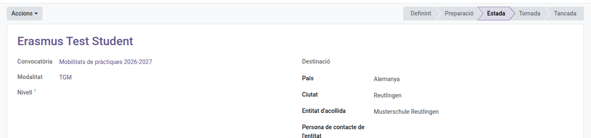
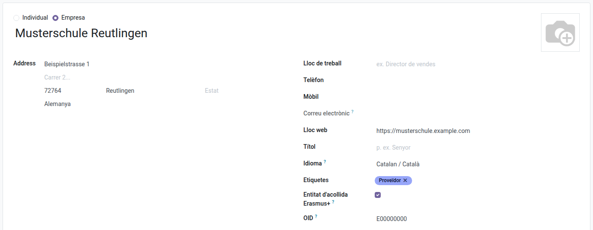

[Català](../../ca/erasmus/mobility-preparation.md) | [Castellano](mobility-preparation.md) | [English](../../en/erasmus/mobility-preparation.md)

---

# Preparar las movilidades Erasmus+

Una vez aceptada una plaza, la movilidad se prepara en EMS: el destino, la entidad de acogida y las fechas, los documentos que hay que entregar antes de salir y a la vuelta, y los pasos que hay que seguir.

> **Dónde lo hacen los participantes:** el alumnado y las familias, en el portal; el personal, en EMS, en **Erasmus+ > Mi participación > Mis movilidades** (véase [Solicitar una movilidad Erasmus+ de personal](../teachers/erasmus-staff-call.md)). Donde este manual dice "en el portal", para el personal quiere decir "en EMS".

**Rol necesario:** *Coordinador/a Erasmus* o *Técnico/a de movilidad Erasmus* (Erasmus+ > Gestor/a). El jefe de estudios y la directora o el director pueden consultar las movilidades; la dirección (la directora o el director, o el jefe de estudios de FP, indicados en la convocatoria) valida las actividades del personal (véase [Validar las actividades del personal Erasmus+](../head_of_studies/erasmus-staff-validation.md)).

> **Las fases de la movilidad** aparecen en la barra de arriba de la ficha y en la lista: *Definiendo* (todavía sin destino), *Preparación*, *Estancia* (desde el día de inicio), *Regreso* (desde el día siguiente al día final) y *Cerrada*. La estancia y el regreso cambian solos según las fechas. La vista de tarjetas de **Movilidades** tiene una columna por fase.

---

## 1. Antes de empezar: los proyectos y la convocatoria

En **Erasmus+ > Gestión económica > Proyectos**, mantened los proyectos Erasmus+ activos del centro: el número de convenio, el tipo (**KA121-VET** para CFGM, **KA131-HED** para CFGS) y el **Nombre corto** (por ejemplo, *2026-VET*). EMS saca el nombre corto del número de convenio (el año y VET o HED) y podéis cambiarlo: es lo que muestran las listas y los desplegables, y podéis buscar por cualquiera de los dos. Puede haber varios del mismo tipo activos a la vez (uno por año de convocatoria); archivad un proyecto cuando termine (**Acciones > Archivar**, en la lista o en el proyecto). La pestaña **Movilidades** tiene dos tablas, **Movilidades individuales** y **Movilidades de grupo**, y cada una solo aparece si tiene alguna. La pestaña **Documentación** es para los convenios, los informes y la difusión del proyecto (los documentos de cada participante ya están en su expediente) y muestra con una barra cuántos expedientes de participantes están completos. Debajo de la tabla, **Conservación** dice hasta cuándo hay que guardar los documentos y si una auditoría pendiente obliga a guardarlos más. La pestaña **Exportaciones** registra cada descarga de los documentos del proyecto: cuándo, quién, qué (con el nombre del participante o del grupo), si era una exportación para auditoría con los documentos confidenciales y cuántos ficheros tenía.

En la convocatoria, revisad estas pestañas:

- **Documentos de la movilidad:** lo que entregan los participantes **antes de salir** y **a la vuelta**. EMS ya tiene el documento de identidad, la cuenta bancaria, los datos personales y el contacto de emergencia, y no se piden. Una convocatoria nueva ya trae los habituales: para el alumnado, la tarjeta sanitaria europea (en cuanto la tengan), el certificado del OLS con el nivel de inglés, la documentación de inclusión si procede (opcional y confidencial), para los menores la autorización de salida al extranjero tramitada con los Mossos d'Esquadra, el convenio de subvención, el acuerdo de aprendizaje, el convenio (REF5) y el plan de actividades (REF6) del sBID (los subís desde el sBID; obligatorios solo en formación en empresa curricular: la movilidad de cada alumno tiene un **Tipo de estancia**, formación en empresa curricular en el sBID por defecto, extracurricular o titulado reciente), la póliza de seguro y el **componente virtual** (solo en estancias KA131-HED de 30 días o menos: un PDF que el alumno sube, desde un mes antes de marchar hasta el día antes, con su preparación, como información sobre la ciudad, cómo irá a la empresa y los precios del transporte, y ejercicios sobre las tecnologías y las tareas que os indique la empresa de acogida; en una estancia más larga no lo ve en el portal); a la vuelta, el certificado de estancia (lo subís para que lo firme el tutor en la empresa de acogida, con las fechas, las tareas realizadas y el número del proyecto, y el alumno lo sube firmado), el documento de movilidad Europass (solo KA121-VET: lo emitís después de la movilidad, con los resultados de aprendizaje y las fechas reales, y el coordinador Erasmus lo firma en representación del centro cuando está autorizado, tal como permite el modelo Europass) y el reconocimiento de los créditos ECTS (solo KA131-HED, lo subís vosotros; obligatorio solo en formación en empresa curricular); para el personal, la tarjeta sanitaria, el convenio de subvención, la póliza de seguro, el acuerdo de aprendizaje (KA121-VET) o el acuerdo de movilidad (KA131-HED), a la vuelta el documento de movilidad Europass (KA121-VET, con el certificado de estancia o de asistencia como documento opcional para cuando haga falta acreditar las fechas o la actividad) o el certificado de estancia o de asistencia (KA131-HED) y la memoria con evidencias. Para cada uno, indicad si es obligatorio (siempre, opcional, solo para menores, solo en formación en empresa curricular o solo en movilidades cortas combinadas), si es solo para algunas modalidades o para un proyecto (**Solo para el proyecto**: KA121-VET o KA131-HED), **quién lo firma** (participante, tutor legal solo para menores, dirección, coordinación Erasmus, tutor del centro que consta en el sBID, entidad de acogida: por defecto, la dirección firma el convenio de subvención y el convenio del sBID; la coordinación Erasmus, el acuerdo de aprendizaje y el documento Europass; y la familia de un menor, también el convenio de subvención y el acuerdo de aprendizaje), el plazo (**Plazo**: después de fijar el destino, antes de salir o después de volver, y **Días**), desde cuándo lo puede subir el participante (**Se abre (días antes de salir)**: vacío, en cuanto tiene destino; el componente virtual se abre un mes antes de salir) y **Quién se encarga**: *lo sube el participante*; *lo rellena el equipo y lo firma el participante* (el convenio de subvención y el acuerdo de aprendizaje: los subís rellenados, el participante los descarga, los firma y los sube, y no se le piden antes); o *lo aporta el equipo* (la póliza de seguro: la subís vosotros y el participante solo la descarga). Por defecto, los documentos de viaje y el certificado del OLS se entregan dentro del mes siguiente a fijar el destino; los convenios, como máximo un mes antes de salir (idealmente tres); la póliza, un mes antes de salir; y los de vuelta, dentro del mes siguiente a volver. Se firman fuera de EMS y se suben firmados, salvo que les asignéis una **plantilla de firma**: entonces se firman electrónicamente en EMS (ver *Firma electrónica* más abajo). Un documento que alguien firma no queda completo hasta que lo marcáis como **Válido** después de comprobar sus firmas, también los que subís vosotros (el sBID o el documento Europass); los que aportáis y no firma nadie (la póliza) quedan completos al subirlos.
  La lista muestra cinco columnas (*Cuándo*, el nombre, *Carácter*, *Plazo* y *Quién se encarga*): haz clic en una línea para ver el resto, firmas incluidas. Una convocatoria del personal no ofrece la firma del tutor legal ni la del tutor del centro.
- **Carta de compromiso** (alumnado): el texto del anexo 3, que una convocatoria nueva ya trae. Cada alumno seleccionado lo lee en el portal, marca que lo acepta y hace clic en **Aceptar y firmar**: EMS guarda el texto aceptado, quién lo ha firmado, cuándo y desde qué dirección IP. Si el alumno es menor, también la firma su familia, desde su propio acceso al portal (Erasmus+): EMS se lo envía por correo cuando se fija el destino y cada semana hasta que la firma. Dejadlo en blanco si la convocatoria no pide ninguna.
- **Autoevaluación semanal:** las preguntas que los participantes responden en el portal cada semana de la estancia (qué han hecho, qué han aprendido, una valoración de la semana del 1 al 5, qué les ha costado más). Una convocatoria de alumnado nueva ya tiene cuatro; podéis cambiarlas, añadir o quitar (cada una es un texto o una valoración del 1 al 5). Dejadla vacía si no queréis autoevaluación (una convocatoria de personal no tiene por defecto).
- **Lista de pasos:** los pasos que no son un documento (sesiones de preparación, difusión). La EU Survey no es un paso: cada movilidad tiene su propio estado de **EU Survey** (ved el punto 6). Podéis limitar un paso a algunas modalidades o a un proyecto, y poner su **Carácter** en *Solo movilidades cortas combinadas*: entonces solo cuenta en una estancia KA131-HED de 30 días o menos. La movilidad lo muestra como **Movilidad corta combinada** cuando ya tiene fechas. Un paso *Opcional* aparece en la lista (en el portal, con «(opcional)») pero nunca frena la movilidad: una convocatoria de personal trae *Compartirlo en una reunión de departamento o de ciclos* como opcional, porque las bases lo dejan al criterio de cada persona (art. 15).

**Solo en la convocatoria de alumnado**, en la pestaña **Destinos**: añadid cada destino con su **modalidad**, un nombre, el país, la ciudad, las **plazas**, los **niveles** para los que es adecuado (en blanco: todos los niveles de la modalidad), las fechas si ya se saben y notas para el alumnado. Añadidlos antes de publicar la resolución definitiva: la oferta de plaza (en el portal y en su correo) muestra los destinos de la modalidad con sus plazas, para que cada alumno sepa qué le puede tocar antes de aceptar. Las plazas de los destinos de una modalidad deben sumar las plazas de la modalidad: EMS no lo comprueba.

## 2. La elección de destino (alumnado)

Cuando se ha publicado la resolución definitiva y los destinos están listos, haced clic en **Acciones > Abrir la elección de destino** en la convocatoria.

- Una modalidad con **un solo destino**: se asigna directamente a todo el alumnado que ha aceptado la plaza.
- Una modalidad con **varios destinos**: el alumnado elige en el portal **por turnos, por orden de puntuación**. Cuando le llega el turno recibe un correo y tiene las **Horas por turno de elección** (72 por defecto) para elegir entre los destinos con plazas libres adecuados a su nivel. Cuando elige, el turno pasa a la persona siguiente.
- Quien no responde dentro de su turno **pierde el turno, no la plaza**: el turno pasa a la persona siguiente, y elige entre los destinos que quedan cuando todas las demás han elegido (entonces recibe otro correo).
- Quien ve que ningún destino le va bien, o que no está disponible para sus fechas, tiene que hablarlo con el equipo Erasmus para buscar una alternativa: un destino que encuentre por su cuenta, o uno a través de una entidad intermediaria con la que trabaja el centro. Cuando se haya acordado, haced clic en **Acciones > Fijar el destino acordado** en su movilidad: una ventana os pide el país (obligatorio), la ciudad, la entidad de acogida y las fechas que tengáis, y al confirmar el alumno recibe un correo. Solo para el alumnado: el personal propone su actividad y la dirección la valida.

Un alumno que acepta una plaza más tarde entra en la cola según su posición.

## 3. Destinos propios (alumnado)

Una persona seleccionada puede proponer su propio destino en el portal, con el compromiso por escrito de la entidad de acogida. Mientras espera la validación, no recibe turno.

1. Id a **Erasmus+ > Movilidades > Movilidades individuales** y usad el filtro **Propuesta por validar**. También recibís una tarea pendiente.
2. Abrid la movilidad y revisad la pestaña **Propuesta**: entidad de acogida, contacto, país, ciudad, fechas y el compromiso.
3. Haced clic en **Acciones > Validar la propuesta**. Para rechazarla, escribid antes el **Comentario de la decisión** y haced clic en **Acciones > Rechazar la propuesta**: el alumno lo recibe por correo y vuelve a elegir entre los destinos del centro.

## 4. Preparar cada movilidad

La lista de **Erasmus+ > Movilidades > Movilidades individuales** muestra cómo va el **Expediente** de cada participante (documentos completos sobre los obligatorios) y si está **Listo** para salir y de **Vuelta**; el estado de la propuesta, el orden o la beca se pueden añadir desde el selector de columnas. Los filtros **Alumnado** y **Personal** las separan, y **Agrupar por > Convocatoria** las agrupa por convocatoria. La vista de tarjetas (botón de arriba a la derecha) las muestra en una columna por fase, con el destino y el expediente.

Abrid la movilidad desde esa lista (o desde el botón **Movilidades** de la convocatoria). La ruta de arriba solo dice el nombre del participante, y el botón **Solicitud** abre su solicitud (con la posición que obtuvo). Mientras se define el destino o la actividad, los campos aún vacíos (país, entidad, fechas) no aparecen: la propuesta está en su pestaña. En la pestaña **Expediente**, una barra dice cuántos documentos obligatorios están completos (*Documentos completos*, por ejemplo 1 / 12, la misma cifra que ve el participante en el portal) y **Fuera de plazo** aparece en rojo solo si alguno ha pasado la fecha límite; la EU Survey aparece cuando acaba la estancia. La pestaña **Carta de compromiso** dice en una línea si está firmada (*Firmada el 03/11/2026 por …* o *Pendiente de firmar en el portal*), para el participante y, si es menor, para la familia; el texto firmado y los detalles de la firma (día y dirección IP) quedan debajo. El personal no tiene pestaña de autoevaluación. En la movilidad:

Arriba de la ficha, un recuadro azul dice en qué paso está la movilidad y quién tiene que hacerlo: por ejemplo *Esperando a que se abra la elección de destino*, *Turno de elegir el destino hasta el 12/11/2026 18:00*, *Pendiente de que la dirección valide la actividad propuesta* o *Pendiente: faltan 3 documentos del participante, 1 documentos por revisar.* Si la movilidad ya tiene destino y todavía no tiene el importe de la beca, un aviso amarillo os recuerda que hay que copiarlo del Beneficiary Module: EMS no la calcula.

- Rellenad la **Entidad de acogida** (un contacto de empresa, que se mantiene para los cursos siguientes) y su **Persona de contacto de la entidad**, corregid el lugar y las **fechas** si hace falta, y elegid el **Proyecto** al que va la movilidad: EMS solo ofrece los proyectos del tipo de la modalidad (CFGM a KA121-VET, CFGS a KA131-HED); para el personal, los de las plazas por proyecto de la convocatoria (ved [Convocatoria del personal](staff-call.md)). La dirección, el país, la web y el **OID** (el código de organización Erasmus+ que piden los convenios) de una entidad de acogida están en su ficha, en **Configuración > Entidades de acogida**. Esa lista muestra el país, la ciudad y el OID de cada entidad y cuántas movilidades ha acogido; en la ficha, los botones **Movilidades** y **Movilidades de grupo** abren las que ha acogido, para decidir si se repite.

  
- Pestaña **Documentos**: en **Ficheros del equipo**, adjuntad el documento rellenado para que el participante lo firme, o el que aportáis vosotros (la póliza de seguro). El participante lo descarga en el portal; esa columna solo aparece en los documentos que entrega el equipo. Los demás los sube el participante en el portal; para adjuntar uno que os haya enviado, añadid la columna **Todas las versiones** desde el selector de columnas. Cada uno muestra su **Fecha límite**. Marcad cada uno como **Válido** o **Hay que corregir** (con un comentario que el participante ve; solo cuando ya tiene un archivo). La lista muestra pocas columnas (las otras, como la categoría o quién firma, se pueden añadir desde el selector de columnas): **Quién** se encarga del documento (*Participante*, *Equipo y participante*, *Equipo Erasmus*), los **Archivos** que cuentan y el **Estado**: solo aparece en rojo lo que el participante tiene que hacer ahora (*Por entregar*, *Hay que corregir*); un documento que tenéis que subir vosotros primero dice *Pendiente del equipo*, y uno que todavía no toca (sin destino, se abre más adelante o es de vuelta antes del final de la estancia) dice *Todavía no*. **Firmas** cuenta las firmas marcadas sobre las necesarias. Un fichero nuevo lo devuelve a revisión; los ficheros anteriores se conservan. En un documento que alguien firma, haced clic en **Firmas** y marcad cada firma que veáis en la copia subida (participante, director, entidad de acogida...): EMS guarda quién la marcó y cuándo, y el participante lo ve en el portal. El documento solo se puede marcar como **Válido** cuando todas las firmas están marcadas (la del tutor legal, solo para un menor). Para quitar un archivo subido por error de un documento que aún no es válido, haced clic en **Quitar un archivo**, elegidlo y escribid el motivo: el archivo no se elimina, queda en el historial de la movilidad con el motivo, vuestro nombre y la fecha. **Lista para salir** se marca cuando todos los documentos obligatorios de antes de salir son válidos (o, si los aporta el equipo, subidos), se han hecho todos los pasos de antes de salir y la carta de compromiso está firmada (pestaña **Carta de compromiso**). Mientras falte algo, EMS se lo recuerda al participante por correo cada semana.
- Pestaña **Lista de pasos**: marcad cada paso cuando se haya hecho. EMS registra quién lo ha marcado y cuándo.
- **Personal:** la persona completa la propuesta con las fechas exactas y la declaración responsable, y la dirección la valida. Entonces EMS solicita sola su **ausencia por formación** para esos días, y quien aprueba sus ausencias la aprueba como siempre. Si las fechas cambian antes de que se apruebe, la ausencia las sigue; si ya estaba aprobada, EMS os avisa en la movilidad para que la corrijáis a mano.
- **Personal, un cambio después de validarla:** hasta que empiece la movilidad, la persona puede proponer desde su movilidad en EMS otro curso, otra entidad u otras fechas; también puedes cambiarlos en la pestaña **Propuesta** y hacer clic en **Acciones > Pedir a la dirección que la vuelva a validar**. La dirección la vuelve a validar y, mientras tanto, la movilidad mantiene las fechas validadas. El profesorado nunca ve la modalidad ni las plazas: son la planificación del equipo.
- **Acciones > Avisar de los documentos pendientes** envía al participante un correo con los documentos que faltan o que hay que corregir.
- Para el personal, si los documentos dependen de la modalidad, asignad la modalidad en la solicitud (los documentos se añaden solos). Haced clic en **Acciones > Actualizar documentos y pasos** después de añadir documentos o pasos a la convocatoria.

### Firma electrónica

El convenio de subvención, el acuerdo de aprendizaje o de movilidad, el certificado de estancia, el documento de movilidad Europass y el informe con evidencias se pueden firmar en EMS en lugar de en papel. Cada firmante firma desde un enlace que recibe por correo electrónico, **sin cuenta en EMS**: también la entidad de acogida. La carta de compromiso mantiene su aceptación en el portal, y los documentos del sBID se firman en el sBID.

**Una vez por documento (en la convocatoria):**

1. En **Firma > Plantillas**, cread una plantilla y subid el modelo del SEPIE (anexo 6) del documento. Usad una copia ya rellenada: las copias que rellenáis para cada participante tienen las mismas páginas, y las firmas quedan en el mismo sitio.
2. Abrid **Configurar** y colocad una casilla de firma para cada firmante, eligiendo su rol: *Erasmus+ participante*, *Erasmus+ tutor legal*, *Erasmus+ director*, *Erasmus+ coordinador*, *Entidad de acogida Erasmus+*.
3. En la convocatoria, pestaña **Documentos de movilidad**, abrid la línea del documento y elegid esa plantilla en **Plantilla de firma**.

**Para cada movilidad:**

1. Rellenad el documento fuera de EMS como siempre, guardadlo en **PDF** y adjuntadlo en **Ficheros del equipo** (para un documento que sube el participante, como el informe, se usa su fichero).
2. Haced clic en **Enviar a firmar** en la línea del documento. EMS prepara la solicitud con el participante, la familia de un menor (el primer contacto familiar con correo electrónico: lo podéis cambiar), el director, el coordinador Erasmus y la persona de contacto de la entidad de acogida, según lo que pida cada documento. Si falta algo (por ejemplo, el correo electrónico del contacto de acogida), EMS os dice qué antes de continuar.
3. Comprobad que las casillas están en su sitio (**Configurar**) y haced clic en **Enviar**. Todos los firmantes reciben el correo a la vez; el participante también ve **Fírmalo aquí** en el portal. Este es el único correo de Erasmus+ que el alumnado recibe en su dirección personal: el módulo de firma siempre escribe a la dirección principal del contacto.
4. Cada firma se marca sola en **Firmas** (y no se puede desmarcar). Cuando firma la última persona, el PDF firmado se añade a los ficheros del documento: revisadlo y marcadlo como **Válido**.

Si volvéis a hacer clic en **Enviar a firmar** mientras la solicitud sigue abierta, EMS abre la misma. Si la canceláis, podéis preparar una nueva.

## 5. Durante la estancia: la autoevaluación semanal

Desde el primer día de la estancia, cada semana el participante responde en el portal las preguntas de la convocatoria, para cada semana ya empezada. Una semana terminada y sin respuesta entra en el correo de recordatorio semanal. En la movilidad, la pestaña **Autoevaluación** muestra cuántas semanas están respondidas (por ejemplo, *2 / 4*) y las respuestas y la valoración de cada semana; para que el participante vuelva a responder una semana, borradla allí. Imprimidlas todas con **Imprimir > Autoevaluación semanal**, y las exportaciones añaden ese PDF al expediente del participante (categoría 03, durante la movilidad).

## 6. Vuelta y cierre

Cuando termina la estancia, el participante ve en el portal que tiene que responder la **EU Survey** (por defecto en 30 días, **Plazo de la EU Survey**) y hace clic en **Ya la he respondido**. Recibís una tarea: comprobadlo y haced clic en **Acciones > Validar la EU Survey** (si el participante os lo dice de otra forma, **Acciones > EU Survey respondida**).

Una vez acabada la estancia (fase *Regreso*), haced clic en **Acciones > Cerrar la movilidad** cuando todo esté hecho: todos los documentos y pasos obligatorios de antes de salir y de vuelta, la movilidad en su **Proyecto**, la EU Survey validada y nada por pagar: todos los pagos solicitados y transferidos, también el final, y todas las facturas del participante pagadas. Cerrar también quita el acceso al portal a un graduado, por eso hay que esperar al último pago.

Para cancelar una movilidad (por ejemplo, no se han entregado a tiempo los documentos de viaje), haced clic en **Acciones > Cancelar la movilidad**: una ventana os pide el motivo. Una vez cancelada, el motivo aparece arriba de la ficha. La solicitud queda como renuncia y la plaza queda libre. Se puede cancelar hasta que acaba la estancia. El participante también puede renunciar desde el portal, pero solo hasta que empieza la estancia.

> **Personas tituladas:** un alumno que se titula y hace la movilidad en verano mantiene el acceso al portal después del cambio de curso, hasta que la movilidad se cierra o se cancela. Entonces EMS le quita el acceso, tal como habría hecho el cambio de curso.

> **Lo que es evidencia no se elimina nunca.** Una movilidad, una solicitud o un documento que ya tiene un archivo, una firma, un pago o una autoevaluación no se puede eliminar, y el archivo de un documento válido no se puede eliminar ni sustituir: cancele la movilidad o suba una versión nueva. Un documento de proyecto con archivos tampoco se puede eliminar. Una movilidad archivada sigue dentro de la exportación del proyecto, marcada como *Archivado*. Una movilidad cancelada o un participante retirado también entra, en la carpeta *99_Cancellades_i_retirades*, cuando tiene un pago hecho o un documento validado o firmado (un documento válido, una firma marcada, la carta de compromiso aceptada); si no, el índice y el manifiesto de la exportación solo lo enumeran. Si la secretaría deshace una transferencia, escribe el motivo, y el historial del pago lo conserva con quién la deshizo, cuándo se había pagado y los justificantes. Cuando termina el plazo de conservación de un proyecto (**Conservar los documentos hasta**) y no está retenido por una auditoría, EMS da una tarea a la coordinación Erasmus, una sola vez: EMS no elimina nada, vosotros decidís qué se conserva. Solo se puede solicitar un pago mientras la movilidad está en preparación o cerrada.

---

[← Volver a los manuales de Erasmus+](index.md)
