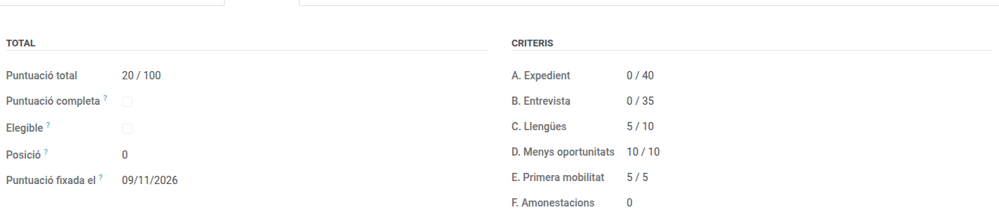
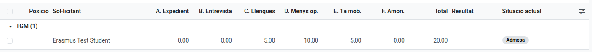

[Català](../../ca/erasmus/scoring-and-interviews.md) | [Castellano](scoring-and-interviews.md) | [English](../../en/erasmus/scoring-and-interviews.md)

---

# Baremación y entrevistas Erasmus+

Puntúa las solicitudes admitidas con los criterios del artículo 12 de la convocatoria, organiza las entrevistas con dos personas evaluadoras y obtén la clasificación de cada modalidad.

**Rol necesario:** *Coordinador/a Erasmus* o *Técnico/a de movilidad Erasmus* (Erasmus+ > Gestor/a).

---

## 1. Cerrar la convocatoria: EMS congela los datos

Cuando termine el plazo de solicitud, haz clic en **Acciones > Cerrar las solicitudes** en la convocatoria. En ese momento, EMS guarda para cada solicitud presentada:

- **A. Nota media del expediente:** todos los módulos del ciclo que cursa el alumno, de todos sus cursos. Los cursos anteriores cuentan con la nota final; los módulos de este curso, con la nota provisional de los resultados de aprendizaje evaluados hasta el momento. Un módulo repetido cuenta una sola vez, con la nota más reciente. Los módulos convalidados y los que aún no tienen nada evaluado quedan fuera. La media se pondera por las horas de cada módulo.
- **F. Amonestaciones:** los avisos del alumno en este ciclo hasta la fecha de cierre. EMS solo tiene los avisos registrados desde que se usa.

Los cambios posteriores de notas o de avisos no modifican estos valores. Los verás en la pestaña **Baremación** de cada solicitud, con la lista de módulos usados.

Cada criterio muestra los puntos sobre el máximo (*36 / 40*), y la fecha está en **Puntuación fijada el**.

> **Consejo:** cierra la convocatoria justo después de la fecha de cierre, para que los datos sean los que tenía EMS ese día.

Un alumno que se ha incorporado al centro este curso solo tiene los módulos de este curso: su media es la nota provisional de los resultados de aprendizaje que ya tienen nota. Si un alumno no tiene ningún resultado de aprendizaje con nota, la media queda *pendiente* y la solicitud no tiene la puntuación completa.

## 2. Rellenar los criterios que comprueba el equipo

En la pestaña **Baremación** de cada solicitud admitida:

| Criterio | Campo | Puntos |
|---|---|---|
| C. Idiomas | **Certificado de idioma**: el nivel más alto que ha aportado el alumno | B1 2,5; B2 5; C1 7,5; C2 10 |
| D. Menos oportunidades | **Menos oportunidades acreditadas** (solo lo ve el equipo Erasmus) | 10 o 0 |
| E. Primera movilidad | **Primera movilidad** | 5 o 0 |

Al alumnado no se le pregunta por la **Primera movilidad**: la marcáis vosotros. Bajo los criterios, la solicitud muestra las **Participaciones Erasmus+ en EMS** del alumno, si tiene. Solo conoce las movilidades gestionadas con EMS, a partir de la convocatoria 2026-2027: para los años anteriores, consultad vuestros registros.

Todos los criterios empiezan vacíos. **Un criterio vacío nunca es un cero:** la solicitud queda sin puntuación completa y fuera de la clasificación hasta que se rellena. EMS registra quién ha rellenado cada criterio y cuándo.

## 3. Organizar las entrevistas

**Muchas a la vez:** en la convocatoria, haz clic en **Acciones > Programar las entrevistas**. Elige la modalidad (o ninguna, para todas), la **Primera entrevista**, los **Minutos por entrevista**, el **Lugar** y las **Personas evaluadoras**. EMS propone las personas admitidas que aún no tienen fecha de entrevista, por modalidad y nombre: quita o reordena a quien haga falta. **Programar** da a cada una la franja siguiente, le asigna las personas evaluadoras y, con **Enviar las convocatorias de entrevista** marcado, envía por correo a cada persona la fecha y el lugar (como mínimo 24 horas antes). Cada persona evaluadora recibe una tarea por entrevista, que queda hecha cuando envía su puntuación, y toda la lista (día y hora, lugar y candidato) en su próximo resumen diario, no un correo por entrevista.

**Una a una**, en la pestaña **Entrevista** de cada solicitud admitida:

1. Rellena la **Fecha de la entrevista** y el **Lugar de la entrevista**.
2. En la lista, añade las **dos personas evaluadoras** (cualquier miembro del personal). Cada una recibe una tarea en EMS y ve la entrevista en **Erasmus+ > Mi participación > Mis evaluaciones**. Solo ven su entrevista: ni la puntuación de la otra persona evaluadora ni el resto de la solicitud.
3. Haz clic en **Acciones > Enviar la convocatoria a la entrevista**. El alumno recibe un correo con la fecha y el lugar. Se debe enviar como mínimo 24 horas antes de la entrevista.

Cada persona evaluadora puntúa los 7 criterios de la rúbrica (anexo 4) de 0 a 5, con los descriptores escritos en el formulario, y la envía. La puntuación de la entrevista es la media de las dos. Si por una causa justificada solo la ha podido valorar una persona, escríbelo en **Motivo de una sola valoración**.

En la convocatoria, el **Plazo para corregir puntuaciones** fija hasta cuándo las personas evaluadoras pueden reabrir y cambiar su valoración. Después, solo el equipo Erasmus puede reabrir una entrevista, desde el botón **Entrevistas** de la convocatoria, escribiendo una **Nota de rectificación**.

Si un alumno no se presenta a la entrevista, escribe el motivo y haz clic en **Acciones > Excluir**.

## 4. La clasificación

Haz clic en **Clasificación** en la convocatoria: las solicitudes admitidas, agrupadas por modalidad y por orden, con la puntuación de cada criterio. **Erasmus+ > Convocatorias > Clasificación** muestra todas las convocatorias agrupadas, solo con lo que tienen todas: posición, solicitante, total, resultado y situación actual.

 **Resultado** marca el corte: en verde las solicitudes que entran en las plazas de la modalidad (*Seleccionada*) y, después, las de *Reserva*.

- Una modalidad solo se clasifica cuando **todas** sus solicitudes admitidas tienen la puntuación completa. Hasta entonces la posición es 0.
- Los empates se deshacen, por este orden, con menos oportunidades, primera movilidad, la parte en inglés de la entrevista y la nota media del expediente.
- Si dos solicitudes siguen empatadas, quedan marcadas con **Requiere sorteo**. La coordinación Erasmus hace clic en **Acciones > Sortear los empates** en la convocatoria (pestaña Resoluciones): EMS ordena al azar cada grupo empatado y guarda el sorteo (quién, cuándo, las solicitudes empatadas y el orden que ha salido), que nadie puede cambiar. El orden queda en **Sorteo** (el número más bajo va primero). Si una corrección (por ejemplo, una reclamación aceptada) hace que alguien empate con solicitudes ya sorteadas, vuelven a quedar marcadas con **Requiere sorteo** y se vuelve a sortear todo el empate; se conservan los dos sorteos.
- Las solicitudes por debajo de la **Puntuación mínima** de la convocatoria (50 por defecto) salen en rojo: no son elegibles.

---

[← Volver a los manuales del equipo Erasmus+](index.md)
