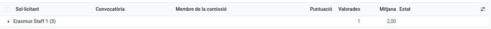
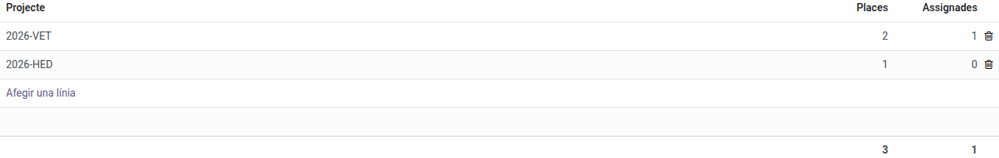

[Català](../../ca/erasmus/staff-call.md) | [Castellano](staff-call.md) | [English](../../en/erasmus/staff-call.md)

---

# La convocatoria Erasmus+ del personal

Gestiona la convocatoria para el personal de formación profesional (job shadowing, cursos estructurados y estancias de docencia): el personal solicita desde EMS (**Erasmus+ > Mi participación**), la comisión valora los planes de movilidad, y tú revisas el resto, publicas las resoluciones y ofreces las plazas.

**Rol necesario:** *Coordinador/a Erasmus* o *Técnico/a de movilidad Erasmus* (Erasmus+ > Gestor/a).

La convocatoria del personal funciona como la del alumnado (ver [Convocatorias y solicitudes](calls-and-applications.md) y [Resoluciones, reclamaciones y ofertas de plaza](resolutions-and-offers.md)). Este manual solo explica lo que es diferente.

---

## 1. Abrir la convocatoria

En **Erasmus+ > Convocatorias > Convocatorias**, crea la convocatoria, pon *Personal* en **Solicitantes**, rellena las fechas, adjunta la convocatoria publicada y publícala. Nada más:

- Los **documentos** del artículo 8 se añaden solos: solo los certificados de idiomas, opcionales (ningún currículum; el documento de identidad se pide a quien va, con los documentos de la movilidad). El **plan de movilidad y transferencia** no es un documento: las personas solicitantes lo escriben en el formulario (anexo 1), y es la única parte de la solicitud que ve la comisión. Puedes cambiarlos antes de publicar.
- No hay **Puntuación mínima**: la convocatoria del personal no tiene, así que EMS la pone a 0 y la oculta.
- El **Plazo de valoración de la comisión** se rellena a partir de la fecha de cierre, como en la convocatoria de alumnado (14 días después, a las 14:00, en un día lectivo): ese día vencen las tareas de la comisión, y después los miembros ya no pueden cambiar sus valoraciones. Si cambias la fecha de cierre, el plazo la sigue, salvo que lo hayas cambiado a mano. Los demás plazos se rellenan igual.
- Para abrir la convocatoria solo hacen falta los ajustes y el calendario: **Pueden solicitar** y **Valida las actividades** ya vienen rellenados. La pestaña **Documentos** no aparece (el único documento que se pide es el formulario, y los certificados de idiomas ya están), la pestaña **Comisión** aparece cuando la convocatoria está cerrada y el bloque **Movilidad** cuando se publica la resolución definitiva.
- **Pueden solicitar:** los niveles del profesorado que puede solicitar. Una convocatoria del personal nueva tiene todos los niveles de formación profesional (ciclos de grado básico, medio y superior, cursos de especialización y PFI). EMS solo muestra la convocatoria al profesorado que da clase en algún grupo de esos niveles y a las personas de **Valida las actividades**: ni al personal de administración ni al profesorado que solo da clase en la ESO o el bachillerato.
- **Valida las actividades:** la dirección que valida la actividad de cada persona seleccionada y sus cambios posteriores. Viene rellenado con la directora o el director y el jefe de estudios de FP (el que está por encima de la mayoría del profesorado de FP), y solo ellos reciben la tarea, aunque un profesor dependa de otro jefe de estudios en el organigrama.
- Para abrirla no hace falta indicar las **plazas**: la convocatoria publicada ya da las orientativas, y pueden cambiar según los proyectos. Las añades más adelante (paso 5); si la publicas sin plazas, EMS te lo avisa para que no se te olvide.

Una vez publicada, todo el personal con ficha de empleado ve la convocatoria en EMS, en **Erasmus+ > Mi participación > Convocatorias de personal**. Para avisarles a todos, usa **Acciones > Avisar a quien puede presentarse**: lo reciben en su resumen diario, no en un correo aparte (ver [Convocatorias y solicitudes](calls-and-applications.md)).

## 2. Qué rellena el personal

Además de sus dos propuestas (A, la principal, y B, la de reserva) y de qué quiere aprender y cómo lo aplicará, escritos con sus palabras, cada persona solicitante declara:

- Si **nunca ha hecho ninguna movilidad Erasmus+ de personal en el Puig**. Si no, ponéis vosotros cuándo fue la última (**Corrección**, criterio 2) con los registros del centro. Los acompañamientos de alumnado y otros programas no cuentan.
- El **mes y el año desde que trabaja en el centro** de forma continuada.
- Su **certificado de idioma** más alto (B2 o superior), que también adjunta.
- Los **proyectos del centro** en los que participa y, opcionalmente, sus **necesidades de apoyo** (confidenciales: solo las ve el equipo Erasmus).

No puede enviar la solicitud sin la fecha de incorporación al centro, las dos propuestas y el plan.

## 3. Revisar, admitir y enviar los planes a la comisión

Revisa los documentos y admite o excluye como en la convocatoria del alumnado (las amonestaciones no cuentan).

Después de **Cerrar las solicitudes**, rellena la pestaña **Comisión** de la convocatoria: las personas que valoran los planes de movilidad (la dirección y las jefaturas de departamento y de seminario). Después haz clic en **Acciones > Enviar los planes a la comisión**. Cada miembro recibe una tarea para valorar todos los planes desde **Erasmus+ > Mi participación > Mis valoraciones de planes**, que vence el **Plazo de valoración de la comisión** (el botón lo pide si está vacío; si lo cambias después, las tareas abiertas lo siguen). Puedes volver a hacer clic después de admitir más solicitudes: solo crea las valoraciones que faltan.

**Erasmus+ > Convocatorias > Valoraciones del plan de movilidad** se abre con una fila por solicitante: cuántos han valorado y la media del plan. Haz clic en una fila para ver la valoración de cada miembro.

**Abstenciones:** un miembro de la comisión que se presenta a la convocatoria no valora (art. 10): sus valoraciones se crean como abstenciones, con el motivo *Candidato en esta convocatoria*. Para otro conflicto de intereses, abre la valoración desde el botón **Valoraciones de planes** de la convocatoria y escribe el **Motivo de la abstención**. No hay personas sustitutas: la puntuación del plan (criterio 1) es la media de los miembros que lo valoran. **Una valoración pendiente la bloquea** hasta que se envía. En **Valoraciones de planes**, una abstención aparece como *Abstención*, y la vista de tabla dinámica (personas candidatas × estado) muestra de un vistazo qué planes todavía tienen valoraciones por enviar.

**La dirección no ve los puntos mientras la comisión valora:** el jefe de estudios y la directora pueden abrir las solicitudes del personal, pero hasta que no se han valorado todos los planes de la convocatoria ven la puntuación del plan, los criterios y el total a 0, también si están en la comisión. Así ningún miembro ve la media de los demás antes de valorar. Cuando se envía la última valoración, lo ven todo.

## 4. Revisar el resto de criterios

En la pestaña **Baremación** de la solicitud, EMS muestra lo que ha declarado la persona y los puntos que le corresponden. Solo lo corriges si no es correcto:

| Criterio | Sale de | Se corrige en | Puntos |
|---|---|---|---|
| 1. Plan de movilidad | La media de la comisión | - | Hasta 2 |
| 2. Última movilidad de personal | **Última movilidad de personal declarada** (el curso del mes indicado) | **Corrección** | Nunca o hace más de dos cursos 1,5; hace dos cursos 0,5; el curso pasado o el actual 0 |
| 3. Proyectos del centro | Los **Méritos** que registras: cada colaboración 0,5, cada coordinación 1 | - | Hasta 1,5 |
| 4. Idiomas | **Certificado de idioma declarado** | **Corrección** | B2 1; C1 1,5; C2 2 |
| 5. Antigüedad | **Antigüedad declarada** (en la fecha de cierre) | **Corrección** | Menos de 1 año 0; de 1 a 2 años 1; de 2 a 5 años 1,5; 5 años o más 2 |
| 6. Internacionalización | Los **Méritos** que registras: cada actividad 0,5 | - | Hasta 1 |

Cada campo **Corrección** dice *Correcto, como ha declarado* mientras está vacío: déjalo así cuando lo que ha declarado la persona es correcto, y elige un valor solo cuando no lo es. Cada criterio muestra los puntos sobre el máximo (*1,5 / 2*). La tabla **Valoraciones de la comisión** muestra qué ha dado al plan cada miembro.

Registra cada mérito con su justificación, a partir de lo que la persona ha escrito en proyectos del centro. Marca **Méritos revisados** cuando todos los méritos estén registrados, también si no hay ninguno: hasta entonces la puntuación no está completa.

## 5. Plazas, clasificación y resoluciones

Una convocatoria del personal no tiene modalidades: el profesorado compite en una sola lista y solo ve el total de plazas de la convocatoria. En la pestaña **Selección**, **Plazas por proyecto** es vuestra planificación: una línea por cada proyecto activo que paga plazas, con sus plazas (por ejemplo, 6 en *2025-VET*, 2 en *2026-VET* y 2 en *2026-HED*). Las plazas de la convocatoria son su suma; la columna **Asignadas** cuenta las movilidades que ya están en cada proyecto. Rellénala antes de preparar la resolución provisional. Esta tabla solo la ve el equipo Erasmus+.

El personal se clasifica **en una sola lista** para toda la convocatoria (botón **Clasificación** de la convocatoria). Los empates se deshacen por la puntuación del plan de movilidad, después por quien lleva más tiempo en el centro (el mes y el año de incorporación declarados en el formulario, no los puntos del criterio 5: quien se incorporó en 2000 va antes que quien se incorporó hace seis años, aunque ambos tengan 2 puntos) y, por último, por el sorteo que hace la coordinación Erasmus desde la convocatoria (**Sortear los empates**).

Las resoluciones se publican como en la convocatoria del alumnado: las listas solo muestran cuatro cifras del documento de identidad, nunca nombres. Para el personal se toma de su **ficha de empleado** (DNI o NIE; si no, el pasaporte); si alguien no lo tiene, pide a secretaría que lo añada. EMS ya te lo avisa cuando admites su solicitud, y las listas no se pueden preparar hasta que esté. Si la puntuación de alguien no está completa cuando preparas una resolución, EMS dice qué falta a cada persona (por ejemplo, *Méritos revisados* o *Antigüedad en el centro*).

Quedan seleccionadas las personas que entran dentro de las plazas de la convocatoria (la suma de las plazas por proyecto); cada persona obtiene como máximo una plaza. Cuando una persona acepta, elige el **Proyecto** en su movilidad: EMS solo ofrece los proyectos de la tabla de la convocatoria y, al lado, muestra cuántas plazas quedan (por ejemplo, *2026-VET: quedan 1 de 2 plazas*). Puedes elegir un proyecto sin plazas libres, pero la movilidad muestra un aviso hasta que le añadas una plaza o elijas otro. El proyecto trae los documentos de su tipo (KA121-VET o KA131-HED). El profesorado nunca ve qué proyecto paga su movilidad. Mientras una plaza aceptada no tiene proyecto, la convocatoria te lo avisa (*N plazas aceptadas sin proyecto*), y las **Solicitudes** de la convocatoria muestran el **Proyecto** de cada persona.

## 6. Ofertas y hoja de cálculo

Las personas seleccionadas responden la oferta desde su solicitud en EMS (**Acciones > Acepta la plaza** o **Renunciar a la plaza**). Una plaza libre se ofrece a la siguiente persona de reserva de toda la convocatoria (**Acciones > Ofrecer una plaza libre**, sin elegir modalidad).

**Exportar a hoja de cálculo** toma los datos del personal de su ficha de empleado. Las columnas del ciclo, el curso y el tutor legal quedan vacías.

---

[← Volver a los manuales del equipo Erasmus+](index.md)
