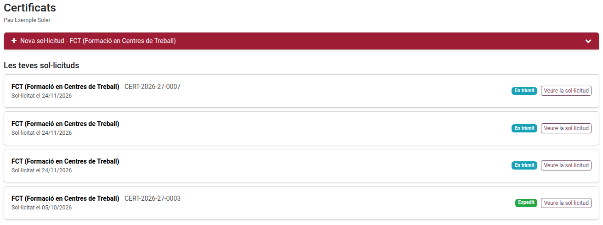
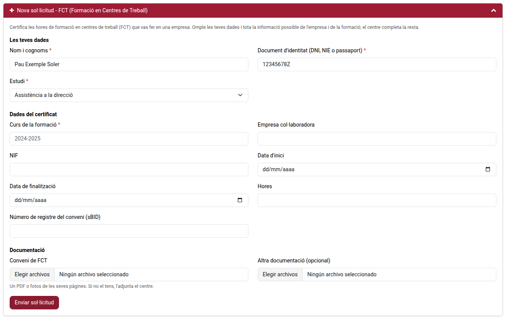
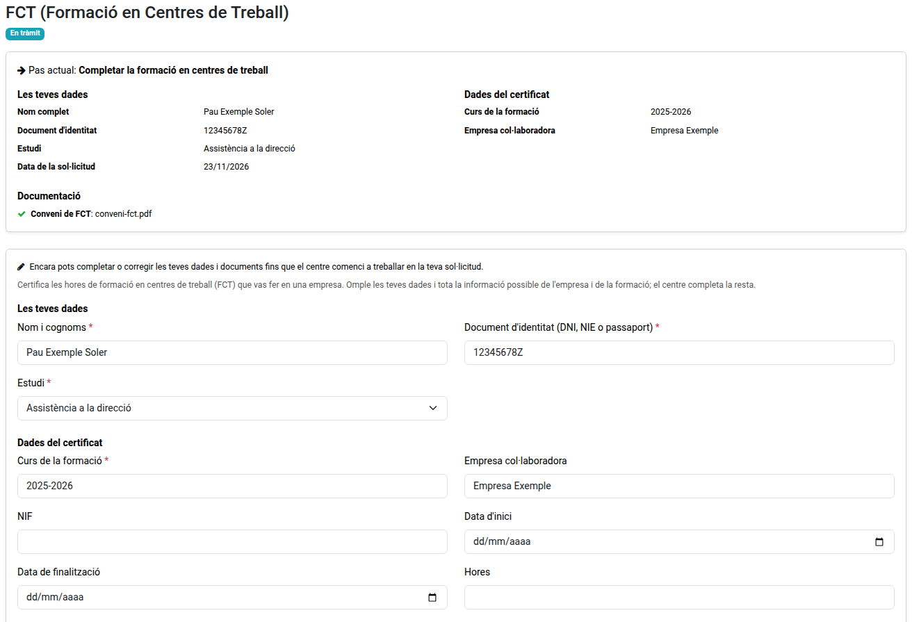

[Català](../../ca/families/manual-certificats.md) | [Castellano](manual-certificats.md) | [English](../../en/families/manual-certificats.md)

---

# Solicitar un certificado

Pide al centro un certificado (por ejemplo, el de las horas de formación en centros de trabajo, FCT), sigue su tramitación y descárgalo cuando esté expedido.

En el portal, los certificados de FCT los puede pedir el alumnado de ciclos formativos (CFGM y CFGS) o su familia.

---

## Pedir un certificado desde el portal

1. Entra en el portal y haz clic en la tarjeta **Certificados**.
2. Haz clic en **Nueva solicitud** seguido del certificado que necesitas (por ejemplo, **Nueva solicitud - FCT (Formació en Centres de Treball)**) para desplegar su formulario. Cada certificado tiene su formulario.
3. Comprueba **Tus datos**.
4. En **Datos del certificado**, rellena lo que pide el certificado. Los que tienen asterisco son obligatorios; el resto, rellénalos tanto como puedas y el centro los completa. Para la FCT: el **Curso académico** (puedes elegir uno de la lista o escribirlo con el formato 2024-25) y, si los tienes, la empresa y su NIF, las fechas, las horas y el número de registro del convenio.
5. En **Documentación**, adjunta el **Convenio de FCT** si tienes una copia (un PDF o fotos de las páginas). Si no lo tienes, lo adjunta el centro. También puedes añadir **Otra documentación**.
6. Haz clic en **Enviar solicitud**.

---

## Seguir la solicitud

En **Tus solicitudes**, haz clic en **Ver la solicitud** para consultar:

- el estado y el **Paso actual**;
- tus datos y los del certificado, incluidos los que añade el centro;
- la documentación adjunta.

Hasta que el centro empiece a trabajar en la solicitud, aún puedes completar o corregir tus datos y documentos desde esta misma página, con **Guardar cambios**.

Si el centro necesita más información, recibirás un correo: haz clic en **Responder al centro**, escribe la respuesta, adjunta lo que te pidan y envíalo.

Mientras no se haya expedido, puedes anular la solicitud con **Anular la solicitud**.

---

## Recibir el certificado

Cuando el certificado está expedido, lo recibes por correo en PDF y también puedes descargarlo con **Descargar el certificado** desde la solicitud.

---

## Si ya no eres alumno del centro

Pide el certificado a secretaría. Recibirás un correo con un enlace al formulario: ábrelo (no hace falta iniciar sesión), rellena tus datos, adjunta el convenio si tienes una copia y envíalo. Con el mismo enlace podrás seguir la solicitud, responder al centro y descargar el certificado.
