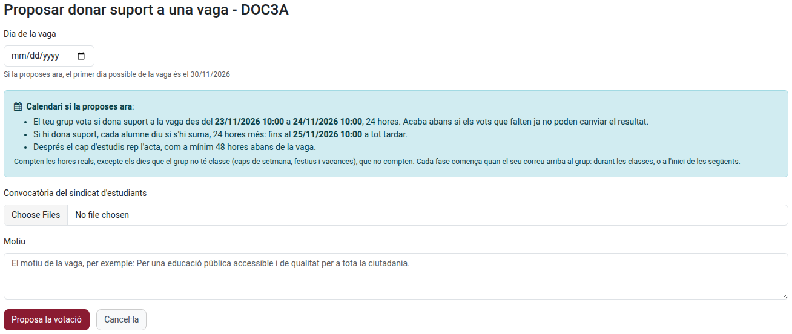
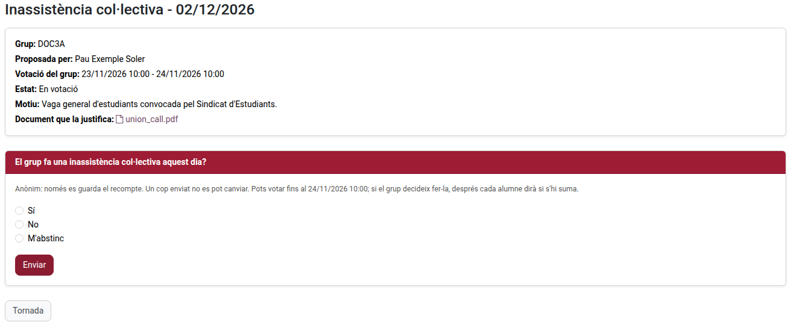
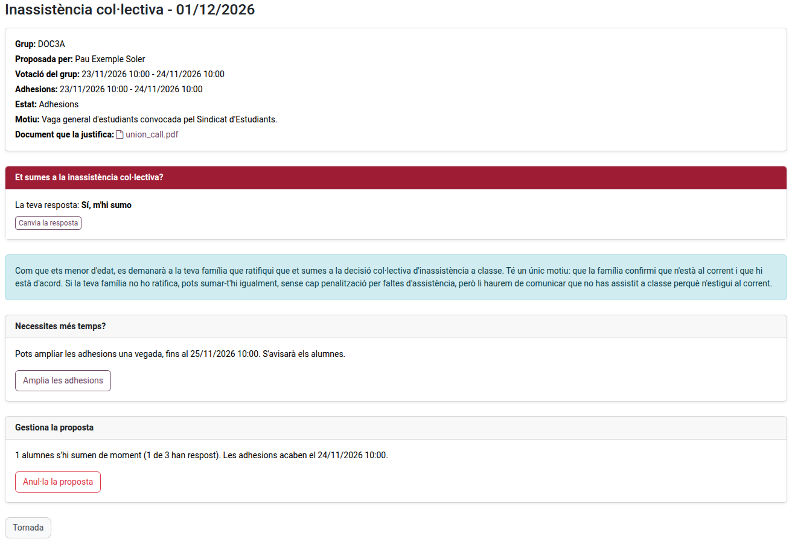
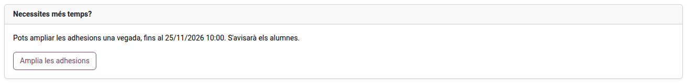
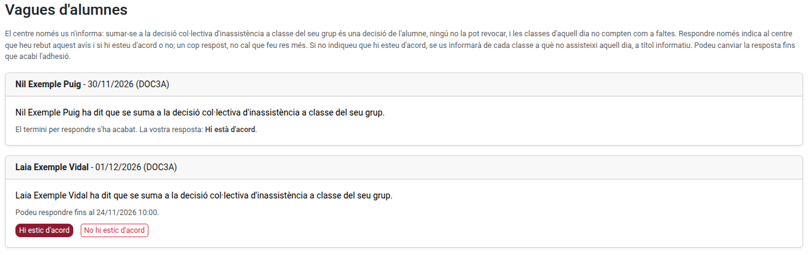

[Català](../../ca/families/manual-vagues.md) | [Castellano](manual-vagues.md) | [English](../../en/families/manual-vagues.md)

---

# Inasistencias colectivas

Cuando un sindicato de estudiantes convoca una huelga, tu grupo puede decidir en el portal si la apoya, y cada alumno dice si se suma. Los alumnos que se suman no constan en el pase de lista de ese día: ni faltan ni asisten.

Es una decisión colectiva de inasistencia a clase del alumnado a partir de 3.º de ESO, comunicada previamente a la dirección del centro (LODE, artículo 8). Nadie puede revocarla, tampoco la familia: el centro solo informa. En Cataluña, se pide a la familia de un alumno menor de edad que la ratifique en el portal (Decret 102/2010, artículo 24.2), solo para saber que está al corriente y de acuerdo.

---

## Quién hace qué

| Quién | Qué hace |
|-------|----------|
| El delegado o el subdelegado del grupo | Propone la votación y adjunta la convocatoria del sindicato |
| Cada alumno del grupo con acceso al portal | Vota si el grupo apoya la convocatoria de huelga y, si la apoya, dice si se suma |
| La familia de un alumno menor que se suma | Lo ratifica, o no, en el portal: solo indica que está al corriente y de acuerdo |
| El tutor del grupo | Recibe un aviso de cada paso y puede detener la propuesta si tiene un defecto de forma |
| La jefatura de estudios | Recibe el acta y valida la inasistencia colectiva o no |

Solo pueden proponer apoyar una convocatoria de huelga los grupos que el centro permite (a partir de 3.º de ESO, bachillerato y formación profesional).

---

## El calendario

La propuesta tiene dos fases: primero el grupo vota si apoya la convocatoria de huelga y después cada alumno dice si se suma. Cada fase dura **24 horas** por defecto, y la jefatura de estudios debe recibir el acta como mínimo **48 horas** antes de la inasistencia colectiva. Por tanto, con la configuración por defecto, **el apoyo a una convocatoria de huelga se tiene que proponer con unos cuatro días lectivos de antelación**.

El centro decide cómo se cuentan las horas, y el formulario te lo explica:

- Normalmente, son **horas reales**, pero los días que tu grupo no tiene clase (fines de semana, festivos y vacaciones) no cuentan: una fase que empieza el viernes a las 9:00 acaba el lunes a las 9:00 (durante el fin de semana también puedes responder).
- El recuento empieza **cuando la propones**, y los correos salen enseguida, o **cuando el correo llega a tu grupo**: durante las clases o, si se envía fuera del horario, al inicio de las siguientes.
- El centro también puede contar solo las **horas de clase** de tu grupo: entonces el calendario es más largo.
- La votación acaba antes si los votos que faltan ya no pueden cambiar el resultado.

Antes de enviarla, el formulario te muestra el calendario exacto, cómo se cuentan las horas y el primer día posible de la inasistencia colectiva.

**Un día más cercano.** Si las dos fases no caben enteras antes del preaviso, pero sí una parte de la adhesión (al menos 5 minutos), puedes proponerla igualmente: el formulario te indica a partir de qué día, y **la fase de adhesión será más corta**. Una vez propuesta, su página te avisa: la fase de adhesión individual durará como máximo tantas horas en lugar de 24. Si la votación del grupo termina antes porque la mayoría ya ha decidido, la fase de adhesión se alarga con el tiempo ganado, hasta las 24 horas habituales.

---

## Proponer la votación (delegado o subdelegado)

1. En el portal, abre **Inasistencias colectivas** (tarjeta de la página de inicio, o en la barra superior) y haz clic en **Proponer apoyar una convocatoria de huelga**.
2. Elige el **Día de la inasistencia colectiva**. Tiene que ser un día lectivo, y no antes del primer día que te indica el formulario.
3. Adjunta la **Convocatoria del sindicato de estudiantes** (uno o más archivos).
4. Escribe el **Motivo** (por qué se convoca la huelga, por ejemplo «Por una educación pública accesible y de calidad para toda la ciudadanía»). Es obligatorio: sin él no puedes proponer la votación.
5. Haz clic en **Propón la votación**.

Tu grupo recibe enseguida un correo para votar. Solo puede haber una propuesta por grupo y día.

Mientras la propuesta está en votación o en adhesiones, su página te muestra cuántos alumnos han respondido, y **Anula la propuesta** la anula. Una propuesta anulada desaparece para el grupo.

---

## Votar (todo el alumnado)

La página de inicio del portal te avisa cuando tu grupo está votando. Abre la propuesta y responde **¿El grupo apoya la convocatoria de huelga?**: **Sí**, **No** o **Me abstengo**, y haz clic en **Enviar**. Una ventana te confirma que el voto se ha guardado.

- La votación es **anónima**: solo se guarda el recuento, nunca quién ha votado qué.
- Votas **una sola vez**: después no se puede cambiar.
- El grupo apoya la convocatoria de huelga cuando hay más votos a favor que en contra entre los votos emitidos (un empate no la apoya).

Si el grupo no la apoya, la propuesta se cierra y ese día se espera a todo el mundo en clase.

Un alumno que no tenía acceso al portal cuando se hizo la propuesta sale en el acta y no vota, pero, si el grupo la apoya y obtiene el acceso mientras la adhesión está abierta, puede decir si se suma: recibe el correo en ese momento.

---

## Sumarse (todo el alumnado)

Si el grupo la apoya, recibes un correo y la propuesta te pregunta **¿Te sumas a la inasistencia colectiva?** Responde **Sí, me sumo** o **No** y haz clic en **Enviar**. Una ventana te confirma la respuesta, y el formulario se cierra y la muestra. Puedes cambiarla hasta que acaben las adhesiones con **Cambiar mi respuesta**.

- Tu nombre sale en el acta que recibe la jefatura de estudios.
- Las clases de ese día no te cuentan como faltas: no constan en el pase de lista. Si la inasistencia colectiva no se valida, sí cuentan.
- **Si eres menor de edad**, se pide a tu familia que ratifique en el portal que te sumas, mientras duren las adhesiones, solo para saber que está al corriente y de acuerdo. Nadie puede revocar tu decisión. Si no lo ratifica, se le informa de cada clase a la que no asistas ese día, a título informativo. La página te dice si tu familia ya lo ha ratificado.

---

## Ampliar las adhesiones (delegado o subdelegado)

Si las adhesiones están a punto de acabar, o ya han acabado, y el alumnado necesita más tiempo, abre la página de la propuesta y haz clic en **Amplía las adhesiones**. Las adhesiones duran una fase más (el mismo tiempo que cada fase en la configuración del centro), o menos si jefatura de estudios no recibiría el acta a tiempo: se amplían todo lo posible. Se cuenta desde el final de las adhesiones, o desde ahora si ya han acabado. Se avisa a todo el alumnado.

- **Solo puedes hacerlo una vez.** El tutor del grupo, y quien tiene por encima, pueden ampliarlas más veces.
- Si las adhesiones ya habían acabado, la propuesta vuelve a estar abierta y el acta llega a jefatura de estudios cuando se cierre de nuevo.
- No siempre es posible: jefatura de estudios debe recibir el acta con la antelación prevista antes de la inasistencia colectiva. El botón solo aparece cuando lo es.

---

## Ratificarlo (familia de un alumno menor de edad)

Cuando vuestro hijo o hija (menor de 18 años ese día) dice que se suma a una decisión colectiva de inasistencia a clase, recibís un correo enseguida. En el portal, la página de inicio os avisa: haced clic en **Responde**, o abrid **Inasistencias colectivas**.

Para cada inasistencia colectiva, haced clic en **Lo ratifico** o **No lo ratifico**. Una ventana os confirma la respuesta, y la página la muestra. Podéis cambiarla con **Cambiar mi respuesta** hasta que acaben las adhesiones (la página os dice hasta cuándo).

- Ratificarlo solo indica al centro que estáis al corriente y de acuerdo. Es una decisión colectiva del alumnado que nadie puede revocar, y las clases de ese día no cuentan como faltas. **Una vez ratificado, no tenéis que hacer nada más**: el resto es automático.
- Si no lo ratificáis, o no respondéis a tiempo, recibiréis un aviso de cada clase a la que no asista ese día, solo a título informativo. Si no lo ratificáis, también se avisa a vuestro hijo o hija.
- Para ratificarlo necesitáis acceso al portal. Si no lo tenéis, pedidlo al centro con tiempo.
- Cuando la inasistencia colectiva se valida, recibís un correo informativo. Si, en cambio, la propuesta se aborta o no se valida, también se os avisa.

---

## Después de las adhesiones

El acta llega a la jefatura de estudios, que decide si valida la inasistencia colectiva:

- **Validada**: los alumnos que se suman siguen sin constar en el pase de lista de ese día. Se avisa a todo el alumnado, y también a la familia de cada alumno menor que se suma.
- **No validada**: las clases de ese día de los alumnos que se suman cuentan como faltas. Se avisa a todo el alumnado, con el motivo.

Mientras tanto, el tutor del grupo puede **abortar** la propuesta mientras está en votación o en adhesiones, solo por un defecto de forma (por ejemplo, si no hay ninguna convocatoria oficial de un sindicato de estudiantes para ese día). Se avisa a todo el alumnado, con el motivo.

El acta (PDF) está en la página de la propuesta una vez cerrada.

### Qué significa cada estado

| Estado | Significado |
|--------|-------------|
| **En votación** | El grupo vota si apoya la convocatoria de huelga |
| **Adhesiones** | El grupo la apoya: cada alumno dice si se suma |
| **Cerrada** | La jefatura de estudios tiene el acta y decide |
| **Validada** | Quienes se suman no constan en el pase de lista de ese día |
| **Abortada** | El tutor ha detenido la propuesta, con un motivo |
| **No validada** | La jefatura de estudios no la ha validado, con un motivo |
| **Anulada** | El delegado la ha anulado |

---

[← Volver a los manuales de familias](index.md)
