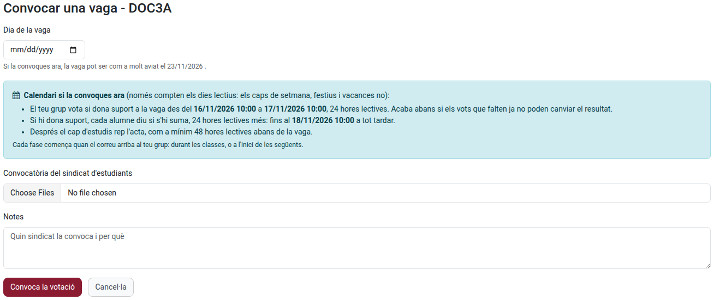
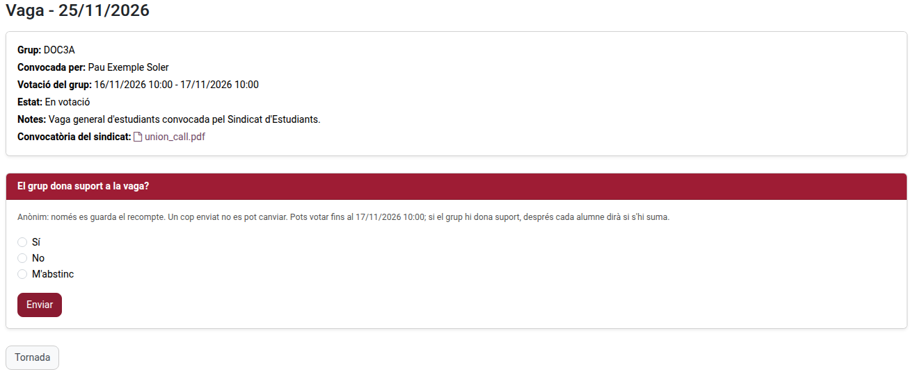
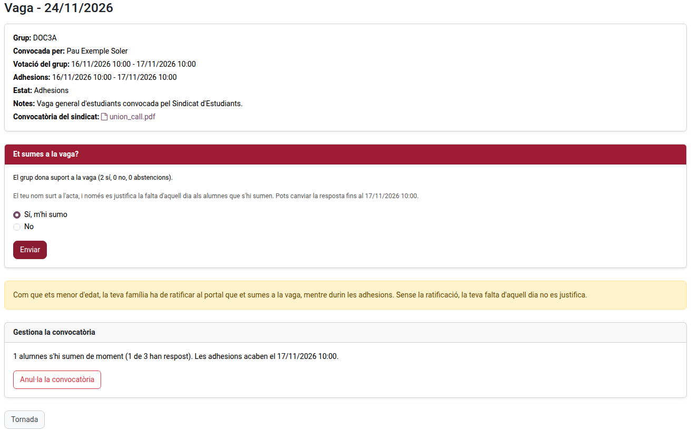
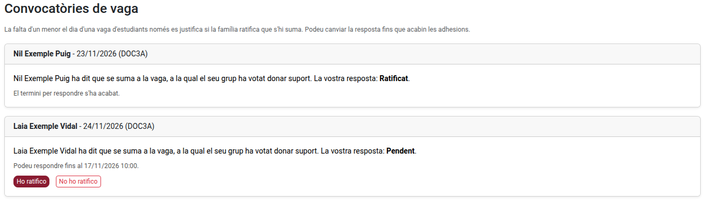

[Català](../../ca/families/manual-vagues.md) | [Castellano](manual-vagues.md) | [English](../../en/families/manual-vagues.md)

---

# Huelgas de estudiantes

Cuando un sindicato de estudiantes convoca una huelga, tu grupo puede decidir en el portal si la apoya, y cada alumno dice si se suma. Si la huelga se valida, la falta de los alumnos que se suman queda justificada ese día.

Decidir colectivamente no asistir a clase es un derecho del alumnado a partir de 3.º de ESO, cuando se comunica previamente a la dirección del centro (LODE, artículo 8). En Cataluña, un alumno menor de edad también necesita la autorización de su familia (Decret 102/2010, artículo 24.2): la familia la ratifica en el portal.

---

## Quién hace qué

| Quién | Qué hace |
|-------|----------|
| El delegado o el subdelegado del grupo | Convoca la votación y adjunta la convocatoria del sindicato |
| Cada alumno del grupo con acceso al portal | Vota si el grupo apoya la huelga y, si la apoya, dice si se suma |
| La familia de un alumno menor que se suma | Lo ratifica, o no, en el portal |
| El tutor del grupo | Recibe un aviso de cada paso y puede detener la convocatoria si tiene un defecto de forma |
| La jefatura de estudios | Recibe el acta y valida la huelga (justifica las faltas) o no |

Solo pueden convocar una huelga los grupos que el centro permite (a partir de 3.º de ESO, bachillerato y formación profesional).

---

## El calendario

La convocatoria tiene dos fases: primero el grupo vota si apoya la huelga y después cada alumno dice si se suma. Cada fase dura **24 horas lectivas** por defecto, y la jefatura de estudios debe recibir el acta como mínimo **48 horas lectivas** antes de la huelga. Por tanto, **una huelga se convoca como mínimo cuatro días lectivos antes**.

- Solo cuentan los días lectivos: los fines de semana, los festivos y las vacaciones no. Una fase que empieza el viernes a las 13:00 acaba el lunes a las 13:00 (durante el fin de semana también puedes responder).
- Cada fase empieza cuando el correo llega a tu grupo: durante las clases o, si se envía fuera del horario, al inicio de las siguientes.
- La votación acaba antes si los votos que faltan ya no pueden cambiar el resultado.

Antes de enviarla, el formulario te muestra el calendario exacto y el primer día posible de la huelga.

---

## Convocar la votación (delegado o subdelegado)

1. En el portal, abre **Convocatorias de huelga** (tarjeta de la página de inicio, o en la barra superior) y haz clic en **Convocar una huelga**.
2. Elige el **Día de la huelga**. Tiene que ser un día lectivo, y no antes del primer día que te indica el formulario.
3. Adjunta la **Convocatoria del sindicato de estudiantes** (uno o más archivos).
4. Si quieres, escribe unas **Notas** (qué sindicato la convoca y por qué).
5. Haz clic en **Convoca la votación**.

Tu grupo recibe enseguida un correo para votar. Solo puede haber una convocatoria por grupo y día.

Mientras la convocatoria está en votación o en adhesiones, su página te muestra cuántos alumnos han respondido, y **Anula la convocatoria** la anula. Una convocatoria anulada desaparece para el grupo.

---

## Votar (todo el alumnado)

La página de inicio del portal te avisa cuando tu grupo está votando. Abre la convocatoria y responde **¿El grupo apoya la huelga?**: **Sí**, **No** o **Me abstengo**, y haz clic en **Enviar**.

- La votación es **anónima**: solo se guarda el recuento, nunca quién ha votado qué.
- Votas **una sola vez**: después no se puede cambiar.
- El grupo apoya la huelga cuando hay más votos a favor que en contra entre los votos emitidos (un empate no la apoya).

Si el grupo no la apoya, la convocatoria se cierra y no se justifica la falta de nadie ese día.

Un alumno que no tenía acceso al portal cuando se convocó la votación sale en el acta, pero no puede responder.

---

## Sumarse (todo el alumnado)

Si el grupo la apoya, recibes un correo y la convocatoria te pregunta **¿Te sumas a la huelga?** Responde **Sí, me sumo** o **No** y haz clic en **Enviar**. Puedes cambiar la respuesta hasta que acaben las adhesiones.

- Tu nombre sale en el acta que recibe la jefatura de estudios.
- Solo se justifica la falta de los alumnos que se suman, si la huelga se valida.
- **Si eres menor de edad**, tu familia tiene que ratificar en el portal que te sumas, mientras duren las adhesiones. Sin la ratificación, tu falta no se justifica. La página te dice si tu familia ya lo ha ratificado.

---

## Ratificarlo (familia de un alumno menor de edad)

Cuando vuestro hijo o hija (menor de 18 años el día de la huelga) dice que se suma a una huelga, recibís un correo enseguida. En el portal, la página de inicio os avisa: haced clic en **Responde**, o abrid **Convocatorias de huelga**.

Para cada huelga, haced clic en **Lo ratifico** o **No lo ratifico**. Podéis cambiar la respuesta hasta que acaben las adhesiones (la página os dice hasta cuándo).

- Si no lo ratificáis, o no respondéis a tiempo, la falta de ese día **no se justifica**. Si no lo ratificáis, se avisa a vuestro hijo o hija.
- Para ratificarlo necesitáis acceso al portal. Si no lo tenéis, pedidlo al centro con tiempo.
- Cuando la huelga se valida, recibís un correo que confirma que la falta está justificada. Si, en cambio, la convocatoria se aborta o no se valida, también se os avisa.

---

## Después de las adhesiones

El acta llega a la jefatura de estudios, que decide si valida la huelga:

- **Validada**: se justifica ese día la falta de los alumnos que se suman (los mayores de edad, y los menores cuya familia lo ha ratificado). Se avisa a todo el alumnado, y también a la familia de cada alumno menor con la falta justificada.
- **No validada**: no se justifica la falta de nadie. Se avisa a todo el alumnado, con el motivo.

Mientras tanto, el tutor del grupo puede **abortar** la convocatoria mientras está en votación o en adhesiones, solo por un defecto de forma (por ejemplo, si no hay ninguna convocatoria oficial de un sindicato de estudiantes para ese día). Se avisa a todo el alumnado, con el motivo.

El acta (PDF) está en la página de la convocatoria una vez cerrada.

### Qué significa cada estado

| Estado | Significado |
|--------|-------------|
| **En votación** | El grupo vota si apoya la huelga |
| **Adhesiones** | El grupo la apoya: cada alumno dice si se suma |
| **Cerrada** | La jefatura de estudios tiene el acta y decide |
| **Validada** | La falta de quienes se suman está justificada |
| **Abortada** | El tutor ha detenido la convocatoria, con un motivo |
| **No validada** | La jefatura de estudios no la ha validado, con un motivo |
| **Anulada** | El delegado la ha anulado |

---

[← Volver a los manuales de familias](index.md)
