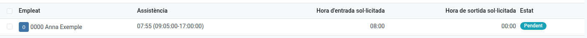

[Català](../../ca/head_of_studies/attendance-corrections.md) | [Castellano](attendance-corrections.md) | [English](../../en/head_of_studies/attendance-corrections.md)

---

# Decidir sobre solicitudes de corrección de fichajes

Los profesores pueden solicitar una corrección de una hora de entrada/salida de su propio fichaje. Esta página explica cómo decidir sobre las solicitudes que te llegan, y cómo hacer una solicitud en nombre de otra persona. Consulta el [manual de Profesores](../teachers/attendance-corrections.md) para ver cómo se hace la solicitud.

**Rol necesario:** Jefatura de Estudios, Jefatura de Estudios Adjunta, Dirección o Administrador

---

## Qué fichajes y solicitudes son tuyos

Ves y corriges los fichajes, y decides las solicitudes de corrección, solo de **tu rama** — no de todos los empleados del centro:

- todos los que están **por debajo de ti en la jerarquía** (los departamentos que dependen de ti, con sus jefes y docentes), y
- el personal del **área que gestionas**, cuyos fichajes y ausencias apruebas.

**Dirección** y el **Administrador** lo ven y lo deciden todo. Un **Jefe de departamento o de seminario** ve los fichajes de su departamento, solo de lectura, y no decide nada.

Tu lista de fichajes (**Asistencia del personal → Asistencia → Vista general**) se abre agrupada por mes y por empleado, y solo muestra el curso actual: los fichajes de cursos anteriores se archivan cuando cambia el curso (marca **Archivado** en el menú **Filtros** de la barra de búsqueda para verlos).

> **Saber quién está, en todo el centro.** Si los jefes de estudios de tu centro necesitan saber en todo momento quién ha fichado y quién no, el Administrador puede activar **Los jefes de estudios ven los fichajes de todos (EMS)** en **Asistencia del personal → Configuración → Ajustes**. Entonces puedes consultar los fichajes de todos los empleados; corregirlos y decidir solicitudes de corrección sigue limitado a tu rama. Por defecto está desactivado.

---

## Crear una solicitud en nombre de otra persona

A diferencia de un profesor o profesora, que solo puede solicitar una corrección de su propio fichaje, tú puedes hacerlo para cualquier empleado o empleada **de tu rama** (Dirección y el Administrador, para cualquier persona):

1. Abre el fichaje de esa persona (por ejemplo, desde **Fichajes de empleados → Asistencia → Resumen**, o desde su ficha).
2. Haz clic en **Solicitar corrección** en la cabecera — el mismo botón y formulario que usaría un profesor o profesora para su propio fichaje.
3. Rellena la hora de entrada/salida solicitada y el motivo, y **Guarda**.

La solicitud sigue el mismo proceso de revisión que cualquier otra — incluido, si tú no eres quien debe decidir, que se envíe a quien corresponda.

---

## Decidir una solicitud

Una solicitud nueva no te envía ningún correo en el momento: no es urgente. La encontrarás en la bandeja de actividades (🕒) y en el correo diario con todas tus tareas pendientes (consulta [Resumen diario de tareas pendientes](../teachers/task-digest.md)).

Si te han enviado una solicitud (la verás como una actividad pendiente, y también aparecerá en **Fichajes de empleados → Asistencia → Solicitudes de corrección**):

1. Abre la solicitud — desde la actividad, desde **Fichajes de empleados → Asistencia → Solicitudes de corrección**, o desde el botón **Correcciones** del propio fichaje.

   > La lista muestra solo las solicitudes **Pendientes** por defecto, para no tener que revisar las que ya tienen una decisión. Quita el filtro **Pendiente** (o cambia al filtro **Aceptada**/**Rechazada**) para ver el resto.

   
2. Revisa la hora original frente a la solicitada, y el motivo indicado.

   > Una solicitud que solo muestra una hora de entrada solicitada, sin salida, es normal cuando el profesor o profesora todavía estaba fichado/a y dentro de su horario laboral en el momento de pedir la corrección — no es una solicitud incompleta.
3. Haz clic en **Aceptar** para aplicar la corrección al fichaje, o en **Rechazar** para dejarlo sin cambios (o restaurarlo, si estás deshaciendo una aceptación anterior). Puedes dejar una nota opcional para el profesor o profesora.
4. El profesor o profesora que hizo la solicitud recibe una notificación automática con tu decisión.

> ¿Te has equivocado? Los botones **Aceptar** y **Rechazar** siguen disponibles después de decidir, así que puedes cambiar de opinión en cualquier momento — pulsar el otro botón revierte la decisión anterior.

> Una solicitud la pueden decidir los jefes de estudios de la rama del empleado o empleada (véase [Qué fichajes y solicitudes son tuyos](#qué-fichajes-y-solicitudes-son-tuyos)), Dirección y el Administrador. No ves las solicitudes de otras ramas.
>
> *Decidir solo las solicitudes de tu rama se introdujo en la versión 18.0.0.36.0; hasta entonces, cualquier Jefatura de Estudios podía decidir cualquier solicitud.*

> **Desde una ausencia detectada.** Un docente al que has pedido justificar una ausencia detectada puede responder que estaba en el centro, con una solicitud de corrección hecha desde la propia ausencia (el campo **Ausencia detectada** dice cuál). Si ese día no tenía ningún fichaje, la solicitud no tiene: al aceptarla se registra un fichaje con las horas solicitadas y la ausencia detectada queda como **Fichaje corregido**. Una solicitud así no se puede rechazar una vez aceptada: corrige o elimina el fichaje. Mientras decides, el docente no recibe recordatorios; si la rechazas, se le vuelven a enviar.

---

[← Volver a los manuales de Jefatura de Estudios](index.md)
