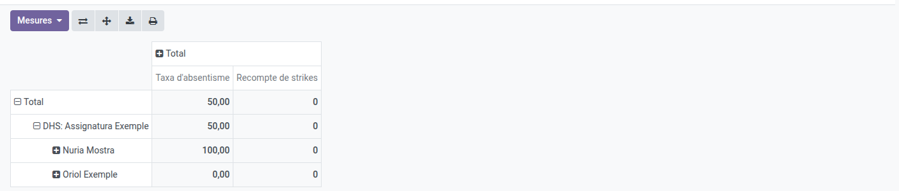
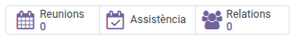
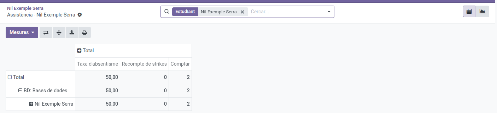

[Català](../../ca/head_of_studies/attendance-reports.md) | [Castellano](attendance-reports.md) | [English](../../en/head_of_studies/attendance-reports.md)

---

# Informes de asistencia

**Asistencia → Informes** abre la pantalla de **Informes de asistencia**: una tabla dinámica que puedes explorar y exportar tú mismo, además de 3 informes PDF imprimibles (por grupo, por alumno, por asignatura) accesibles desde su cabecera.

**Rol necesario:** Jefatura de Estudios / Jefatura de Estudios Adjunta / Dirección

---

## Explorar los informes de asistencia

1. Ve a **Asistencia → Informes**. Se abre directamente con una **tabla dinámica**. Como Jefatura de Estudios o Jefatura de Estudios Adjunta ves al alumnado de **tu área**: el de los estudios que gestionan los departamentos de tu área (el campo **Gestionado por el departamento** de cada estudio), más el de los tutores que dependen de ti. La Dirección ve **todo el centro**. Como cualquier docente, también ves tus asignaturas.
2. La tabla agrupa por **asignatura y luego por alumno**. Haz clic en el icono **Expandir todo** (arriba a la derecha, junto a Invertir ejes) dos veces: una para desplegar las asignaturas y otra para desplegar los alumnos de cada asignatura. El número principal es el **% de faltas por alumno** — el **Recuento** (número de sesiones contabilizadas) y el **Recuento de strikes** se muestran al lado, así puedes saber si un 33% sale de 3 sesiones o de 30, y si viene acompañado de strikes disciplinarios. Una asignatura que el horario divide en partes impartidas por separado (su **tema**, por ejemplo la Educación física de un módulo de CFGB) aparece como una asignatura propia, «Asignatura - Tema».
3. Usa la barra de búsqueda para filtrar más (por alumno, grupo, asignatura o estado), y **Agrupar por** para cambiar cómo se pliega la tabla — por ejemplo, por grupo para comparar las tasas de asistencia entre grupos del centro. El grupo es el del alumno en la fecha de cada sesión: una sesión compartida por varios grupos cuenta a cada alumno solo en su grupo.

   
4. Usa el icono de **hoja de cálculo/descarga** de la cabecera para exportar la tabla dinámica actual a Excel.
5. Cambia a la vista de **gráfico** (iconos arriba a la derecha) para ver un resumen visual — por defecto muestra el **% de absentismo por asignatura** de lo que ves, así puedes detectar de un vistazo qué asignaturas tienen más absentismo. El gráfico muestra una medida a la vez — usa el desplegable **Medidas** de su cabecera para cambiar a **Recuento de strikes** si quieres ver los strikes disciplinarios por asignatura.

---

## Desde la ficha del alumno

Para consultar la asistencia de un solo alumno, abre su ficha y haz clic en el botón **Asistencia** de la parte superior, junto a **Reuniones** y **Relaciones**. Se abre la misma tabla dinámica, ya filtrada por ese alumno (el filtro **Alumno** de la barra de búsqueda, que puedes quitar con su **×**). Para un alumno de tu área verás todas las asignaturas. La vista de gráfico y los informes PDF funcionan exactamente como se describe en este manual.

---

## Imprimir un informe PDF

En la pantalla de **Informes de asistencia**, haz clic en el botón de la **impresora**, el último de la fila de encima de la tabla (junto al de descarga), también en la vista de gráfico. También está en el menú **⚙ (engranaje)**, como **Imprimir informe de asistencia**. En el formulario, elige el **Tipo de informe** — por grupo, por alumno o por asignatura — y los campos se adaptan a tu elección. Las listas ofrecen exactamente los alumnos, grupos y asignaturas que ves en la tabla dinámica (solo el curso actual), y el PDF incluye las mismas sesiones que la tabla.

**Informe de asistencia (por grupo):**
1. Selecciona un **Grupo**.
2. El **Tutor/a** y las fechas **Desde**/**Hasta** se rellenan automáticamente a partir del grupo y su rango de sesiones.
3. Haz clic en **Imprimir**. El PDF se abre con un resumen global de asistencia/absencia, un recuento por estado y las notas de sesión registradas durante el periodo. Incluye al alumnado del grupo, según el grupo de cada alumno en la fecha de cada sesión.

**Informe de asistencia (por alumno):**
1. Selecciona un **Alumno**.
2. El **Tutor/a** y las fechas **Desde**/**Hasta** se rellenan automáticamente a partir del alumno y su rango de sesiones.
3. Haz clic en **Imprimir**. El PDF se abre con un resumen global de asistencia/absencia, un recuento por estado y las notas de sesión registradas durante el periodo.

**Informe de asistencia (por asignatura):**
1. Selecciona una **Asignatura**.
2. El campo **Grupos** se rellena automáticamente con todos los grupos que imparten esa asignatura, y **Tutores** muestra sus tutores como referencia. Quita los grupos que no quieras en el informe — **Grupos** se queda editable.
3. Las fechas **Desde**/**Hasta** se rellenan automáticamente para cubrir todo el rango de sesiones de tu selección.
4. Haz clic en **Imprimir**. El PDF se abre con un resumen global de asistencia/absencia, un recuento por estado y las notas de sesión registradas durante el periodo.

**Para cualquier tipo de informe**, dos controles gobiernan el detalle por línea en el PDF:
- **Estados de detalle** — qué estados aparecen en las tablas "Detalles". Por defecto solo incluye estados
  de ausencia (**Falta**, **Falta justificada**, **Retraso grave**) para que el informe se mantenga de un
  tamaño razonable; añade más y aparece un aviso de que el informe puede volverse lento de generar o fallar
  para selecciones grandes.
- **Incluir los strikes** (activado por defecto) — añade tablas de los strikes disciplinarios del periodo.

El PDF descargado lleva el nombre del informe y del alumno, grupo o asignatura seleccionados (p. ej. `Informe de asistencia_ por estudiante_Nombre_Apellido.pdf`), para poder distinguir varias descargas.

---

[← Volver a los manuales de Jefatura de Estudios](index.md)
