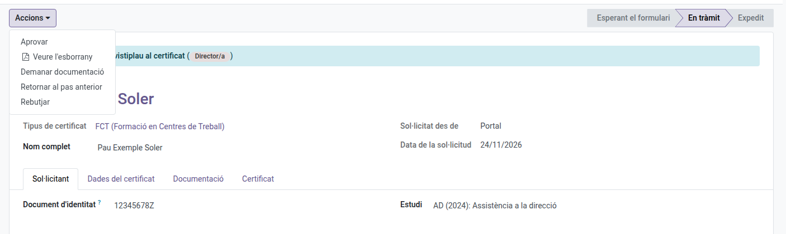

[Català](../../ca/head_of_studies/certificates.md) | [Castellano](certificates.md) | [English](../../en/head_of_studies/certificates.md)

---

# Certificados: dar el visto bueno

Da el visto bueno a los certificados que secretaría ha expedido. Al darlo, EMS genera el PDF y lo envía a la persona solicitante.

**Rol necesario:** el cargo de director o directora.

---

## Cuándo te toca

Después de que secretaría expide un certificado, el último paso del circuito es tuyo: lo encuentras como tarea en tu resumen diario y en **Gestión académica → Certificados**, con el filtro **Pendientes de mí**.

---

## Dar el visto bueno

1. Abre la solicitud.
2. Comprueba los datos de las pestañas **Solicitante**, **Datos del certificado** y **Documentación**. **Acciones → Ver el borrador** muestra cómo será el certificado, marcado como **BORRADOR**.
3. Abre **Acciones → Aprobar** y confirma.

EMS:

- pone el sello de **Visto bueno**;
- genera el PDF del certificado, con los sellos de secretaría y de dirección y, al final, las páginas del convenio;
- lo envía por correo a la persona solicitante, que también puede descargarlo desde el portal o desde el enlace.

El PDF está en la pestaña **Certificado** de la solicitud.

---

Si has expedido tú mismo el certificado (por ejemplo, como administrador), no puedes darle el visto bueno: lo tiene que hacer otra persona.

---

## Hacer constar en lugar de dar el visto bueno

Mientras el certificado aún no se ha expedido, puedes **hacerlo constar** tú: EMS no genera un certificado, sino un **documento acreditativo** con el mismo texto, donde dice que **haces constar** lo que se indica, firmado solo por ti.

1. Abre la solicitud (quita el filtro **Pendientes de mí** si aún no está en tu paso).
2. **Acciones → Ver el borrador del documento acreditativo** muestra cómo quedará, marcado como **BORRADOR**.
3. Abre **Acciones → Hacer constar** y confirma.

Tienen que estar todos los datos y toda la documentación obligatorios; si falta alguno, EMS te indica cuál y no lo genera.

EMS:

- le da un número propio (por ejemplo `DACR-2026-27-0001`) y le pone tu sello;
- genera el PDF, con las páginas del convenio al final;
- lo envía por correo a la persona solicitante y cierra la solicitud.

---

## Si algo no es correcto

- **Acciones → Devolver al paso anterior** — devuelve la solicitud a secretaría con el motivo; se deshace su sello.
- **Acciones → Pedir documentación** — pide a la persona solicitante lo que falte.
- **Acciones → Rechazar** — si el certificado no se puede expedir; la persona solicitante recibe el motivo por correo.

También puedes consultar todas las solicitudes de certificado del centro quitando el filtro **Pendientes de mí**.
