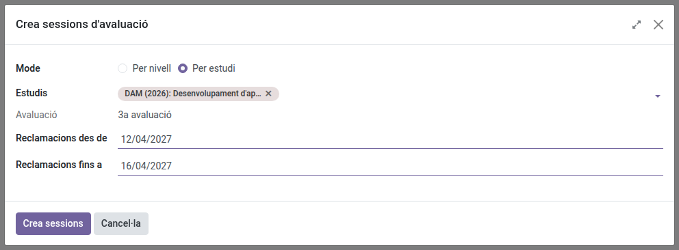
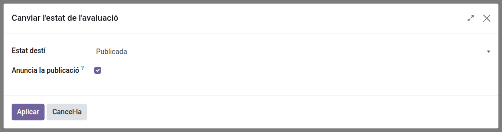

[Català](../../ca/head_of_studies/evaluation-sessions.md) | [Castellano](evaluation-sessions.md) | [English](../../en/head_of_studies/evaluation-sessions.md)

---

# Sesiones de evaluación: crearlas, publicarlas y cerrarlas

Esta guía explica cómo el jefe de estudios (y el jefe de estudios adjunto) gestiona cada evaluación: crear sus sesiones, hacerlas pasar por sus estados y publicar las notas al alumnado y a las familias.

---

## Índice

1. [Acceso](#acceso)
2. [Crear las sesiones de una evaluación](#crear-las-sesiones-de-una-evaluación)
3. [Cambiar el plazo de reclamaciones o las notas provisionales](#cambiar-el-plazo-de-reclamaciones-o-las-notas-provisionales)
4. [Los estados de una sesión](#los-estados-de-una-sesión)
5. [Cambiar el estado](#cambiar-el-estado)
6. [Publicar las notas](#publicar-las-notas)

---

## Acceso

**Planificación y calificación → Calificaciones → Gestión de evaluaciones**:

- **Crear sesiones de evaluación**
- **Cambiar el estado de la sesión de evaluación**

Las sesiones están en **Planificación y calificación → Calificaciones → Evaluación por grupo y materia**.

---

## Crear las sesiones de una evaluación

1. Abre **Crear sesiones de evaluación**.
2. Elige el **Modo**: **Por estudio** (uno o más estudios) o **Por nivel** (todos los estudios de un nivel), y selecciónalos.
3. La **Evaluación** ya aparece rellenada: la siguiente a la última creada para esos estudios. La cuarta es la **evaluación extraordinaria**.
4. Rellena **Reclamaciones desde** y **Reclamaciones hasta**: los días en que el alumnado puede reclamar una nota una vez publicada. Las dos fechas son obligatorias.
5. Pulsa **Crear sesiones**.

EMS crea una sesión por cada grupo y módulo con alumnos matriculados (sin las tutorías), cada una con sus alumnos y sus resultados de aprendizaje, y te muestra la lista de las sesiones creadas.

---

## Cambiar el plazo de reclamaciones o las notas provisionales

Cada sesión tiene las fechas **Reclamaciones desde** y **Reclamaciones hasta** y la casilla **Notas provisionales permitidas** (marcada por defecto: el profesorado puede marcar como provisional la nota de un resultado de aprendizaje).

- **Una sesión:** cámbialo en la ficha de la sesión.
- **Varias sesiones a la vez:** en la lista de sesiones, selecciónalas, cambia el valor en una de las filas seleccionadas y confirma: se aplica a todas.

Solo el jefe de estudios y la administración lo pueden cambiar.

---

## Los estados de una sesión

| Estado | Qué significa |
|--------|---------------|
| **Abierta** | El profesor de la sesión y el tutor ponen las notas. |
| **Junta de evaluación** | Junta de evaluación: solo el tutor (y la administración) puede modificar las notas. |
| **Publicada** | El alumnado y las familias ven las notas en el portal y el plazo de reclamaciones está abierto. Solo las puede modificar la administración. |
| **Finalizada** | La evaluación está cerrada. Solo la administración puede modificar las notas. |

Una sesión avanza **de uno en uno**, hacia delante o hacia atrás: de Abierta a Junta de evaluación, de Junta de evaluación de nuevo a Abierta o a Publicada, y así sucesivamente.

---

## Cambiar el estado

**Para las sesiones que elijas:** en la lista de sesiones, selecciónalas y usa **Acciones → Cambiar el estado**. En la ficha de una sesión, la misma opción está en su menú **Acciones**.

**Para todo un estudio o nivel:** abre **Cambiar el estado de la sesión de evaluación** y elige los estudios o niveles y la evaluación.

En los dos casos, el **Estado destino** solo ofrece los estados a los que pueden pasar las sesiones, por defecto el siguiente. Pulsa **Aplicar**.

---

## Publicar las notas

Cuando el estado destino es **Publicada**:

- Las sesiones necesitan el plazo de reclamaciones: sin él, no se pueden publicar.
- Si alguna **no tiene ningún resultado de aprendizaje con nota**, un aviso las lista (quizá se ha olvidado un módulo entero). Puedes publicarlas igualmente.
- Marca **Anunciar la publicación** para enviar un correo a cada alumno, y a la familia de los menores de edad, avisando de que las notas ya están en el portal. Reciben un correo por evaluación, con el plazo de reclamaciones y un botón para ir al portal; el correo nunca lleva las notas.

A partir de ese momento, el alumnado y las familias ven las notas en la tarjeta **Calificaciones** del portal y las pueden descargar en un PDF no oficial (véase la [guía del portal del alumno](../families/manual-portal-alumne.md#consultar-las-notas)).

---

[← Volver al índice del jefe de estudios](index.md)
