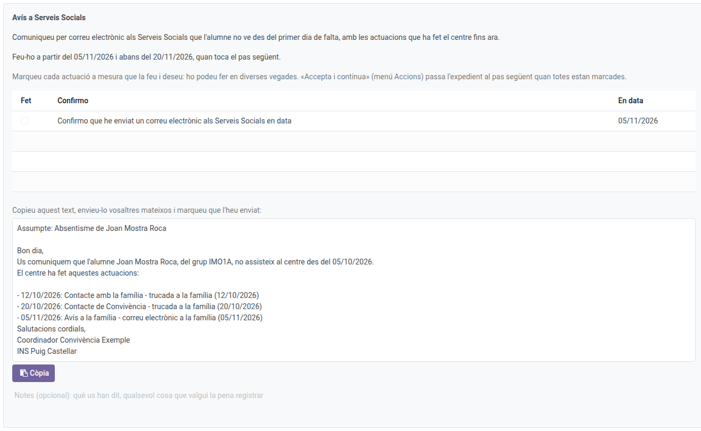
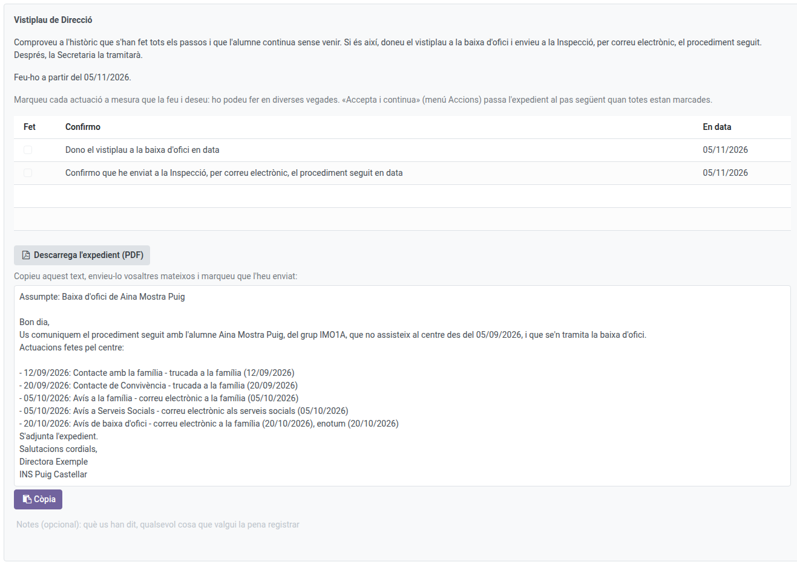
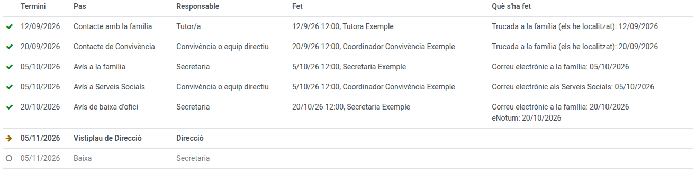

[Català](../../ca/head_of_studies/ex-officio-withdrawal.md) | [Castellano](ex-officio-withdrawal.md) | [English](../../en/head_of_studies/ex-officio-withdrawal.md)

---

# Baja de oficio: Dirección, jefatura de estudios y Convivencia

Esta guía explica qué hacen en un expediente de baja de oficio la dirección (el visto bueno), la jefatura de estudios (seguimiento y decisiones en nombre del tutor) y Convivencia o el equipo directivo (los pasos del circuito de obligatoria).

**Rol necesario:** director/a, jefe de estudios o jefe de estudios adjunto; coordinador/a de convivencia para sus pasos (también el Administrador)

---

## Índice

1. [Dónde encontrar los expedientes](#dónde-encontrar-los-expedientes)
2. [Qué puede hacer la jefatura de estudios](#qué-puede-hacer-la-jefatura-de-estudios)
3. [Los pasos de Convivencia (obligatoria)](#los-pasos-de-convivencia-obligatoria)
4. [El visto bueno de Dirección](#el-visto-bueno-de-dirección)
5. [El historial y el expediente en PDF](#el-historial-y-el-expediente-en-pdf)

---

## Dónde encontrar los expedientes

Navega a: **Gestión académica → Bajas de oficio**. Ves todos los expedientes del centro, con el paso en que está cada uno. Cómo empiezan y qué hace el tutor lo explica el [manual del tutor](../tutors/ex-officio-withdrawal.md); los pasos de Secretaría, el [de Secretaría](../secretary/ex-officio-withdrawal.md).

---

## Qué puede hacer la jefatura de estudios

El jefe de estudios y el jefe de estudios adjunto pueden hacer lo que hace el tutor en cualquier expediente: iniciar o descartar una propuesta, hacer el paso del tutor y revisar los pases de lista que dicen otra cosa. En cambio, solo pueden **abrir** un expediente nuevo (Solicitar la baja de oficio) para el alumnado de los tutores que tienen por debajo.

---

## Los pasos de Convivencia (obligatoria)

En el circuito de obligatoria, el coordinador de convivencia del tutor (o el equipo directivo) tiene dos pasos:

- **Contacto de Convivencia, a los 15 días:** una llamada a la familia, con los botones **Los he localizado** / **No los he localizado**, como el tutor.
- **Aviso a Servicios Sociales, al mes:** el expediente prepara el texto del aviso, con las actuaciones hechas hasta ahora. Cópialo con **Copiar el texto**, envíalo tú mismo por correo y marca que lo has enviado.

Cuando todo está marcado, **Acciones → Aceptar y continuar**.

---

## El visto bueno de Dirección

Cuando se acaba el plazo (15 días lectivos o 2 meses), Dirección recibe la tarea. Comprueba en el historial que se han hecho todos los pasos y que el alumno sigue sin venir:

- **Dar el visto bueno:** marca **Doy el visto bueno a la baja de oficio** y acepta el paso. El alumno pasa a **Baja prevista** (deja de salir en los pases de lista) y Secretaría tramita su baja.
  - En obligatoria, hay que enviar también el procedimiento a la Inspección: descarga el expediente con **Descargar el expediente (PDF)**, copia el texto preparado, envíalo tú mismo por correo y marca que lo has enviado.
- **No darlo:** si el alumno ha vuelto o ha justificado las faltas, **Acciones → Cierra sin baja**, con el motivo y una nota. El expediente se cierra.

---

## El historial y el expediente en PDF

El **Histórico** de cada expediente muestra todos los pasos: cuándo tocaba cada uno, quién lo hizo y cuándo, y qué se marcó. Los pasos pendientes salen en gris.

Cuando el expediente ha acabado (con la baja o cancelado), **Acciones → Imprimir el expediente** genera su PDF, siempre en la lengua del centro.
