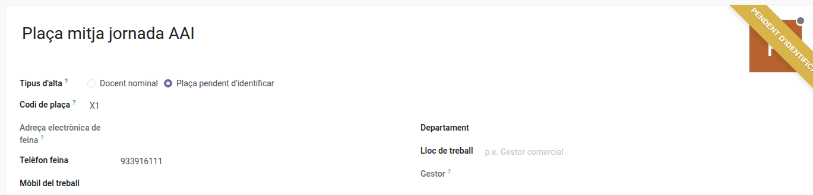
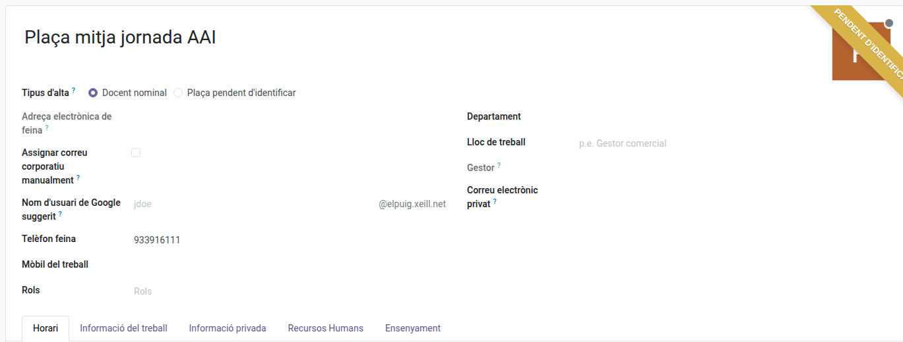
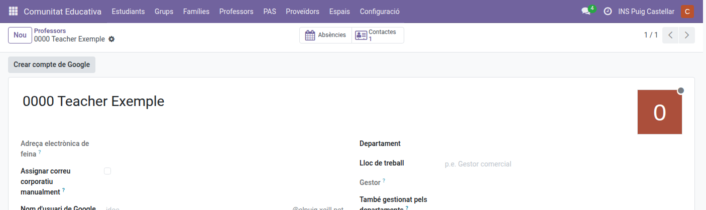
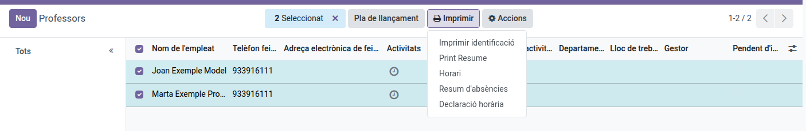
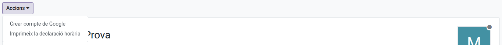
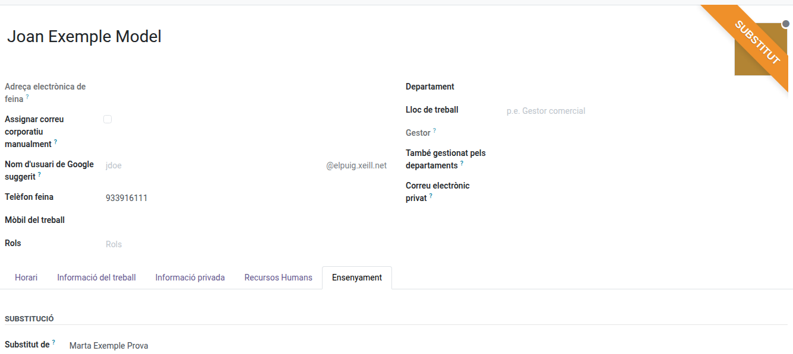

[Català](../../ca/head_of_studies/staff-management.md) | [Castellano](staff-management.md) | [English](../../en/head_of_studies/staff-management.md)

---

# Crear y editar profesorado

La jefatura de estudios, la jefatura de estudios adjunta y la coordinación TAC pueden crear fichas nuevas de profesorado y editar las existentes, sin tener que pasar por una persona administradora. Gestionan la ficha del profesorado entera, incluidas las pestañas **Información privada** y **Recursos Humanos**.

**Cargo necesario:** Jefe/a de estudios, Jefe/a de estudios adjunto/a, director/a o Coordinador/a TAC

---

## Acceso

Id a: **Comunidad Educativa → Profesorado**

---

## Crear una ficha de profesorado

1. Id a **Comunidad Educativa → Profesorado**.
2. Haced clic en **Nuevo**.
3. Dejad **Tipo de alta** en **Docente nominal**, y rellenad el nombre y, en la columna de la derecha bajo **Gestor**, el **Correo electrónico privado**. Este es obligatorio, y el apartado siguiente explica por qué.
4. Haced clic en **Guardar**. El resto de datos (puesto de trabajo, departamento, horario) se pueden completar ahora o más adelante.

Al guardar también se crea el horario semanal propio del profesor o profesora, precargado a partir del marco horario del centro. No hace falta crearlo a mano: abrid la pestaña **Horario** de la ficha para ajustarlo.

### Por qué el correo personal es obligatorio

Es la dirección donde se envían las credenciales de la nueva cuenta de Google. Sin ella la cuenta corporativa simplemente no se crea: la ficha se guarda, pero no pasa nada más y queda una nota en el historial de mensajes explicando qué falta. Pedid una dirección personal antes de crear la ficha: no es una formalidad, es la única manera de que la persona reciba su contraseña. El campo sale dos veces en la ficha: en la pantalla principal, para que nada obligatorio quede escondido detrás de una pestaña mientras la creáis, y en su sitio habitual dentro de la pestaña **Información privada**. Es el mismo campo: si rellenáis uno, se rellena el otro. Tampoco puede ser una dirección del dominio del centro: EMS no permite guardarla, porque también es la dirección de recuperación de la cuenta corporativa.

---

## Crear una plaza pendiente de identificar

Cuando una plaza ya tiene departamento, horario, etc., pero todavía no hay nadie que la cubra, dadla de alta como plaza: no se le crea cuenta de Google ni usuario de EMS.

1. Id a **Comunidad Educativa → Profesorado** y haced clic en **Nuevo**.
2. Bajo el nombre, en **Tipo de alta**, marcad **Plaza pendiente de identificar**.
3. Rellenad el **Código de plaza** (p. ej. `X1`). Dos plazas activas no pueden tener el mismo código. Si más adelante un archivo de horarios trae ese mismo código, el horario se importa en esta ficha.
4. Si queréis, usad el **Nombre** para describir la plaza (p. ej. "Plaza media jornada AAI"); si lo dejáis en blanco, la ficha toma el código de plaza como nombre. No se pide correo personal.
5. Haced clic en **Guardar**. La ficha muestra la cinta **Pendiente de identificar**.

### Cuando se cubre la plaza

1. Abrid la ficha de la plaza.
2. En **Tipo de alta**, marcad **Docente nominal**.

3. Sustituid el **Nombre** por el nombre real de la persona y rellenad su **Correo electrónico privado**.
4. Haced clic en **Guardar**. En unos momentos se crean automáticamente la cuenta de Google y el usuario de EMS, la cinta desaparece y el historial de mensajes de la ficha recoge el código de plaza que tenía. El horario, las asignaturas y las listas de asistencia se mantienen.

Una vez guardada como docente nominal, la ficha ya no muestra **Tipo de alta**: no se puede volver a convertir en plaza.

Si la persona ya tiene una cuenta corporativa (por ejemplo, en otra ficha), marcad **Docente nominal**, activad **Asignar correo corporativo manualmente** y escribid su correo corporativo: no se crea ninguna cuenta nueva. Después, usad **Crear usuario EMS** en el menú **Acciones**.

---

## Editar una ficha de profesorado

1. Id a **Comunidad Educativa → Profesorado** y abrid la ficha.
2. Cambiad lo que necesitéis y haced clic en **Guardar** (o salid de la pantalla, Odoo guarda automáticamente).

---

## Documento de identidad y número de la Seguridad Social

La pestaña **Información privada** de la ficha de un docente empieza con un grupo **Identificación** con el **Documento de identidad** (DNI/NIE) y el **Núm. de la Seguridad Social**. Vosotros, el adjunto/a, el director y el coordinador TAC podéis editarlos en las fichas del profesorado; la Secretaría los mantiene al día para todo el personal, PAS incluido.

El jefe de departamento y el jefe de seminario de un docente también pueden ver estos dos campos, solo de lectura, en las fichas del personal de su propio departamento (solo su propia cadena de mando, no la de otros departamentos). Para ellos la pestaña solo muestra el grupo **Identificación**: el resto de la información privada queda oculta.

---

## Crear la cuenta corporativa de Google

Al guardar la ficha de un profesor nuevo con el nombre y el correo personal, la cuenta corporativa se crea automáticamente en unos momentos: no hace falta pulsar nada.

Las acciones que gestionan la cuenta corporativa están arriba de la ficha, agrupadas en el menú **Acciones** cuando hay más de una. Cuáles aparecen depende del estado de la cuenta:

| Botón | Cuándo aparece | Qué hace |
|-------|----------------|----------|
| **Crear cuenta de Google** | El profesorado no tiene cuenta corporativa y no se está creando ninguna | Crea la cuenta de Google Workspace y el usuario de EMS en un solo paso. Solo hace falta si no se ha podido crear automáticamente |
| **Crear usuario de EMS** | El correo corporativo ya existe, pero no hay ningún usuario de EMS vinculado | Solo vincula o crea el usuario de EMS, no toca nada de Google |
| **Suspender cuenta de Google** | La cuenta está activa | La suspende (por ejemplo, cuando la persona deja el centro) |
| **Reactivar cuenta de Google** | La cuenta está suspendida | La vuelve a activar |
| **Restablecer contraseña de Google** | La cuenta existe y no está suspendida | Asigna a la cuenta una contraseña temporal nueva, que hay que cambiar en el primer inicio de sesión, y entrega credenciales nuevas (ver más abajo). Para quien ha olvidado la contraseña |

Cuando la cuenta se crea, o se restablece su contraseña, las credenciales viajan por dos vías: se guarda un PDF en la ficha, en el bloque **Cuenta de Google** de la pestaña **Recursos humanos**, y se envía un correo con la contraseña a la dirección personal. La ficha solo conserva el último PDF, y solo lo ven los roles que gestionan la cuenta. Si la cuenta no se puede crear porque faltan datos obligatorios, se publica una nota en el historial de mensajes de la ficha indicando exactamente qué campos faltan.

---

## Imprimir las declaraciones horarias

La declaración horaria oficial del Departament de cada docente ("Horari professor/a"), lista para firmar: en **Comunidad Educativa → Profesores**, pasad a la vista de lista, seleccionad los docentes y elegid **Imprimir → Declaración horaria** (una página por docente), o abrid un docente y elegid **Acciones → Imprimir la declaración horaria**. En [Imprimir la declaración horaria oficial](../admin/working-schedules.md#imprimir-la-declaración-horaria-oficial) tenéis qué contiene cada página y cómo se rellena el cuadro resumen.

Las horas de un bloque de *Atención al alumnado* cuentan en la fila de su nivel o en la fila de tutoría de ese nivel según el nivel y el tipo de atención indicados en su tarjeta: consultad [Horarios de los docentes y marcos horarios](../admin/working-schedules.md).

La declaración de los grupos funciona igual: en **Comunidad Educativa → Grupos**, pasad a la vista de lista, seleccionad los grupos principales y elegid **Imprimir → Declaración horaria** (una página cada uno), o abrid un grupo y elegid **Acciones → Imprimir la declaración horaria**. En [Imprimir la declaración horaria oficial](../admin/working-schedules.md#imprimir-la-declaración-horaria-oficial) tenéis qué contienen las páginas.

## Registrar una sustitución

Cuando un docente es sustituido mientras está ausente, registradlo en la ficha del **sustituto**, para que EMS sepa quién sustituye a quién:

1. Id a **Comunidad Educativa → Profesorado** y abrid la ficha del sustituto.
2. En la pestaña **Enseñanza**, en **Sustitución**, elegid al docente sustituido en **Sustituto de**. EMS os avisa de que se reemplazará el horario del sustituto.
3. Haced clic en **Guardar**.

A partir de ese momento, y hasta que termine la sustitución:

- **Horario:** el horario del sustituto pasa a ser una copia del horario del docente sustituido, con sus clases y guardias. La copia se hace una sola vez: si más adelante cambia el horario del docente sustituido, modificad también el del sustituto.
- **Cinta:** la ficha del sustituto muestra la cinta **Sustituto** y la del docente sustituido, la cinta **Sustituido**, con el nombre del sustituto en **Sustituido por** (pestaña Enseñanza).
- **Tablero de guardias:** el docente sustituido ya no aparece. Sus clases y guardias (lavabos, patio...) son del sustituto, así que no hay que cubrirlas.
- **Qué ve el sustituto:** lo mismo que el docente sustituido como docente y como tutor: el alumnado de su grupo de tutoría y sus incidencias de asistencia, sus pases de lista y sus notas. Los avisos y las tareas de tutoría también le llegan al sustituto.
- **Qué sigue siendo del docente sustituido:** sus ausencias, fichajes y declaraciones de huelga, y sus roles (el sustituto de un jefe de departamento no pasa a ser jefe de departamento).

**Cuando el docente sustituido vuelve**, archivad al sustituto, como a cualquier docente que deja el centro. Eso termina la sustitución: su horario se archiva con él (los pases de lista que ha hecho conservan su historial), el docente sustituido vuelve a aparecer en el tablero de guardias y el sustituto deja de tener acceso a sus datos. Su ficha archivada sigue mostrando a quién sustituyó. Si más adelante vuelve al centro, desarchivarlo no retoma la sustitución antigua: **Sustituto de** y su horario quedan vacíos, listos para una nueva.

Vaciar **Sustituto de** a mano solo deshace la sustitución (hacedlo si os habéis equivocado de docente): el horario copiado se queda tal cual, así que ajustadlo en la pestaña **Horario** o elegid al docente correcto, lo que vuelve a copiar su horario.

Si el sustituto también es sustituido, indicad el primer sustituto en el campo **Sustituto de** del nuevo: también actúa como el docente original.

---

## Qué no podéis hacer

Hay dos límites deliberados, y Odoo rechazará la operación si lo intentáis:

- **No podéis borrar una ficha de personal.** Borrar está reservado a la administración. Si una persona deja el centro, no borréis su ficha: suspendedle la cuenta de Google y archivad la ficha, así se conserva su historial.
- **No podéis editar fichas del Personal de Administración y Servicios (PAS).** Las podéis consultar — y, como ahora tenéis los permisos de recursos humanos, también su información privada — pero la edición y la creación quedan restringidas al personal docente. Las fichas del PAS las gestiona la secretaría.

---

## Quién más puede hacerlo

Crear y editar profesorado también está disponible para la dirección (que hereda los permisos de la jefatura de estudios) y para la administración, que además puede borrar fichas y gestionar el PAS. Ved [Cargos del profesorado y niveles de permisos](../admin/teacher-roles.md) para ver la escala completa de permisos y cómo se asigna el cargo de coordinación TAC.

---

[← Volver al índice de Jefatura de Estudios](index.md)
