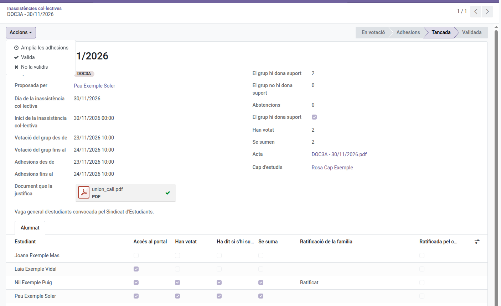
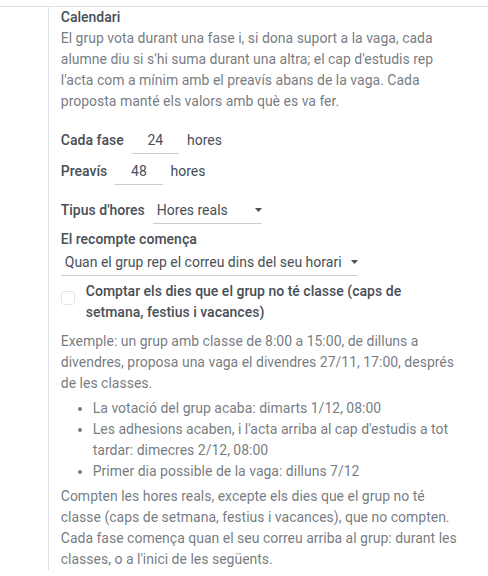

[Català](../../ca/head_of_studies/student-walkout.md) | [Castellano](student-walkout.md) | [English](../../en/head_of_studies/student-walkout.md)

---

# Huelgas de estudiantes: validarlas

El delegado de un grupo propone en el portal que el grupo apoye una huelga convocada por un sindicato de estudiantes, el grupo vota, y el tutor del grupo vela por la propuesta. Tú recibes el acta cuando se cierra y decides si la validas. Los alumnos que se suman no constan en el pase de lista de ese día (ni faltan ni asisten), y no se justifica nada. Cómo participan el alumnado y las familias se explica en el [manual de familias](../families/manual-vagues.md), y la parte del tutor en el [manual de tutores](../tutors/student-walkout.md).

No hay que confundirla con los **Strikes** (Convivencia), el registro disciplinario, ni con el informe de huelga del personal.

---

## Qué recibes

- **Nada cuando se hace una propuesta**: vela por ella el tutor.
- **Un aviso en tu resumen diario** cuando un tutor (o alguien por encima de él) aborta una propuesta, con el motivo.
- **El acta, por correo**, cuando la propuesta se cierra: como mínimo 48 horas antes de la huelga (por defecto), con el recuento de votos y los alumnos que se suman. Si alguien se suma, también recibes la tarea **Validar la huelga de estudiantes**.
- **Un aviso en tu resumen diario** cuando se vuelve a abrir una propuesta cerrada porque se han ampliado sus adhesiones: el acta que tenías se retira y recibes una nueva cuando se cierre de nuevo.

El acta llega al jefe de estudios o al jefe de estudios adjunto por encima del tutor del grupo; la de un grupo sin tutor, a todos los jefes de estudios y jefes de estudios adjuntos.

---

## Validarla

Abre la propuesta desde el correo o desde **Asistencia de los estudiantes > Huelgas de estudiantes**.

- **Acciones > Validar**: confirma la huelga. Los alumnos que se suman siguen sin constar en el pase de lista de ese día; la ratificación de la familia de un menor no cambia nada (solo indica que está al corriente y de acuerdo), pero la familia que no la ha ratificado recibe, a título informativo, el aviso de cada clase a la que no asiste. Se avisa a todo el alumnado del grupo, a la familia de cada alumno menor que se suma, y al tutor.
- **Acciones > No validar**: elige un motivo; las clases de ese día de los alumnos que se suman cuentan como faltas. Se avisa a todo el alumnado, al tutor y a las familias a las que se pidió que lo ratificaran.
- **Acciones > Deshacer la validación** (en una propuesta validada): igual que no validarla, las clases de ese día vuelven a contar como faltas. Se avisa al alumnado, a las familias y al tutor, con el motivo.

Los motivos salen de **Asistencia de los estudiantes > Configuración > Huelgas de estudiantes > Motivos de rechazo**, los mismos que usa el tutor para abortar una propuesta. Puedes añadirlos, cambiarles el nombre o reordenarlos; «Otros» pide detalles.

---

## Configuración

Un administrador la define en **Ajustes > Huelgas de estudiantes**:

- **Niveles y cursos**: qué niveles (y, si hace falta, qué cursos) pueden proponer apoyar una huelga. Por defecto, a partir de 3.º de ESO, bachillerato y formación profesional.
- **Calendario**: cuánto dura cada fase y con cuánta antelación debes recibir el acta antes de la huelga (24 y 48 horas por defecto), y cómo se cuentan esas horas:
  - **Tipo de horas**: **horas reales** (cualquier hora del día) u **horas lectivas** (solo las horas que el grupo está en clase, según su horario; el calendario se alarga mucho).
  - **El recuento empieza** (solo con horas reales): **desde el momento de la propuesta** (los correos al grupo y al tutor salen enseguida, sea la hora que sea) o **cuando el grupo recibe el correo dentro de su horario**.
  - **Contar los días que el grupo no tiene clase** (solo con horas reales, desactivado por defecto): desactivado, los fines de semana, los festivos y las vacaciones no cuentan (24 horas desde el viernes a las 9:00 acaban el lunes a las 9:00); activado, cuentan como cualquier otro día (acaban el sábado a las 9:00).

  Bajo los controles, un **ejemplo** muestra, antes de guardar, cuándo acabarían la votación y la adhesión de una propuesta de muestra y el primer día posible de la huelga con los valores de la pantalla. Cada propuesta mantiene los valores con los que se hizo.

---

[← Volver a los manuales de jefatura de estudios](index.md)
