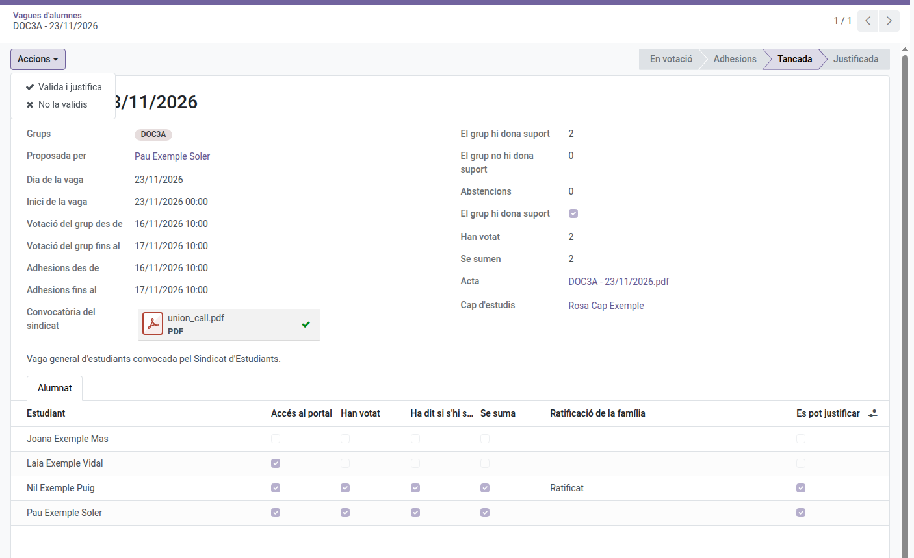

[Català](../../ca/head_of_studies/student-walkout.md) | [Castellano](student-walkout.md) | [English](../../en/head_of_studies/student-walkout.md)

---

# Huelgas de estudiantes: validarlas

El delegado de un grupo propone en el portal que el grupo apoye una huelga convocada por un sindicato de estudiantes, el grupo vota, y el tutor del grupo vela por la propuesta. Tú recibes el acta cuando se cierra y decides si la validas: validarla justifica la falta de quienes se suman. Cómo participan el alumnado y las familias se explica en el [manual de familias](../families/manual-vagues.md), y la parte del tutor en el [manual de tutores](../tutors/student-walkout.md).

No hay que confundirla con los **Strikes** (Convivencia), el registro disciplinario, ni con el informe de huelga del personal.

---

## Qué recibes

- **Nada cuando se hace una propuesta**: vela por ella el tutor.
- **Un aviso en tu resumen diario** cuando un tutor (o alguien por encima de él) aborta una propuesta, con el motivo.
- **El acta, por correo**, cuando la propuesta se cierra: como mínimo 48 horas lectivas antes de la huelga (por defecto), con el recuento de votos y los alumnos que se suman. Si hay que justificar la falta de alguien, también recibes la tarea **Justificar la huelga de estudiantes**.

El acta llega al jefe de estudios o al jefe de estudios adjunto por encima del tutor del grupo; la de un grupo sin tutor, a todos los jefes de estudios y jefes de estudios adjuntos.

---

## Validarla

Abre la propuesta desde el correo o desde **Asistencia de los estudiantes > Huelgas de estudiantes**.

- **Acciones > Validar y justificar**: crea un justificante de todo el día de la huelga para los alumnos a quienes se puede justificar la falta, y lo abre. Son los mayores de edad que se suman y los menores cuya familia lo ha ratificado (Decret 102/2010, artículo 24.2: la columna **Se puede justificar** de la pestaña **Alumnado**). Si un alumno ya tenía un justificante ese día, se lo salta y queda anotado en la convocatoria. Se avisa a todo el alumnado del grupo, a la familia de cada alumno menor con la falta justificada, y al tutor.
- **Acciones > No validar**: elige un motivo; no se justifica la falta de nadie. Se avisa a todo el alumnado, al tutor y a las familias a las que se pidió que lo ratificaran.
- **Acciones > Deshacer la validación** (en una propuesta validada): borra el justificante, de modo que las faltas dejan de estar justificadas. Se avisa al alumnado, a las familias y al tutor, con el motivo.

Los motivos salen de **Asistencia de los estudiantes > Configuración > Huelgas de estudiantes > Motivos de rechazo**, los mismos que usa el tutor para abortar una propuesta. Puedes añadirlos, cambiarles el nombre o reordenarlos; «Otros» pide detalles.

---

## Configuración

Un administrador la define en **Ajustes > Huelgas de estudiantes**:

- **Niveles y cursos**: qué niveles (y, si hace falta, qué cursos) pueden proponer apoyar una huelga. Por defecto, a partir de 3.º de ESO, bachillerato y formación profesional.
- **Calendario**: cuánto dura cada fase y con cuánta antelación debes recibir el acta antes de la huelga, en horas lectivas (24 y 48 por defecto). Cada propuesta mantiene los valores con los que se hizo.

---

[← Volver a los manuales de jefatura de estudios](index.md)
