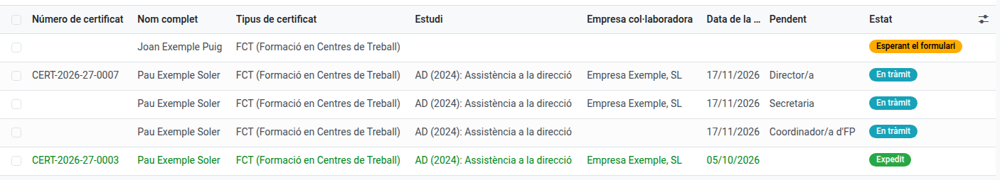
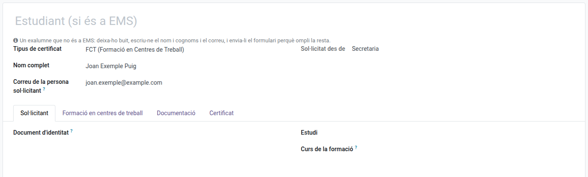
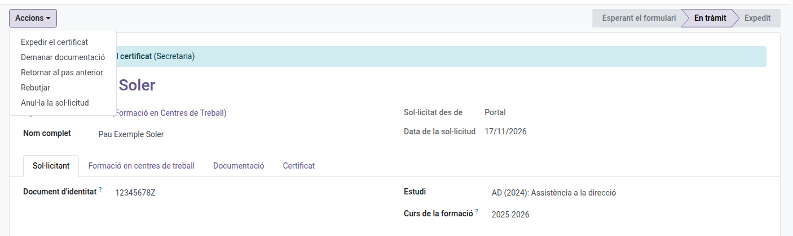

[Català](../../ca/secretary/certificates.md) | [Castellano](certificates.md) | [English](../../en/secretary/certificates.md)

---

# Certificados: registrar, expedir y hacer el seguimiento de las solicitudes

Registra las solicitudes de certificado que llegan a secretaría (por ejemplo, de un exalumno), expide los certificados y haz el seguimiento de todas las solicitudes.

**Rol necesario:** Secretaría. Para expedir un certificado hay que ocupar el cargo de secretario o secretaria.

---

## Cómo funciona una solicitud

Cada certificado es de un **tipo** (por ejemplo, *FCT (Formació en Centres de Treball)*), y cada tipo tiene su **circuito de aprobación**: los pasos que hace cada cargo, por orden. El del certificado de FCT es:

1. **Completar los datos** — el coordinador o coordinadora de FP completa la empresa, el periodo, las horas y el convenio.
2. **Expedir el certificado** — secretaría lo expide: recibe el número (por ejemplo `CERT-2026-27-0001`) y el sello de EMS.
3. **Dar el visto bueno** — el director o directora da el visto bueno. Se genera el PDF y se envía por correo a la persona solicitante.

Cada paso es una tarea para quien ocupa el cargo, que la encuentra en su resumen diario y en el filtro **Pendientes de mí**.

Una solicitud puede llegar de dos maneras:

- **Desde el portal:** el alumnado actual (o su familia) la hace desde el portal y entra directamente en el primer paso.
- **Desde secretaría:** la registras tú, normalmente para un exalumno, que no tiene acceso al portal.

---

## Acceso

Navega a: **Gestión académica → Certificados**. La lista se abre con el filtro **Pendientes de mí**; quítalo para ver todas las solicitudes. La columna **Pendiente de** indica de qué cargo es el paso actual.

---

## Registrar la solicitud de un exalumno

1. Haz clic en **Nuevo**.
2. Elige el **Tipo de certificado**.
3. Si el exalumno está en EMS, elígelo en **Estudiante (si está en EMS)**: sus datos se rellenan solos. Si no está, déjalo vacío y escribe su **Nombre completo** y el **Correo de la persona solicitante**.
4. Guarda.
5. Abre **Acciones → Enviar formulario**. El exalumno recibe un correo con un enlace al formulario, donde rellena los datos que faltan y adjunta la documentación que tenga, sin iniciar sesión.

Si ya tienes todos los datos obligatorios (pestaña **Solicitante**: documento de identidad, estudio y curso de la formación), **Enviar formulario** también pasa la solicitud al primer paso. El exalumno aún puede completar o corregir sus datos desde el enlace hasta que alguien del centro cambie la solicitud o haga alguna acción.

Si la solicitud te llega en papel y no hace falta enviar nada, rellena todos los datos y haz clic en **Acciones → Iniciar la solicitud**.

El estudio tiene que ser de uno de los niveles del tipo de certificado (para el de FCT, CFGM o CFGS): el desplegable solo muestra esos.

---

## Expedir un certificado

1. Abre la solicitud desde el filtro **Pendientes de mí**.
2. Comprueba los datos de las pestañas **Solicitante** y **Formación en centros de trabajo**.
3. En la pestaña **Documentación**, comprueba que todos los documentos obligatorios (en verde) tienen ficheros.
4. Abre **Acciones → Expedir el certificado** y confirma.

Si falta algún dato o algún documento obligatorio, EMS te lo indica y no deja expedirlo.

### Expedirlo sin esperar a los pasos anteriores

A veces ya tienes todos los datos y documentos de una solicitud que aún está en un paso anterior (por ejemplo, esperando a que el coordinador de FP complete la formación en centros de trabajo). No hace falta que esperes:

1. Abre la solicitud. Aún no aparece en **Pendientes de mí**: quita ese filtro para encontrarla.
2. Completa lo que falte en las pestañas **Solicitante** y **Formación en centros de trabajo**, y adjunta los documentos obligatorios en **Documentación**.
3. Abre **Acciones → Expedir ahora** y confirma que tienes todos los datos y documentos obligatorios.

Los pasos anteriores se saltan y sus tareas pendientes se cierran, y el historial de la solicitud registra quién los ha saltado. El certificado recibe su número y tu sello, y pasa a la aprobación de la dirección como siempre. Se hacen las mismas comprobaciones que al expedirlo en su paso: si falta algo obligatorio, EMS te indica qué y no lo expide. El botón también está disponible en una solicitud que acabas de registrar, antes de enviar el formulario o de iniciarla.

---

## Otras acciones

En el menú **Acciones** de la solicitud:

- **Pedir documentación** — escribe qué falta; la persona solicitante lo recibe por correo con un enlace para responder y adjuntarlo. Cuando responde, la solicitud vuelve a su paso.
- **Documentación recibida** — si la documentación te llega por otra vía (en papel, por correo), devuelve la solicitud a su paso.
- **Devolver al paso anterior** — escribe el motivo; quien hizo el paso anterior lo vuelve a tener pendiente.
- **Rechazar** — escribe el motivo; la persona solicitante lo recibe por correo.
- **Anular la solicitud** — solo antes de expedir el certificado (por ejemplo, si está duplicada). Una solicitud anulada se puede **Reabrir**.

La pestaña **Certificado** contiene el PDF expedido y los sellos (quién hizo cada paso y cuándo).

---

## Documentación

La pestaña **Documentación** tiene:

- **Documentación obligatoria** — los documentos que exige el tipo de certificado (para el de FCT, el **Convenio de FCT**). La columna **Lo adjunta** indica quién puede adjuntarlos. Abre la línea para adjuntar ficheros (PDF o fotos de las páginas).
- **Otra documentación** — cualquier otro fichero, opcional. No se añade al certificado.

El PDF del certificado incluye al final las páginas de los documentos obligatorios marcados para añadirlos al certificado.

---

## Empresas colaboradoras

Las empresas donde el alumnado hace la formación están en **Comunidad educativa → Empresas colaboradoras**. Desde la pestaña **Formación en centros de trabajo** de una solicitud se puede elegir una o crearla con el botón **Crear empresa**, a partir del nombre y el NIF que escribió el alumno.
