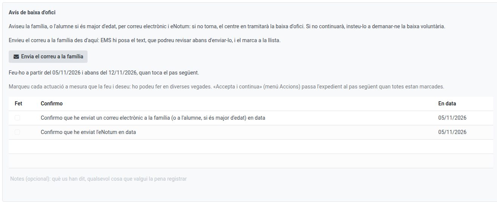
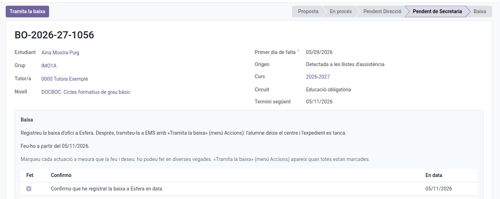

[Català](../../ca/secretary/ex-officio-withdrawal.md) | [Castellano](ex-officio-withdrawal.md) | [English](../../en/secretary/ex-officio-withdrawal.md)

---

# Baja de oficio: los pasos de Secretaría

Esta guía explica los pasos que hace Secretaría en un expediente de baja de oficio: los avisos a la familia y, cuando Dirección ha dado el visto bueno, la tramitación de la baja.

**Rol necesario:** Secretaría (también el Administrador)

---

## Índice

1. [Dónde encontrar los expedientes](#dónde-encontrar-los-expedientes)
2. [Los avisos a la familia](#los-avisos-a-la-familia)
3. [Tramitar la baja](#tramitar-la-baja)

---

## Dónde encontrar los expedientes

Navega a: **Gestión académica → Bajas de oficio**. Ves todos los expedientes del centro. Cuando un paso es tuyo, recibes la tarea el día que toca y el expediente te muestra qué tienes que hacer y hasta cuándo; en los demás pasos solo ves de quién es el turno.

Cómo empieza un expediente y qué hacen el tutor y Dirección lo explican el [manual del tutor](../tutors/ex-officio-withdrawal.md) y el [de Dirección](../head_of_studies/ex-officio-withdrawal.md).

---

## Los avisos a la familia

Según el circuito, Secretaría avisa a la familia:

- **Postobligatoria, el 10.º día lectivo (Aviso de baja de oficio):** correo a la familia y eNotum: si el alumno no vuelve, el centro tramitará su baja de oficio.
- **Obligatoria, al mes (Aviso a la familia) y al mes y medio (Aviso de baja de oficio):** el correo y, en el último, el eNotum.

Para enviar el correo, haz clic en **Envía el correo a la familia**: EMS pone el texto, que puedes revisar antes de enviarlo, y lo marca en la lista con la fecha. El eNotum lo haces fuera de EMS y lo marcas tú, con el día en que lo enviaste. Cuando todo está marcado, **Acciones → Aceptar y continuar**.

---

## Tramitar la baja

Cuando Dirección ha dado el visto bueno, el alumno pasa a **Baja prevista** (deja de salir en los pases de lista) y te llega el último paso:

1. Registra la baja en Esfera, fuera de EMS, y márcalo en la lista.
2. En postobligatoria, también la registras en SAGA y envías el eNotum (márcalo igual) y el correo de baja hecha a la familia, con **Envía el correo a la familia**.
3. Haz clic en **Tramita la baja**: se abre el asistente de baja ya rellenado como baja de oficio. Al aplicarlo, el alumno deja el centro y el expediente se cierra.

Si el alumno pide la baja voluntaria mientras el expediente está abierto, tramítala como siempre ([Marcar una graduación y tramitar una baja](graduation-withdrawal.md)): el expediente se cierra solo.
