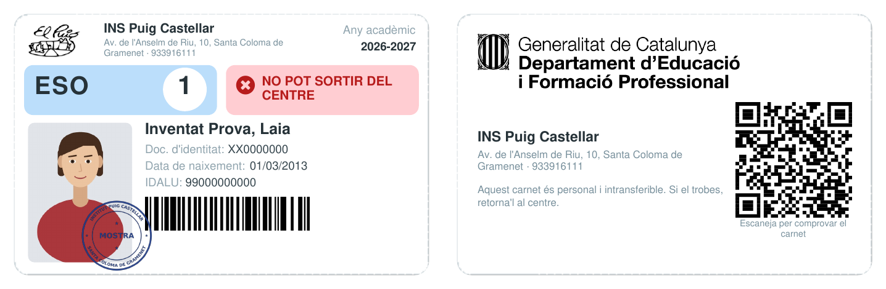
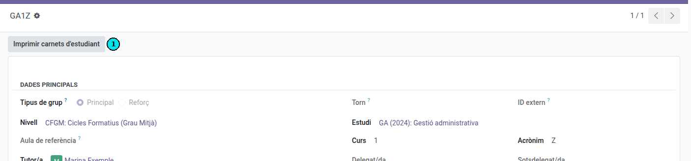
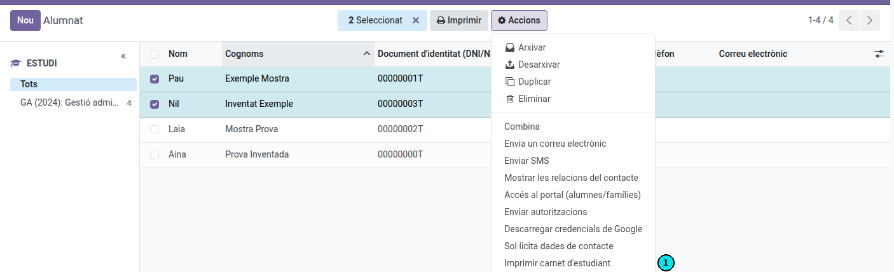
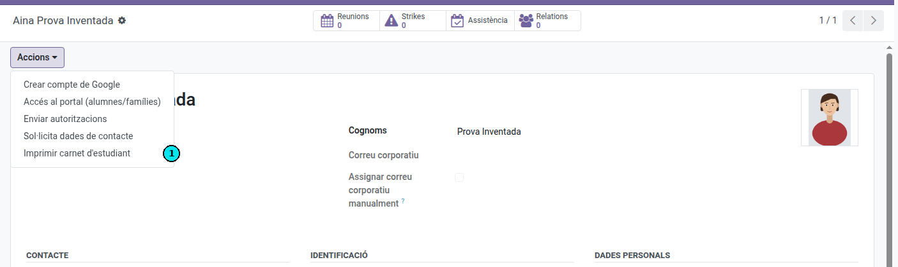

[Català](../../ca/secretary/student-card.md) | [Castellano](student-card.md) | [English](../../en/secretary/student-card.md)

---

# Imprimir los carnés de estudiante

EMS genera el carné de estudiante en un PDF listo para imprimir y recortar.

**Rol necesario:** secretaría, jefatura de estudios o administración, para cualquier alumno. Los tutores imprimen los carnés de sus alumnos, y su jefe de seminario, su jefe de departamento y su jefe de estudios también pueden hacerlo con ese alumnado.

---

## Qué hay en el carné

**Anverso:**

- El logotipo, el nombre, la dirección y el teléfono del centro, y el curso académico actual.
- Una franja partida en dos. A la izquierda, el nivel del alumno en grande (ESO, BTX, CFGB, CFGM, CFGS, PFI, EFPS), las siglas del estudio (SMX, DAW...; no en la ESO ni en el BTX, donde repetirían el nivel) y el curso (1, 2, 3, 4) dentro de un círculo blanco, en el color del nivel.
- A la derecha, si el alumno puede salir del centro, para el profesorado de la puerta: **Pot sortir del centre** (en verde) cuando el alumno es mayor de edad o la familia ha aceptado la autorización *Salir del centro* de este curso, y **No pot sortir del centre** (en rojo) en caso contrario. El carné lo muestra tal como era al imprimirlo; el QR del reverso lo muestra siempre tal como es ahora. Si el alumno cumple 18 años o la familia acepta la autorización más tarde, puedes volver a imprimir el carné.
- La foto, los apellidos y el nombre, el documento de identidad (DNI o NIE, o el pasaporte si no tiene), la fecha de nacimiento y el IDALU, con su código de barras.
- El sello del centro, sobre la esquina inferior de la foto. Si la administración aún no lo ha subido, sale un círculo en blanco para sellarlo a mano. Sellar a mano con tinta, encima de la foto, y después plastificar el carné hace mucho más difícil cambiarle la foto.

**Reverso:** el logotipo del Departament d'Educació i Formació Professional, los datos del centro, el aviso de que el carné es personal e intransferible y un **código QR** para comprobar que el carné es auténtico (ver [Comprobar un carné de estudiante](../teachers/student-card-check.md)).

El carné sale siempre en catalán, sea cual sea el idioma de quien lo imprime. Los datos salen de la ficha del alumno: si falta alguno (por ejemplo, la foto), complétalo antes de imprimir.

---

## Imprimir los carnés de todo un grupo

1. Ve a **Comunidad educativa → Grupos** y abre el grupo.
2. En la cabecera, pulsa **Imprimir carnés de estudiante**. Si hay más acciones, el botón está dentro del menú **Acciones**.

El PDF contiene el carné de todos los alumnos que tienen este grupo como grupo principal, ordenados por apellidos.

---

## Imprimir los carnés de unos cuantos alumnos

1. Ve a **Comunidad educativa → Estudiantes** y pasa a la vista de lista.
2. Marca los alumnos.
3. Abre el menú **Acciones** (el engranaje) y pulsa **Imprimir carné de estudiante**.

Si entre los seleccionados hay contactos que no son alumnos, o alumnos de los que no puedes imprimir el carné, se dejan fuera. Si no queda ninguno, un mensaje te lo indica.

---

## Imprimir el carné de un alumno

1. Abre la ficha del alumno.
2. En la cabecera, abre el menú **Acciones** y pulsa **Imprimir carné de estudiante**.

---

## Imprimir y recortar

El PDF está en formato A4, con 10 carnés por hoja en dos columnas. Cada carné mide lo que una tarjeta de crédito (85,6 × 54 mm), para que quepa en las fundas habituales.

Detrás de cada hoja de anversos va su hoja de reversos. Imprime el PDF a doble cara, girando por el lado largo, y cada reverso (con su QR) queda justo detrás de su anverso. Después, recorta cada carné por la línea discontinua.

---

## Volver a imprimir un carné

Un carné estropeado se puede volver a imprimir tantas veces como haga falta, solo o con todo el grupo: el carné nuevo tiene el mismo QR, y los carnés ya entregados siguen funcionando.

El QR vale para el curso académico actual. Cuando cambia el curso, los carnés del anterior muestran «no válido», y el primer carné que se imprime en el curso nuevo lleva un QR nuevo.

---

## Anular un carné perdido o robado

1. Abre la ficha del alumno.
2. En la cabecera, abre el menú **Acciones**, pulsa **Anular carné de estudiante** y confírmalo.

Desde ese momento, el QR de todos los carnés impresos hasta ahora para ese alumno muestra **Carnet no vàlid**. Imprímele un carné nuevo: lleva el QR nuevo. En la ficha del alumno queda una nota de la anulación.

Cuando un alumno deja el centro (baja, graduación), su carné deja de ser válido automáticamente: no hace falta anularlo.

---

[← Volver al índice](index.md)
