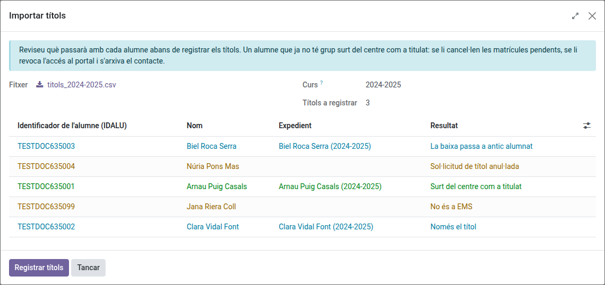
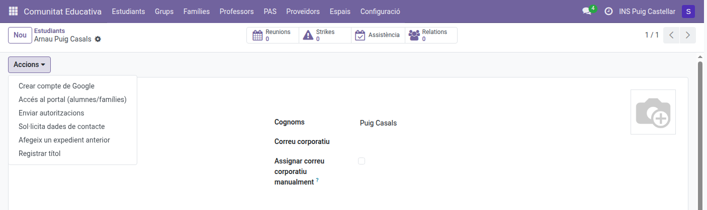
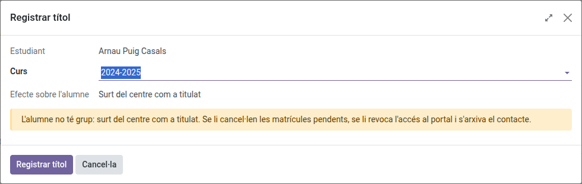

[Català](../../ca/secretary/titles.md) | [Castellano](titles.md) | [English](../../en/secretary/titles.md)

---

# Registrar los títulos obtenidos

Esta guía explica cómo dejar constancia en el histórico académico de que un alumno ha obtenido un título (ESO, Bachillerato...), ya sea para todo un listado de alumnos o para uno solo, y qué pasa con cada alumno al hacerlo.

---

## Contenido

1. [Qué hace registrar un título](#qué-hace-registrar-un-título)
2. [Importar los títulos de un curso](#importar-los-títulos-de-un-curso)
3. [Registrar el título de un alumno](#registrar-el-título-de-un-alumno)

---

## Qué hace registrar un título

El título se marca en el histórico académico del alumno, en el expediente del curso en que lo obtuvo, y el alumno queda marcado como titulado. Después, según la situación del alumno:

| Situación | Qué pasa |
|---|---|
| Estudia en el centro (tiene grupo) | Solo se marca el título. |
| Activo pero sin grupo (ya no estudia aquí) | Sale del centro como titulado: se le cancelan las matrículas pendientes, se le revoca el acceso al portal, se programa la suspensión de la cuenta de Google y el contacto se archiva como **Antiguo alumno**. |
| Dado de baja | Pasa a **Antiguo alumno**. Se conservan los datos de la baja (fecha y curso). |

El expediente de ese curso debe existir ya en el histórico.

## Importar los títulos de un curso

Usadlo con el listado de solicitudes de título exportado de Esfera, o con cualquier listado del alumnado titulado.

1. Id a **Planificación y calificación → Calificaciones → Importar títulos**.
2. Elegid el fichero (CSV o Excel).
3. Comprobad el **Curso**: por defecto aparece el curso anterior. Cambiadlo si los títulos son de otro curso.
4. Haced clic en **Previsualizar**.
5. Revisad el resultado de cada alumno, haced clic en **Registrar títulos** y confirmad.

Al terminar, el asistente muestra un resumen (títulos registrados, alumnos que han salido del centro, bajas que han pasado a antiguo alumnado y filas no registradas) y descarga un fichero CSV con el resultado de cada fila del fichero. Podéis volver a descargarlo con **Descargar log de importación (CSV)**.

La única columna que debe tener el fichero es el identificador del alumno, con el nombre **Identificador de l'alumne/a** (como lo exporta Esfera) o **IDALU**. Si el fichero también tiene estas columnas, se usan:

- **Curs**: las filas de un curso distinto del elegido se descartan.
- **Estat de la sol·licitud**: una solicitud anulada no cuenta, salvo que el alumno tenga otra en el fichero.
- **Nom**, **Primer cognom**, **Segon cognom**: se muestran para los alumnos que no están en EMS.

La previsualización muestra uno de estos resultados para cada alumno:

| Resultado | Significado |
|---|---|
| Sale del centro como titulado | Alumno activo sin grupo. |
| Solo el título | Alumno que sigue estudiando en el centro. |
| La baja pasa a antiguo alumnado | Alumno dado de baja. |
| Título ya registrado | No hay nada que hacer. |
| Sin expediente del curso | El alumno no tiene el expediente de ese curso en el histórico: el título no se registra. |
| No está en EMS | Ningún contacto tiene ese identificador. |
| Solicitud de título anulada | Todas las solicitudes del alumno en el fichero están anuladas. |
| Otro curso | La fila es de otro curso. |

Solo se registran los tres primeros resultados.

## Registrar el título de un alumno

1. Abrid la ficha del alumno.
2. Haced clic en **Acciones → Registrar título**.

3. Elegid el **Curso** del histórico académico en que obtuvo el título (aparece seleccionado el último curso sin título).
4. Comprobad el **Efecto sobre el alumno** y haced clic en **Registrar título**.

También podéis marcar **Título obtenido** directamente en un expediente del histórico académico (**Planificación y calificación → Calificaciones → Histórico académico**): tiene los mismos efectos.

---

[← Volver al índice de Secretaría](index.md)
