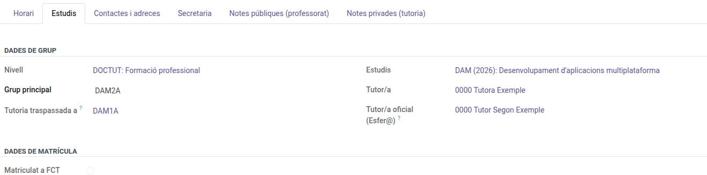

[Català](../../ca/secretary/tutorship-transfer.md) | [Castellano](tutorship-transfer.md) | [English](../../en/secretary/tutorship-transfer.md)

---

# Traspasar la tutoría de un alumno

A veces, un alumno matriculado en 2.º con asignaturas de 1.º pendientes se da de baja de todas las de 2.º y solo cursa las de 1.º. En Esfer@ sigue en su grupo de 2.º, con su tutor, que sigue poniéndole las notas allí. En EMS, en cambio, el seguimiento pasa al tutor de 1.º: la familia, las faltas, los strikes, las inasistencias colectivas y el resumen diario. Traspasar la tutoría sirve para registrarlo.

**Rol necesario:** secretaría

---

## Cómo se traspasa la tutoría

1. Abre la ficha del alumno (**Comunidad educativa → Alumnado**).
2. Ve a la pestaña **Estudios**.
3. En **Tutoría traspasada a**, elige el grupo al que asiste ahora el alumno (por ejemplo, el grupo de 1.º). Deja el **Grupo principal** como está: es el grupo de Esfer@.
4. Guarda. Ahora **Tutor/a** muestra el tutor del grupo nuevo y **Tutor/a oficial (Esfer@)**, el del grupo principal.

Para deshacerlo, vacía **Tutoría traspasada a** y guarda.

## Qué cambia

- El tutor nuevo encuentra al alumno entre su alumnado (**Mi alumnado**) y puede gestionar sus datos y los de su familia, como con cualquier alumno de su grupo. Recibe las incidencias de asistencia del alumno, los avisos de strikes y el resto de avisos de tutor.
- El alumno participa en las inasistencias colectivas del grupo al que se ha traspasado la tutoría.
- El tutor oficial conserva lo que va por grupo: las sesiones de evaluación y el expediente de su grupo. Deja de gestionar los datos del alumno y de recibir avisos sobre él.
- El grupo principal, la matrícula y la declaración de horario no cambian.

## El horario del alumno

El horario muestra las asignaturas en las que está matriculado el alumno. Para que solo aparezca la tutoría de 1.º, da de baja la tutoría de 2.º (con el resto de asignaturas de 2.º) y matricula al alumno en la tutoría de 1.º, en el grupo de 1.º.

## Cuándo termina

El traspaso termina solo cuando cambia el curso, cuando el alumno deja el centro y cuando su grupo principal pasa a ser el grupo al que se había traspasado la tutoría.

---

[← Volver a los manuales de secretaría](index.md)
