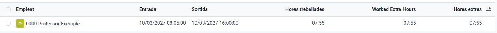
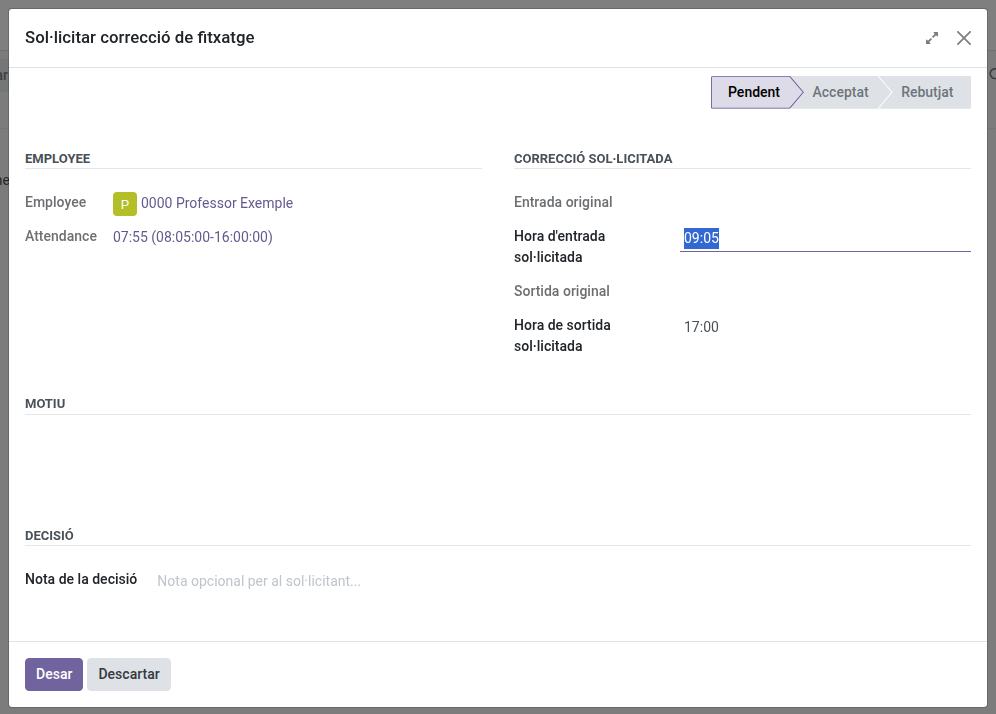
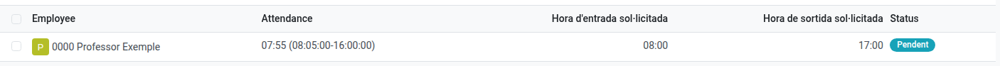

[Català](../../ca/teachers/attendance-corrections.md) | [Castellano](attendance-corrections.md) | [English](../../en/teachers/attendance-corrections.md)

---

# Fichajes: revisar tus entradas/salidas y solicitar correcciones

Cada entrada y salida que haces queda registrada automáticamente. Esta página explica cómo revisar tus propios fichajes y, si alguno tiene la hora incorrecta, cómo solicitar una corrección.

**Rol necesario:** Profesor/a

---

## Revisar tus fichajes

1. Ve a **Fichajes de empleados → Asistencia → Vista general**.
2. La lista muestra tus fichajes de entrada/salida del curso actual, los más recientes primero, como una lista simple: cada registro está a un clic.

   

3. Haz clic en cualquier registro para ver sus detalles: hora de entrada, hora de salida y cómo se registró (quiosco, manual, etc.).

> Aquí solo ves tus propios fichajes. Además de ti, pueden verlos quienes están por encima de ti en la jerarquía — tu Jefe de departamento o de seminario (solo lectura) y tu JE o JEA —, Dirección y el Administrador. Un centro también puede permitir que todos los jefes de estudios consulten los fichajes de todos.

**Cursos anteriores.** Cuando el centro pasa a un curso nuevo, los fichajes del anterior se archivan: no se borran, pero ya no aparecen en la lista. Para verlos, abre el menú **Filtros** de la barra de búsqueda y marca **Archivado**.

**Si eres Jefe de departamento o de seminario**, la misma lista muestra también los fichajes de las personas de tu departamento (todos los que están por debajo de ti en la jerarquía), solo para consultarlos: no puedes cambiarlos. Como incluye a varias personas, tu lista se abre agrupada por mes y por empleado; despliega un grupo para ver sus registros.

---

## Solicitar una corrección

Si una entrada o salida se ha registrado con una hora incorrecta (has olvidado fichar, un fallo del quiosco, etc.):

1. Abre el fichaje con la hora incorrecta.
2. Haz clic en **Solicitar corrección** en la cabecera.
3. Se abre un formulario con la **hora de entrada** y/o **salida** ya rellenadas con el valor actual — solo necesitas cambiar la que esté mal. Recuerda que solo se puede corregir la hora del día, no la fecha.

   

   > Si todavía estás fichado/a (no has fichado salida) y sigues dentro de tu horario laboral de hoy, solo se muestra el campo de **hora de entrada** — todavía no has salido, así que no hay nada que corregir en la salida. El campo de **salida** aparece cuando tu jornada laboral de ese día ya ha terminado.
4. Explica el motivo en el campo **Motivo**.
5. Haz clic en **Guardar**. La solicitud queda **Pendiente**.

> Una vez guardado, el motivo ya no se puede editar — si necesitas añadir más contexto después, usa el chat de la parte inferior de la solicitud para dejar un comentario.

> **¿Has recibido un mensaje sobre tu salida?** Si fichas la entrada después de la última hora que tu horario preveía ese día y olvidas fichar la salida, la salida automática no puede usar tu horario para cerrar el fichaje: lo cierra una hora después de la entrada y te envía un mensaje (correo electrónico y chat del fichaje) que lo explica. Si esa hora no es la de tu salida, solicita una corrección como se explica más arriba. Ese mensaje solo lo recibes tú: tu jefe de estudios o jefe de estudios adjunto solo se entera si solicitas la corrección.

---

## Qué pasa después

Tu solicitud se envía automáticamente a quien puede validarla — normalmente tu Jefatura de Estudios o Jefatura de Estudios Adjunta (se encuentra subiendo por la cadena de mando desde tu propio responsable; si no hay ninguna configurada, se avisa a un Administrador para que lo corrija).

- Revisa la hora original frente a la que has solicitado, y tu motivo.
- **Aceptar**: tu fichaje se corrige con la hora solicitada.
- **Rechazar**: tu registro se queda tal como estaba.
- En cualquier caso, recibirás una notificación automática (la verás en el chat de la solicitud, y por correo).
- Si se ha equivocado, puede cambiar su decisión más adelante — recibirás una nueva notificación si esto ocurre.

---

## Consultar el estado de tus solicitudes

- **Fichajes de empleados → Asistencia → Solicitudes de corrección** muestra todas las solicitudes que has hecho y su estado actual (Pendiente / Aceptada / Rechazada).

  
- Desde el propio fichaje, el botón **Correcciones** de la cabecera (solo visible si existe alguna solicitud para ese registro) te lleva directamente a ella.

> De forma predeterminada, la lista solo muestra las solicitudes **Pendientes**. Quita el filtro **Pendiente** de la barra de búsqueda (o cambia al filtro **Aceptada**/**Rechazada**) para ver las solicitudes que ya tienen una decisión.

> Si también eres Jefatura de Estudios, Jefatura de Estudios Adjunta o Dirección, consulta el [manual de Jefatura de Estudios](../head_of_studies/attendance-corrections.md) para saber cómo decidir sobre las solicitudes que te llegan.

---

[← Volver a los manuales de Profesores](index.md)
