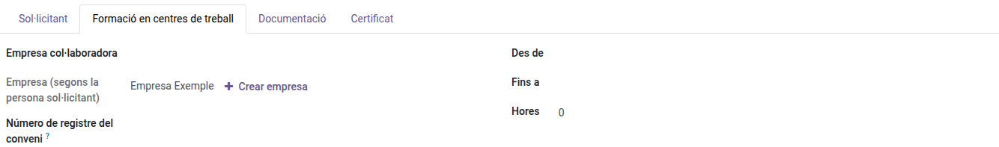
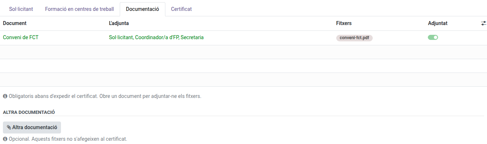

[Català](../../ca/teachers/certificates.md) | [Castellano](certificates.md) | [English](../../en/teachers/certificates.md)

---

# Certificados de FCT: completar la formación (coordinación de FP)

Completa los datos de la formación en centros de trabajo de las solicitudes de certificado de FCT y pásalas a secretaría para que las expida.

**Rol necesario:** el cargo de coordinador o coordinadora de FP. Si un administrador pone otro cargo en el circuito de un tipo de certificado, quien lo ocupa hace su paso de la misma manera.

---

## Cuándo te toca

Cuando el alumno (o secretaría, para un exalumno) envía la solicitud, el primer paso es tuyo: la encuentras como tarea en tu resumen diario y en **Gestión académica → Certificados**, con el filtro **Pendientes de mí**.

El alumno puede haber escrito el nombre y el NIF de la empresa y haber adjuntado el convenio, pero a menudo no lo tiene todo: tu paso es completarlo.

Mientras no hagas ningún cambio, el alumno aún puede completar o corregir sus datos desde el enlace. Cuando haces cualquier cambio o acción, el formulario del alumno se cierra.

---

## Completar la formación

1. Abre la solicitud.
2. En la pestaña **Formación en centros de trabajo**:
   - En **Empresa colaboradora**, elige la empresa. Si no existe y el alumno escribió su nombre, haz clic en **Crear empresa**: se crea con el nombre y el NIF que escribió (si ya hay una con el mismo NIF, se vincula esa).
   - Rellena **Desde**, **Hasta**, **Horas** y el **Número de registro del convenio** (sBID).
3. En la pestaña **Documentación**, comprueba el **Convenio de FCT**. Si no está, abre la línea, adjúntalo (PDF o fotos de las páginas) y guarda.
4. Abre **Acciones → Hecho: enviar al paso siguiente**. La solicitud pasa a secretaría.

Sin la empresa, el periodo y las horas, EMS no deja pasar la solicitud al paso siguiente.

---

## Si falta información

- **Acciones → Pedir documentación** — escribe qué necesitas; la persona solicitante lo recibe por correo con un enlace para responder y adjuntar documentos. Cuando responde, la solicitud vuelve a ti.
- **Acciones → Rechazar** — si el certificado no se puede expedir; escribe el motivo, que la persona solicitante recibe por correo.

Si secretaría o dirección te devuelven la solicitud, el motivo aparece arriba del formulario.

---

## Empresas colaboradoras

En **Comunidad educativa → Empresas colaboradoras** están las empresas donde el alumnado hace la formación. Puedes crearlas y editar sus datos (NIF, dirección, contactos como el tutor de la empresa).
