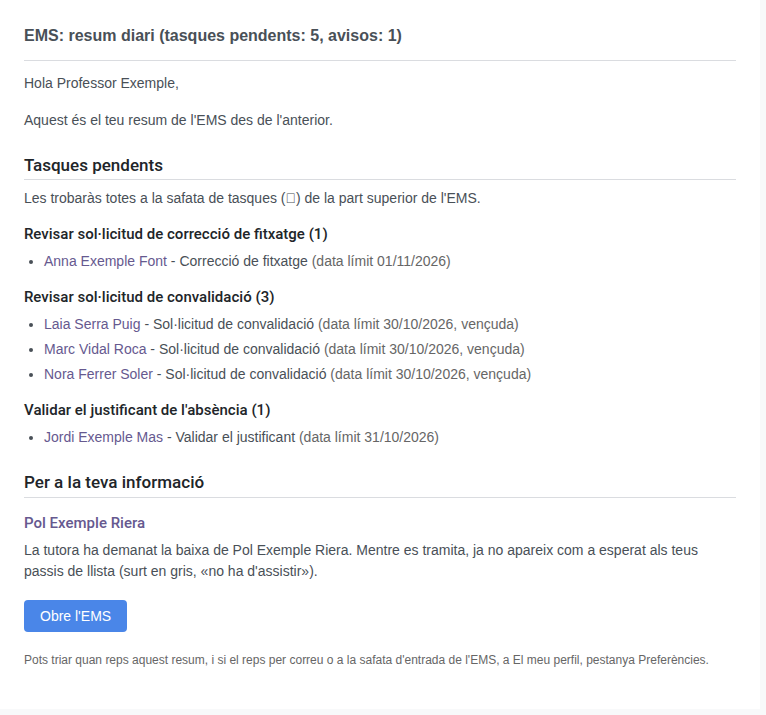
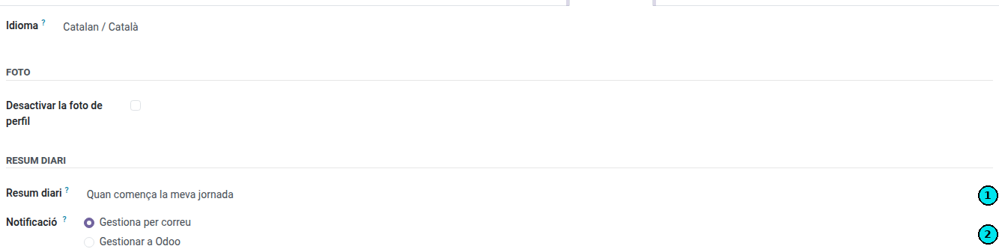

[Català](../../ca/teachers/daily-summary.md) | [Castellano](daily-summary.md) | [English](../../en/teachers/daily-summary.md)

---

# Resumen diario

Esta guía explica el mensaje diario con todo lo que EMS tiene para ti (tareas pendientes, incidencias de asistencia de tus alumnos si eres tutor/a y avisos informativos), cuándo te llega y cómo elegir el momento y la forma de recibirlo.

**Rol necesario:** cualquier persona del personal con usuario de EMS

---

## Índice

1. [Qué es](#qué-es)
2. [Qué contiene](#qué-contiene)
3. [Cuándo llega](#cuándo-llega)
4. [Elegir cuándo y cómo lo recibes](#elegir-cuándo-y-cómo-lo-recibes)

---

## Qué es

EMS no te envía un correo cada vez que pasa algo que no es urgente: lo guarda y te lo hace llegar todo junto, **como máximo una vez al día**, en el momento que hayas elegido. Así no se te llena el buzón y tienes una única revisión diaria.

Lo urgente (por ejemplo, una guardia para hoy) sigue llegando en el momento.

> **Desde la versión 18.0.0.44.0:** el resumen de tareas pendientes y el informe de incidencias de asistencia de los tutores son un solo mensaje, y ya no se puede desactivar: llega siempre que hay algo, por correo o en la bandeja de EMS, según lo que elijas.

---

## Qué contiene

Solo aparecen los apartados que tienen algo:

- **Tareas pendientes:** todas las tareas de tu bandeja de actividades (🕒), agrupadas por tipo (por ejemplo, *Revisar solicitud de convalidación*). Para cada tarea, un enlace que la abre en EMS, la descripción y la fecha límite; las vencidas se indican entre paréntesis. Si un tipo tiene más de 20 tareas, se muestran las 20 más próximas a vencer y cuántas quedan.
- **Incidencias de asistencia de tus alumnos** (solo tutores): las faltas, los retrasos, etc. registrados desde el resumen anterior, por día y por alumno. Consulta [Informe de incidencias de asistencia de tus alumnos](../tutors/attendance-issues-report.md).
- **Para tu información:** avisos que no te piden hacer nada, agrupados por alumno. Por ejemplo, que un alumno tuyo tiene una [baja prevista](../tutors/withdrawal-expected.md) y deja de salir en tus pases de lista, que no asistirá a un módulo tuyo mientras se resuelve su solicitud de convalidación, o que se le han convalidado módulos.

El asunto resume lo que hay, por ejemplo *EMS: resumen diario (tareas pendientes: 3, avisos: 1)*.

---

## Cuándo llega

- **En el momento que hayas elegido** (ver abajo). Por defecto, **al inicio de tu jornada**, según tu horario; si no tienes horario en EMS, se usa el marco horario del centro.
- **Solo si hay algo.** Si no tienes nada pendiente ni ningún aviso, ese día no recibes nada.
- **Lo que llega después del momento elegido espera al resumen siguiente.** Por ejemplo, una tarea que te asignan a mediodía la verás al día siguiente a primera hora.
- **Las tareas y los avisos no llegan los días que no trabajas** (fin de semana, festivos, ausencia aprobada de toda la jornada). Las incidencias de tus alumnos no esperan a que vuelvas: si ese día no trabajas, llegan al acabar la jornada del centro.

---

## Elegir cuándo y cómo lo recibes

1. Haz clic en tu avatar, en la esquina superior derecha de EMS, y elige **Mi perfil**.
2. Abre la pestaña **Preferencias**.
3. En el grupo **Resumen diario**, elige el momento en **Resumen diario** (1) y, si eliges **A una hora concreta**, indica la hora.
4. En **Notificación** (2), elige si quieres recibirlo **por correo** o **en EMS** (la bandeja de entrada de la parte superior). Esta opción también vale para el resto de notificaciones de EMS.
5. Guarda los cambios.

| Momento | Cuándo llega |
|---------|--------------|
| **Cuando empieza mi jornada** (por defecto) | Al inicio de tu jornada, según tu horario. |
| **Cuando acaba mi jornada** | Cuando acaba tu jornada. |
| **Cuando acaban las clases de mis alumnos (tutores)** | Cuando acaba la última clase del día de cualquiera de tus alumnos. Si no eres tutor/a de ningún grupo, funciona como *Cuando acaba mi jornada*. |
| **A una hora concreta** | A la hora que elijas, cada día lectivo. |

El cambio también se aplica al resumen que tengas pendiente en ese momento.

---

[← Volver al índice](index.md)
