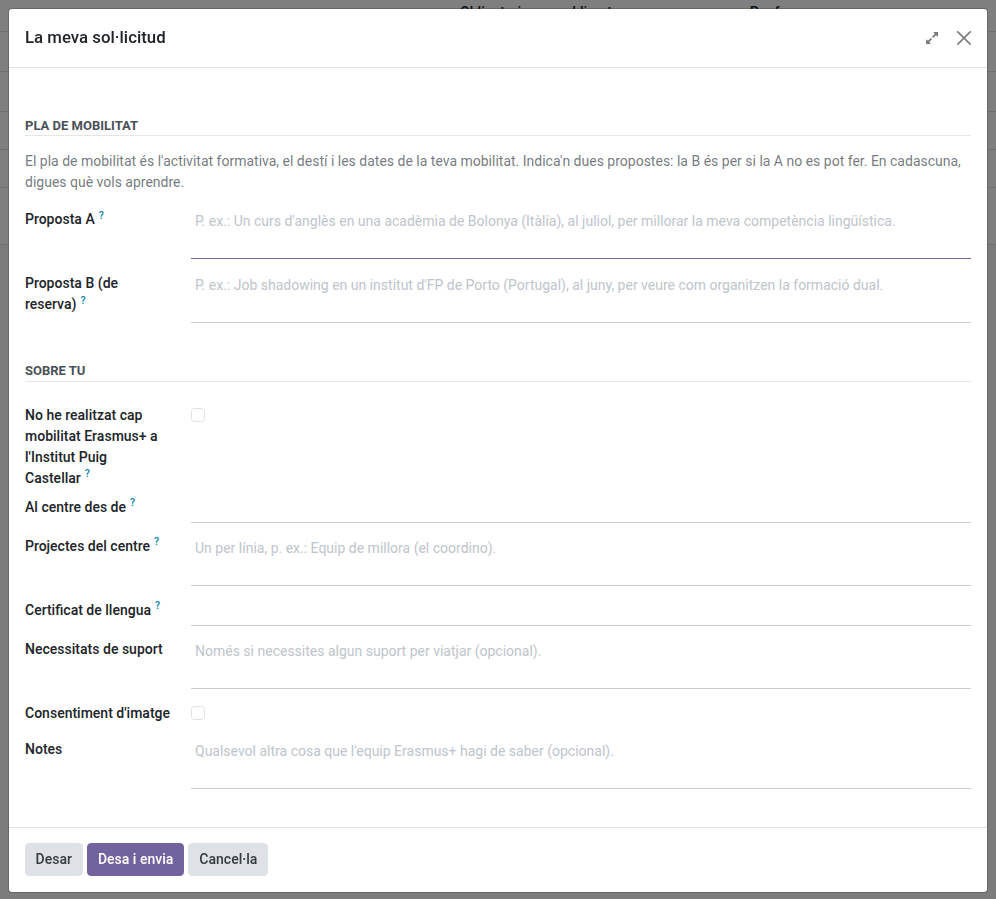

[Català](../../ca/teachers/erasmus-staff-call.md) | [Castellano](erasmus-staff-call.md) | [English](../../en/teachers/erasmus-staff-call.md)

---

# Solicitar una movilidad Erasmus+ de personal

Solicita un job shadowing, un curso estructurado o una estancia de docencia en el extranjero, sigue tu solicitud y prepara tu movilidad, todo desde EMS.

**Quién:** el profesorado de formación profesional (ciclos de grado básico, medio y superior, cursos de especialización y PFI), la directora o el director y el jefe de estudios de formación profesional. Solo ellos ven la convocatoria del personal.

Lo tienes todo en la aplicación **Erasmus+** (debajo de **Reuniones**), en **Mi participación**: **Convocatorias de personal**, **Mis solicitudes** y **Mis movilidades**. También puedes hacer clic en tu nombre, arriba a la derecha, y en **Erasmus+**. Los enlaces de los correos de Erasmus+ te llevan directamente allí. En cada pantalla solo aparece lo que puedes hacer en ese momento: si es una sola cosa, es un botón arriba; si es más de una, está en el menú **Acciones**.

---

## 1. Abre la convocatoria

Cuando el equipo Erasmus publica una convocatoria del personal a la que te puedes presentar, aparece en **Convocatorias de personal**, con sus fechas, y te enteras en tu [resumen diario](daily-summary.md). Ábrela: lees la **Información para los solicitantes**, puedes descargar la convocatoria publicada, y **Acciones > Presenta la solicitud** abre directamente el formulario.

## 2. Rellena el formulario

El formulario se abre cuando presentas la solicitud. Para cambiarlo más adelante, en tu solicitud, el botón **Rellena el formulario** lo vuelve a abrir (**Modifica la solicitud** una vez la has enviado); mientras no hayas rellenado nada, la solicitud solo muestra un recuadro que te lo dice. Cada campo vacío muestra un ejemplo de lo que puedes escribir. Tiene tres bloques cortos:

1. **Plan de movilidad** (anexo 1 de la convocatoria): la actividad formativa, el destino y las fechas de tu movilidad. Escribe dos propuestas, ambas obligatorias, en pocas frases cada una: la actividad (job shadowing, curso de formación o estancia de docencia), la entidad de acogida o el curso, dónde, cuándo y **qué quieres aprender**. Debe ser una entidad o un curso concretos. La **propuesta A** es la principal, por ejemplo "Un curso de inglés en una academia de Bolonia (Italia), en julio, para mejorar mi competencia lingüística"; la **propuesta B** es por si la A no se puede hacer, por ejemplo "Job shadowing en un instituto de FP de Oporto (Portugal), en junio, para ver cómo organizan la formación dual". Preferiblemente en el periodo no lectivo (junio, julio); en otro momento, como abril, solo una semana que no afecte a las evaluaciones, y con la validación de la dirección. 1.500 caracteres como máximo por propuesta. Encontrarás opciones en la [web Erasmus+ del centro](https://elpuig.xeill.net/el-centre/erasmus/recursos-i-formacio). La comisión solo lee tus dos propuestas.
2. **Sobre ti**: marca **No he realizado ninguna movilidad Erasmus+ en el Institut Puig Castellar** si es el caso (como personal: los acompañamientos de grupos y las movilidades de otros programas no cuentan; si no, el equipo Erasmus comprueba cuándo fue la última), el **mes y el año desde que trabajas en el centro** sin interrupción, tu **certificado de idioma** oficial de nivel más alto (B2 o superior) y los **proyectos del centro**: si los coordinas o participas en ellos, los proyectos del centro, equipos de mejora o comisiones de este curso o del pasado, uno por línea, indicando los que coordinas.
3. **Opcional**: el **apoyo** que necesitas para hacer la movilidad (confidencial: solo lo lee el equipo Erasmus), el consentimiento para usar tu imagen y cualquier otra cosa para el equipo Erasmus.

La **difusión** no forma parte del plan: es la misma para todos. Cuando vuelvas, publicarás una noticia en la web del centro sobre tu experiencia, siguiendo la identidad visual y la política de difusión de Erasmus+, y, si se considera necesario, la compartirás con los compañeros en una reunión de departamento o de ciclos.

Haz clic en **Guardar** para seguir más adelante, o en **Guarda y envía** cuando lo tengas todo listo. Recibirás un justificante por correo electrónico. Hasta la fecha de cierre todavía puedes modificarla.

Los documentos que pide la convocatoria están en la pestaña **Documentos** de tu solicitud: haz clic en **Entrega** en cada uno y adjunta el archivo (un PDF o una foto; puedes adjuntar varios). La columna **Entregado** muestra lo que has entregado y **Por hacer**, lo que todavía falta (*Por entregar* mientras no hayas adjuntado nada). Si el equipo Erasmus te pide subsanaciones, entrega allí lo que te pide y vuelve a enviar la solicitud con **Enviar**.

## 3. Síguela

**Mis solicitudes** muestra tus solicitudes con **Qué tienes que hacer ahora** y el plazo. En la solicitud ves su estado, tus respuestas (pestaña **Formulario**), los documentos y, una vez publicadas, la pestaña **Resultados**: cada resolución con tu posición (descárgala con **PDF**), la plaza ofrecida y tus reclamaciones.

Si no estás de acuerdo con la resolución provisional, usa **Acciones > Reclamación** antes de que acabe el plazo de reclamaciones: escribe qué reclamas y adjunta los archivos que lo justifiquen. Recibirás un justificante por correo electrónico, y el equipo Erasmus la responderá: estimada, estimada en parte o desestimada, y por qué.

Si te seleccionan, usa **Acciones > Acepta la plaza** o **Renunciar a la plaza** antes del plazo: sin respuesta, se considera que renuncias.

## 4. Prepara tu movilidad

Cuando aceptas la plaza, tu movilidad aparece en **Mis movilidades** (y en tu solicitud, en **Mi movilidad**). Hasta que la envías, la movilidad no muestra los campos de la actividad vacíos. Usa **Acciones > Envía la propuesta de actividad**: empieza con las propuestas de la solicitud. Elige la **actividad** (job shadowing, curso o docencia) y complétala con las **fechas exactas de inicio y de fin**, acepta la declaración responsable para la ausencia por formación y envíala: la dirección (la directora o el director o el jefe de estudios de FP) valida la actividad, la entidad de acogida o el curso, el destino y las fechas. Cuando la valida, EMS solicita por sí solo la ausencia por formación para esos días, y quien te aprueba las ausencias la aprueba como siempre. Si no se valida, recibirás el motivo por correo electrónico: cambia lo necesario y vuelve a enviarla.

**Si cambia más adelante:** una vez validada, si cambian el curso, la entidad de acogida o las fechas (por ejemplo, porque ese mes no se ofrece el curso), envía una nueva propuesta desde la misma acción antes de que empiece la movilidad. La dirección la vuelve a validar y, mientras tanto, tu movilidad se mantiene tal como se validó. Si la dirección deja un comentario, lo verás en el correo y en **Validación por parte de la Dirección**.

La pestaña **Expediente** tiene los documentos que tienes que entregar antes de marcharte y al volver (tarjeta sanitaria europea, convenio de subvención, acuerdo de aprendizaje (personal de FP, KA121-VET) o acuerdo de movilidad (educación superior, KA131-HED) firmado por ti, la coordinación Erasmus y la entidad de acogida, al volver el documento de movilidad Europass (personal de FP, lo emite el equipo Erasmus; el certificado de estancia o de asistencia solo si hace falta para acreditar las fechas o la actividad) o el certificado de estancia o de asistencia (educación superior), una memoria breve con evidencias en el mes siguiente al regreso...), quién firma cada uno y el plazo. Lo que el equipo Erasmus sube primero (el convenio de subvención rellenado, tu póliza de seguro) está en **Del equipo Erasmus**: descárgalo, fírmalo si hace falta y haz clic en **Entrega** para adjuntarlo. Un documento que puedes firmar en EMS tiene **Fírmalo aquí**. Los demás, fírmalos fuera de EMS y entrégalos.

Arriba, **Tus documentos** dice cuántos has entregado de los que te toca entregar a ti, por ejemplo *Has entregado 1 de 4*: no cuentan los que sube el equipo Erasmus ni los de la solicitud. Las columnas **Del equipo Erasmus** y **Comentario para el solicitante** solo aparecen cuando el equipo ha puesto algo en ellas.

Cuando el equipo Erasmus ha calculado tu beca, la pestaña **Beca** la muestra en dos bloques, con los mismos nombres que la ficha del equipo Erasmus: **Beca** (la beca, lo **Pagado directamente por el centro** por ti, como el viaje o el alojamiento, y lo que **Recibes**) y **Pagos a ti** (lo ya **Transferido** y lo **Pendiente de transferir**). Es solo de consulta: si ves algo extraño, díselo al equipo Erasmus.

El resto también está en **Acciones**: **Firma la carta de compromiso**, la **Autoevaluación semanal** durante la estancia y, al volver, **He respondido la EU Survey** cuando hayas respondido el informe final. Mientras falte algo, tienes una tarea en EMS, **Erasmus+: entrega lo que falta**, con la lista; se actualiza cada semana y desaparece sola cuando lo has entregado todo.

Arriba de tu movilidad, un recuadro te dice qué tienes que hacer ahora (por ejemplo, enviar la propuesta o firmar la carta) y hasta cuándo, como en la solicitud. La pestaña **Pasos** lista los pasos de la convocatoria (por ejemplo, compartir la estancia en una reunión): cuando hayas hecho uno, haz clic en **Hecho**; si te has equivocado, **Deshacer**. Los pasos **al volver** (por ejemplo, la noticia en la web) se pueden marcar desde el día que empieza la estancia, porque a menudo se escribe el último día. Un paso que ha marcado el equipo Erasmus solo lo puede desmarcar el equipo.

Si finalmente no puedes ir, usa **Renunciar a la plaza** y escribe el motivo. Puedes hacerlo hasta que empieza la estancia; después, habla con el equipo Erasmus.

---

[← Volver a los manuales del profesorado](index.md)
