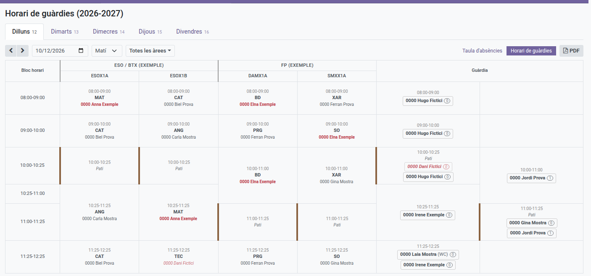
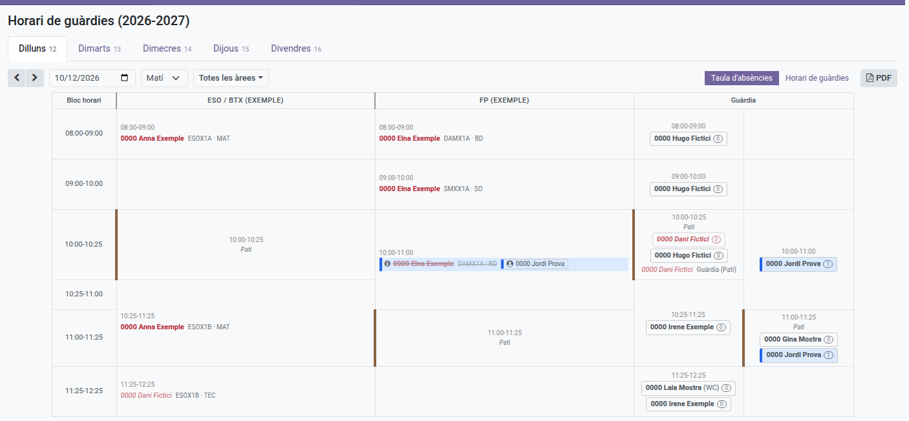
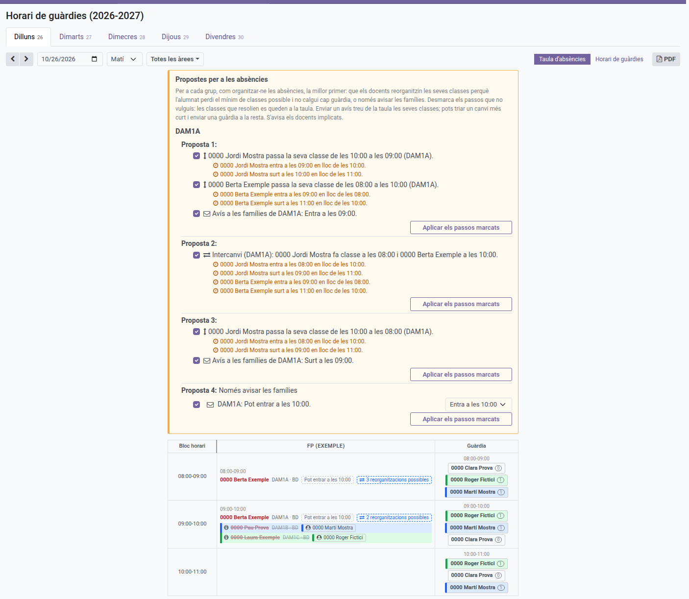
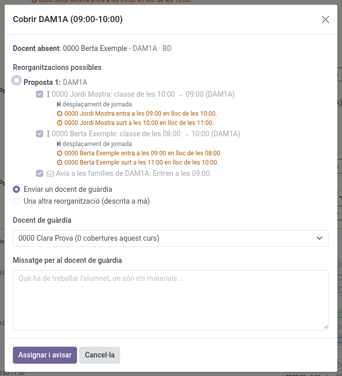
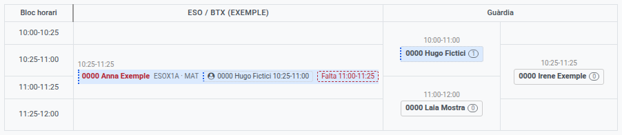
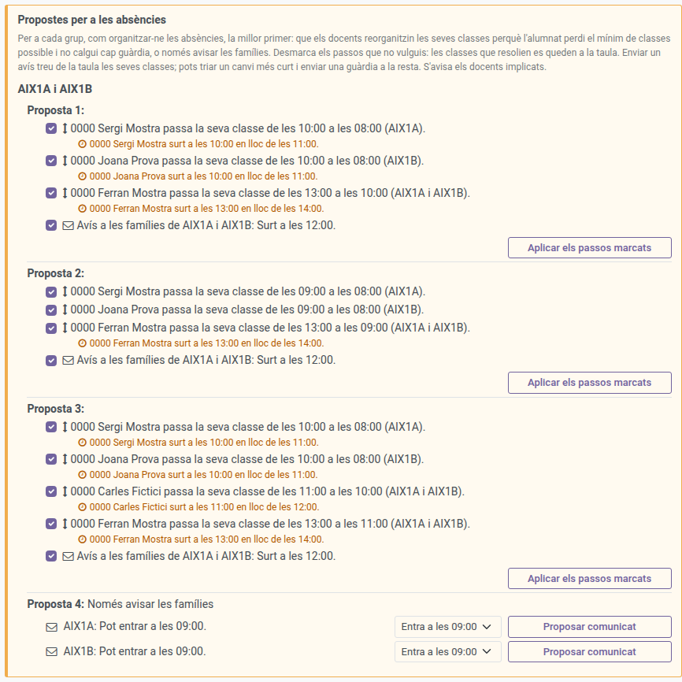
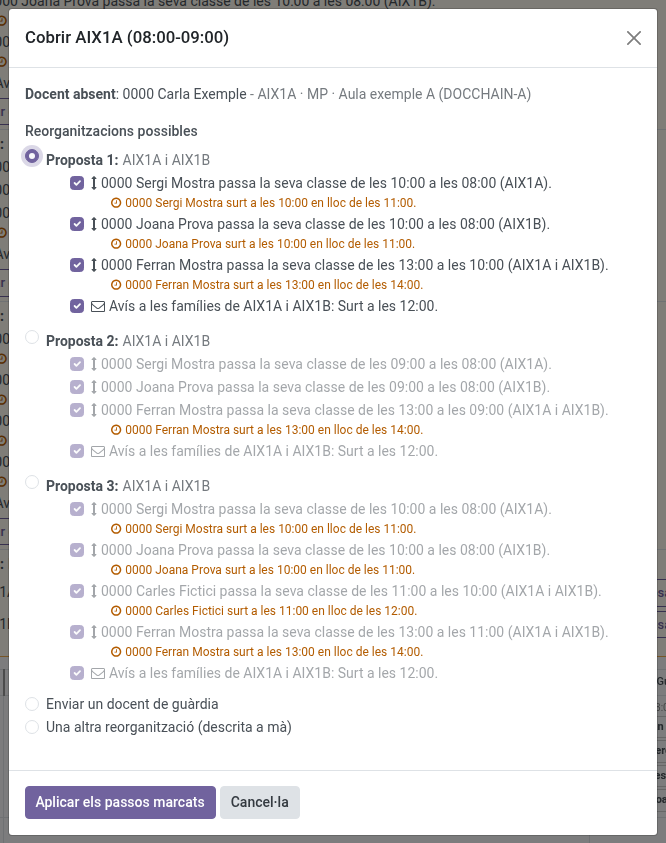
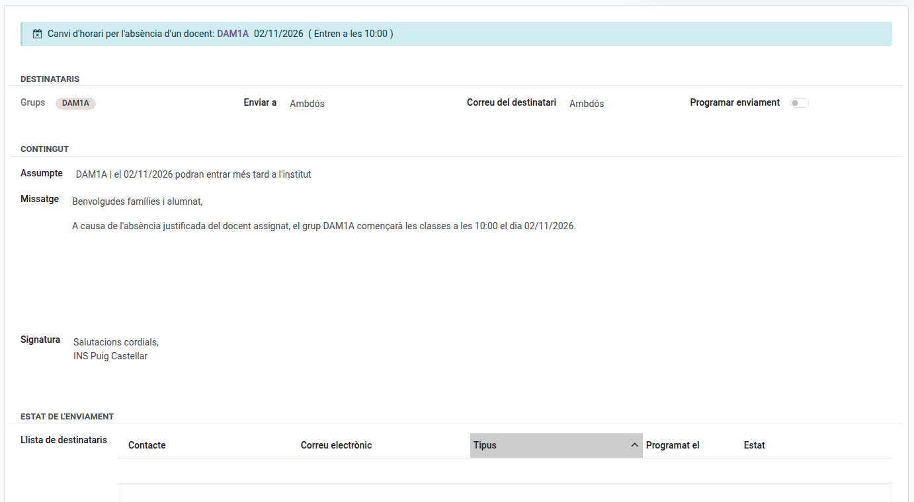
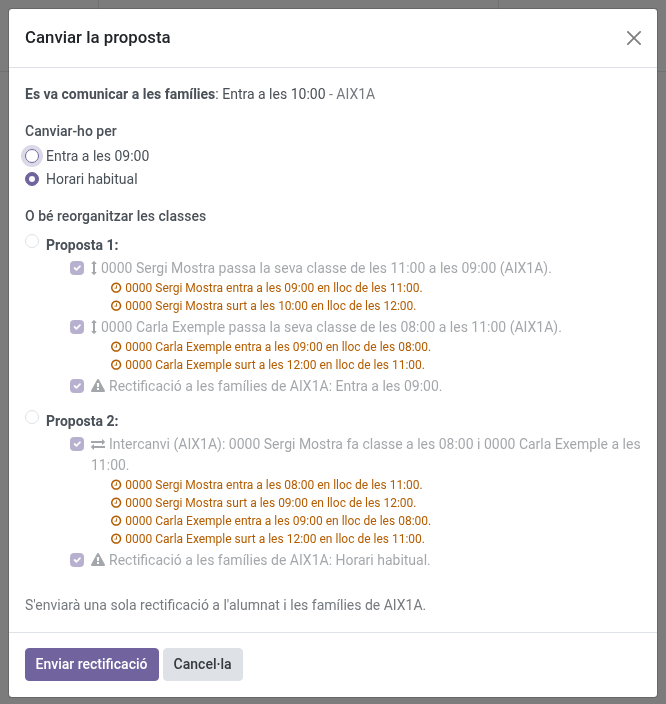
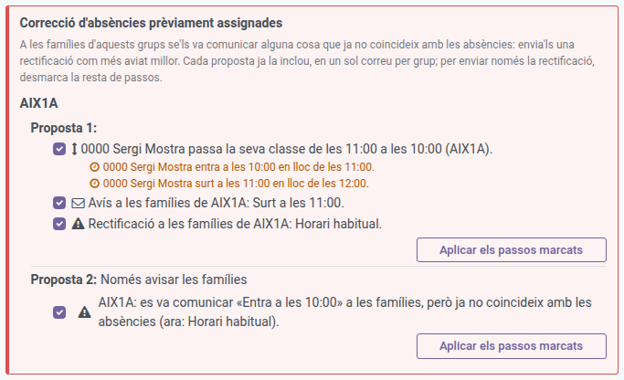

[Català](../../ca/teachers/guard-duty-schedule.md) | [Castellano](guard-duty-schedule.md) | [English](../../en/teachers/guard-duty-schedule.md)

---

# Horario de guardias

Consulta dónde está cada docente, y quién está de guardia, en cada franja horaria de la semana — no solo tu propio horario.

**Rol necesario:** Docente (solo lectura; los horarios los configura un Jefe de departamento o superior desde el horario semanal propio del docente correspondiente). Organizar una ausencia desde la Tabla de ausencias corresponde al Jefe de departamento o de seminario del docente ausente y a quienes están por encima (ver [Organizar una ausencia](#organizar-una-ausencia)), que también pueden introducir una ausencia prevista para un docente de su departamento (ver [Introducir una ausencia prevista](#introducir-una-ausencia-prevista)); un docente de guardia también puede cogerse él mismo una clase sin docente (ver [Cubrir tú mismo una clase](#cubrir-tu-mismo-una-clase)). Cuando los estudios del grupo tienen un departamento que los gestiona, los jefes de ese departamento también pueden organizarla.

---

## Acceso

Ve a: **Asistencia de empleados → Horario de guardias**

El cuadro se abre directamente con el día y el turno de ahora mismo (mañana antes de las 15h, tarde a partir de las 15h) — no siempre lunes por la mañana — así llegas enseguida a la información relevante.

---

## Elegir el día y la semana

Haz clic en **Lunes** a **Viernes** en la parte superior para cambiar de día. Cada pestaña muestra también el día del mes que le corresponde dentro de la semana que tienes en pantalla.

Usa las flechas **‹** y **›** para ir a la semana anterior o siguiente, o la casilla de fecha de al lado para saltar a cualquier fecha — las pestañas se mueven a la semana de esa fecha y el cuadro se abre por su día.

La mañana y la tarde son turnos distintos — usa el desplegable para cambiar entre ellos; solo se muestra uno a la vez.

---

## Las dos vistas

Los dos botones de la derecha de la barra de herramientas cambian entre las dos maneras de leer el mismo día y turno. El horario se abre en la **Tabla de ausencias**:

- **Tabla de ausencias** — una fila por franja horaria: quién falta y qué hay que cubrir, frente a quién está de guardia para cubrirlo.
- **Horario de guardias** — el horario, con todo el que falta marcado encima.

Cuando el horario muestra el día de hoy, una **línea roja de puntos** cruza las dos vistas a la hora actual, a la altura exacta dentro de la franja horaria en la que cae (a las 16:40, a dos tercios de la franja 16:00-17:00), para que veas de un vistazo qué clases se están dando ahora. Va bajando a medida que pasa el tiempo, y no se dibuja en otro día ni fuera del turno que hay en pantalla.

---

## Leer el horario

Las columnas de la tabla son los grupos que tienen clase en ese turno, agrupados por **área** (por ejemplo ESO / BTX y FP): cada área tiene su propio marco horario, y la cabecera de la tabla lo indica con una banda por área.

Como cada área empieza y acaba las clases a horas distintas (la ESO hace el patio a las 10:00 y la FP a las 11:00, por ejemplo), las filas de la tabla son los tramos entre todas las horas de inicio y de final del turno, y cada clase ocupa los tramos que dura: una clase de 10:25 a 11:25 ocupa los tramos 10:25-11:00 y 11:00-11:25. Así las dos áreas quedan alineadas por el reloj sin deformar las clases de nadie, y las filas son más altas cuanto más largo es el tramo.

Cada celda muestra su propia hora de inicio y de final, la asignatura (con su código corto, p. ej. "MP 0440"), el o los docentes — más de uno si la clase es compartida — y el aula de la clase de ese grupo en esa hora. Una celda vacía simplemente significa que no hay nada programado para ese grupo en ese momento.

La columna **Guardia**, a la derecha, lista todos los docentes de guardia, agrupados por la franja de su guardia (que también se indica arriba de cada bloque), cada uno en un recuadro de borde fino. Cuando dos guardias se solapan en el tiempo (la del patio de la ESO y una guardia de FP de 10:00 a 11:00, por ejemplo), aparecen una al lado de la otra. Un docente de guardia no tiene ningún grupo propio en ese momento (es precisamente el sentido de la guardia), por eso solo aparece aquí, nunca en la columna de un grupo. Un docente en guardia de **WC** en concreto muestra la etiqueta **"(WC)"** justo después de su nombre — se destaca porque, a diferencia de una guardia de patio (ver más abajo), una guardia de WC puede caer en cualquier momento del día, así que no hay otra forma de distinguirla de una guardia normal a simple vista.

El número pequeño en un círculo tras cada nombre indica cuántas clases ha cubierto ese docente este curso (incluidas las coberturas ya previstas para un día próximo). Varios grupos atendidos juntos en la misma aula y a la misma hora cuentan como una sola cobertura; los grupos en aulas distintas cuentan por separado. Sirve para repartir las coberturas de forma equitativa.

El patio de cada grupo se muestra como un bloque propio, con su hora y la etiqueta **"Patio"**, y un borde marrón en el lado izquierdo, para que no se lea como un hueco en el horario. Las guardias de patio de la columna Guardia llevan el mismo borde.

---

## Filtrar por área

Junto al desplegable de turno hay un botón de **filtro de área** (muestra "Todas las áreas" hasta que marcas algo). Haz clic para abrir una lista con una casilla por cada área — por ejemplo ESO / BTX y FP — y marca las que necesites. Deja todo sin marcar para ver todas las áreas a la vez.

Una vez marcas una o más áreas:
- Solo se muestran las columnas de los grupos de esa área, incluidos los grupos de refuerzo de sus grupos.
- La columna **Guardia** sigue mostrando a todos los docentes de guardia en cualquier franja visible, sin importar qué hacen por lo demás — lo que importa es que están de guardia, no en qué área den clase ese día. Una guardia del patio de otra área no aparece.
- Una guardia del patio del área marcada obtiene su propia fila de "Patio", aunque ningún grupo tenga clase entonces.

El área de un grupo es la de los estudios que lo gestionan (campo **Gestionado por el departamento** de la ficha de los estudios, o el departamento de nivel superior al que pertenece).

> El filtro de área sustituyó al filtro de nivel en la versión 18.0.0.38.0.

---

## Leer la tabla de ausencias

La tabla usa los mismos tramos de tiempo que el horario, con una columna por área:

- **Una columna por área** — una línea por cada clase que se queda sin docente en esa área: quién falta, y el grupo, la asignatura y el aula que hay que cubrir, dentro de un bloque con la hora de la clase. El patio del área aparece como un bloque "Patio".
- **Guardia** — los docentes de guardia, agrupados por la franja de su guardia, los mismos que muestra el horario.

Así ves de un vistazo qué guardias coinciden con cada clase que hay que cubrir, aunque las dos áreas tengan las clases a horas distintas. Un tramo donde no falta nadie tiene las columnas de área vacías.

En una clase con codocencia (dos docentes en la misma aula) en la que solo falta uno, su línea aparece **tachada**: sigue ahí para que sepas quién falta, pero no hace falta guardia porque el otro docente se hace cargo de la clase. Pasa el ratón por encima de la línea o haz clic en ella para ver el motivo; el icono **ⓘ** de su izquierda indica que hay una explicación.

Toda línea tachada tiene ese icono, sea cual sea el motivo: otro docente está en la clase, ya se ha enviado un docente de guardia (su nombre aparece al lado), o se ha comunicado a las familias que el alumnado no tiene que venir a esa clase (ver [Organizar una ausencia](#organizar-una-ausencia)). Si faltan los dos, o cada docente tiene medio grupo en un aula distinta, la línea no aparece tachada y sí hay que cubrir la clase.

---

## Ausencias

Un docente que falta aparece en rojo allá donde salga su nombre — en su propia celda del horario, y en la columna de guardia si era quien estaba de guardia:

- **Rojo y negrita** — la ausencia está aprobada.
- **Rojo más suave y cursiva** — la ausencia se ha solicitado y todavía está pendiente de aprobación.

Las solicitudes denegadas y canceladas no se muestran.

Una ausencia que su jefe o Jefatura de Estudios ya conoce pero que el docente todavía no ha solicitado (una *ausencia prevista*, ver más abajo) también se muestra como pendiente de aprobar.

Un docente de guardia ordinaria que falta queda marcado en la columna de guardia y no genera ninguna línea en la columna de ausencias: no tiene ninguna clase propia que nadie deba cubrir. Una guardia que es un puesto fijo, como la de WC o la de patio, es distinta: alguien tiene que estar allí, así que cuando falta su docente tiene su propia línea en la columna **Guardia** de la tabla de ausencias, debajo de los docentes de guardia de su bloque, con el nombre de la guardia (por ejemplo **Guardia (WC)**) donde una clase muestra el grupo, y se cubre como una clase (consulta [Cubrir una guardia de WC o de patio](#cubrir-una-guardia-de-wc-o-de-patio)).

Aquí solo se muestra que la persona falta. El tipo de ausencia, el motivo y el justificante, no.

---

## Cubrir tú mismo una clase

Si estás de guardia en una franja, no hace falta que esperes a que alguien te envíe: puedes coger tú mismo una clase que todavía está sin docente.

1. En la **Tabla de ausencias**, haz clic en la línea de la clase (las líneas que puedes coger muestran una mano al pasar por encima y la indicación **Haz clic para cubrir tú esta clase**).
2. Haz clic en **Cubrirla** para confirmarlo.

La clase queda tachada con tu nombre al lado, igual que cuando te envían. Nadie recibe ningún mensaje: el propio cuadrante muestra quién cubre qué. Si tu guardia solo coincide con una parte de la clase, coges esa parte (el diálogo te indica cuál), y otra persona puede cubrir el resto. Solo se puede coger una clase, o tu parte, que todavía no tiene ningún docente de guardia, y solo en una franja en la que estás de guardia ordinaria (no en una guardia de WC o de patio, ni mientras tú mismo estás ausente). Lo mismo vale para la línea de una guardia de WC o de patio cuyo docente falta: también puedes cogerla tú mismo.

Las líneas que no puedes coger porque a esa hora no estás de guardia también muestran la mano, con la indicación **No puedes cubrir a este docente porque a esta hora no estás de guardia** (y lo mismo al hacer clic), para que sepas por qué no puedes cogerlas.

Si cambias de idea, vuelve a hacer clic en la línea y después en **Deja de cubrir esta clase**: la clase vuelve a quedarse sin guardia. Solo puedes hacerlo con una clase que te has cogido tú; si alguien te ha enviado, pídele que lo cambie. Quien organiza la ausencia siempre puede cambiar o quitar a un docente de guardia que se haya cogido una clase por su cuenta.

## Introducir una ausencia prevista

Quién puede hacerlo: los **Jefes de seminario** y los **Jefes de departamento**, para los docentes de su propio departamento, además de JE o JEA, Dirección y el administrador. También pueden hacerlo para un docente de otro departamento que da clase a un grupo que gestiona su departamento, o que tiene su departamento en el campo **También gestionado por los departamentos** (ver [Organizar una ausencia](#organizar-una-ausencia)).

La vía normal siempre es que el docente solicite la ausencia él mismo. Usa esto solo en el caso excepcional de un docente que llama o escribe para avisar de que faltará y no puede entrar en EMS: al introducirla, sus clases salen en el cuadro enseguida y puedes organizar la cobertura.

1. Ve a **Asistencia del personal > Ausencias > Administración > Ausencias previstas** y haz clic en **Nuevo**.
2. Elige el **Profesor**. Solo aparecen los docentes de tu departamento.
3. Indica **De** y **A**, con fecha y hora. Por defecto, hoy de 08:00 a 15:00. Una ausencia puede abarcar varios días.
4. Si quieres, añade **Notas** para ti. El docente nunca ve esta entrada.
5. Guarda.

La ausencia sale entonces en el cuadro como pendiente de aprobar (rojo claro en cursiva), y puedes organizarla como se explica a continuación. Cuando el docente solicita la ausencia él mismo, la ausencia prevista se vincula sola y lo que hayas organizado se mantiene tal cual. Si al final el docente no falta, borra la entrada.

---

## Organizar una ausencia

Quién puede hacerlo: el **Jefe de seminario** o el **Jefe de departamento** del docente ausente, y quienes están por encima en la jerarquía (JE o JEA, y Dirección), además del administrador. Lo que cuenta es el departamento donde da clase el docente: sus jefes y el responsable del área a la que pertenece organizan las ausencias de todos los que forman parte de él, incluidos los miembros del equipo directivo (como el Secretario). El resto de docentes ven el resultado pero no pueden cambiarlo, y el docente ausente no puede organizar su propia ausencia. Da igual si la ausencia la ha solicitado el docente o la ha introducido su jefe o Jefatura de estudios como ausencia prevista: las dos se gestionan igual. Cuando más adelante el docente solicita una ausencia que estaba prevista, lo que ya se había organizado se mantiene tal cual, y solo los días u horas de más de la solicitud aparecen como líneas nuevas por decidir. **Docentes compartidos entre departamentos:** además de los responsables del docente, también puede organizar una clase quien responde de los alumnos que se quedan sin ella: cuando los estudios del grupo tienen indicado un departamento que los gestiona (campo **Gestionado por el departamento** de la ficha de los estudios), el Jefe de departamento y el Jefe de seminario de ese departamento, y quienes tienen por encima, pueden organizar las clases de sus grupos, sea cual sea el departamento del docente. Por ejemplo, si una docente del departamento de Lenguas extranjeras falta a una hora con un grupo de Informática, la guardia la pueden asignar los jefes de Informática; si falta a una hora con un grupo de Administración, los de Administración; y en ambos casos, también su propia jefa de departamento. Un grupo de refuerzo sigue los estudios de sus grupos principales. Para un docente que en la práctica trabaja para otro departamento o área que no es el suyo, su ficha permite indicarlo en el campo **También gestionado por los departamentos** (debajo de **Gestor**): los jefes de esos departamentos, y quienes tienen por encima, pueden organizar todo lo suyo, incluidas las guardias fijas (lavabos, patio), que no tienen alumnos.

> Los campos **Gestionado por el departamento** y **También gestionado por los departamentos** se introdujeron en la versión 18.0.0.36.2. Nadie que ya pudiera organizar una ausencia ha dejado de poder hacerlo.

Todo se hace desde la **Tabla de ausencias**, y nada ocurre solo: cada paso espera a que pulses su botón. Un día que ya ha pasado no se puede cambiar.

### Enviar un docente de guardia a una clase

1. Haz clic en la línea de la clase que hay que cubrir (las líneas que puedes organizar muestran el cursor de mano).
2. Si el diálogo ofrece reorganizaciones posibles (véase [Reorganizar las clases en lugar de enviar una guardia](#reorganizar-las-clases-en-lugar-de-enviar-una-guardia)), elige **Enviar un docente de guardia**. Después elige el **Docente de guardia**. Solo se ofrecen los docentes de guardia ordinaria durante la clase (nunca los de guardia de WC o de patio, que son necesarios en su puesto), salvo los que también están ausentes. Primero aparecen los que pueden cubrir toda la clase y después los que solo pueden cubrir una parte, con el tramo que cubrirían (consulta [Cubrir una clase entre varios docentes de guardia](#cubrir-una-clase-entre-varios-docentes-de-guardia)). Junto a cada nombre se ve cuántas clases ha cubierto este curso, para poder elegir a quien menos haya cubierto.
3. Opcionalmente, escribe un **mensaje**: qué tiene que trabajar el alumnado, dónde están los materiales...
4. Haz clic en **Asignar y avisar**.

El docente de guardia recibe un mensaje de Odoo (en su bandeja de entrada o por correo, según su preferencia de notificaciones) con la fecha, la hora, el grupo, la asignatura, el aula, el docente ausente y tu mensaje. Si responde a ese correo, la respuesta te llega a ti.

Entonces la clase queda tachada, aparece el nombre del docente de guardia, y la línea y la casilla del docente en la columna Guardia comparten el mismo color. El color es de la clase cubierta: cuando varios docentes de guardia cubren clases distintas a la misma hora, cada clase tiene su color, de modo que se ve de un vistazo quién cubre qué. Un docente de guardia puede cubrir más de una clase: todas toman el mismo color. Su casilla solo lo toma en las horas en que cubre una clase: si está de guardia de 10 a 12 y cubre una clase de 10 a 11, la casilla de 11 a 12 queda sin color.

Para cambiar el docente de guardia, haz clic en la línea y después en **Cambiar o quitar el docente de guardia** (solo lo ve quien organiza la ausencia), y elige otro: al anterior se le comunica que ya no hace falta. Para enviar un mensaje nuevo al mismo docente, vuelve a elegirlo y haz clic en **Asignar y avisar**. Para sacar a un docente de la clase, haz clic en **Quitar la asignación** junto a su nombre, en la parte de arriba del diálogo: se le avisa.

### Cubrir una clase entre varios docentes de guardia

Cuando las áreas tienen horarios distintos, puede que ningún docente de guardia coincida con toda una clase. Por ejemplo, una clase de ESO de 10:25 a 11:25 y dos docentes de guardia de FP, uno de 10:00 a 11:00 y otro de 11:00 a 12:00. Entonces el diálogo también ofrece los que coinciden con una parte de la clase, con el tramo que cubrirían (*"… - 10:25-11:00, parte de la clase"*), y cada docente cubre exactamente ese tramo.

Mientras falte una parte por cubrir, la línea no se tacha: muestra el docente con su tramo y una etiqueta roja discontinua con lo que falta (*"Falta 11:00-11:25"*), para que envíes a otro docente. Cuando entre todos cubren toda la clase, la línea se tacha.

Todos los docentes que cubren la misma clase comparten su color. Un borde de puntitos (en la línea, en la etiqueta y en la casilla del docente) indica una cobertura parcial; un borde continuo, una clase cubierta entera.

### Cubrir una guardia de WC o de patio

Cuando falta el docente de una guardia de WC o de patio, su guardia aparece como una línea en la columna **Guardia** de la tabla de ausencias, debajo de los docentes de guardia de su bloque, con el nombre de la guardia en lugar de un grupo. Se cubre exactamente como una clase: haz clic en ella, elige uno de los docentes de guardia ordinaria de esa franja y haz clic en **Asignar y avisar**. El mensaje que recibe indica que lo que debe cubrir es una guardia. Si después la ausencia se anula, se te ofrece liberar al docente de guardia como cualquier otro.

### Reorganizar las clases en lugar de enviar una guardia

A menudo no hace falta ninguna guardia, porque los docentes pueden reorganizar sus clases de ese día. El cuadrante lo calcula para cada clase que todavía no tiene a nadie y lo propone en el recuadro **Propuestas para las ausencias**, encima de la tabla (solo lo ve quien puede organizar la ausencia); esas líneas muestran además una etiqueta como **3 reorganizaciones posibles**.

El recuadro tiene una sección por grupo, encabezada con su nombre. Los grupos que comparten una clase ese día (dos grupos que dan clase juntos) comparten sección, porque reorganizar una clase compartida cambia el día de ambos. En cada sección aparece primero lo que está pendiente (una reorganización que espera su comunicado), después las propuestas, numeradas a partir de la mejor, y al final **Solo avisar a las familias** (ver [Entrada tarde, salida anticipada o sin clases](#entrada-tarde-salida-anticipada-o-sin-clases)).

Un grupo a cuyas familias hay que rectificar algo no aparece en este recuadro, sino en uno rojo, encima: **Corrección de ausencias previamente asignadas** (ver **Cuando la ausencia cambia después**).

Cada propuesta es una lista de pasos, uno por línea, siempre entre docentes de esos grupos y dentro del mismo día:

- **Clase movida**: un docente que está libre a esa hora da entonces una clase suya con el grupo de otra hora. La clase que deja se convierte en un hueco, que otro paso puede llenar a su vez: un docente adelanta una clase, otro llena el hueco que deja, y así sucesivamente, hasta que lo que queda libre está al principio o al final del día (o junto a un patio).
- **Grupos unidos**: para las dos mitades de un grupo desdoblado. El docente que da la misma materia a la otra mitad a esa hora da clase a las dos mitades a la vez, en el aula de la otra mitad, y la clase que tenía con esta mitad a otra hora queda libre, como en una clase movida. A menudo sirve para que las dos mitades salgan una hora antes. Dos mitades son las de los grupos que comparten alguna clase en el horario semanal; no hay que configurar nada.
- **Aviso a las familias**: el grupo entra más tarde, sale antes o tiene un patio más largo, por las clases que quedan libres al principio o al final del día.

Una clase compartida por varios grupos se mueve para todos, siempre que todos tengan el mismo hueco, y entonces el aviso va a cada grupo.

Las propuestas aparecen en este orden: primero las que hacen perder menos clases al alumnado; entre esas, las que le hacen pasar menos horas en el centro sin clase (con una guardia o en un patio más largo); después las que necesitan menos comunicados y menos docentes que muevan clases, las que mantienen juntas dos horas de la misma materia y las que cambian menos horas de entrada o de salida. Se muestran hasta tres por grupo.

**La jornada de nadie se alarga.** Una propuesta solo incluye un paso si ningún docente implicado acaba con una jornada más larga (contada desde su primera franja hasta la última, tanto clases como guardias y cualquier otra tarea): quien tenga que entrar antes debe salir antes, y quien tenga que salir más tarde debe entrar más tarde. Cuando un paso cambia la hora de entrada o de salida de alguien, una línea naranja debajo dice exactamente de quién y cómo (*"… sale a las 20:20 en lugar de a las 21:20"*).

**Aplicar una propuesta.** Haz clic en **Aplicar los pasos marcados**, a su derecha, o haz clic en la clase y elige la propuesta en el diálogo, donde las propuestas que resuelven esa clase aparecen primero, por encima de enviar una guardia. Todos los pasos aparecen marcados: desmarca los que no quieras. Un paso que necesita otro se desmarca con él (una clase movida al hueco que deja otra, un aviso que solo tiene sentido por una clase movida), y marcar un paso marca lo que necesita.

- Un **intercambio**, y una **clase movida** que no depende de ningún aviso, tienen efecto de inmediato: la clase queda tachada con el docente que está con el grupo, y los docentes implicados reciben un mensaje de Odoo con el cambio (y su nueva hora de entrada o de salida, si cambia).
- Los **avisos** se envían enseguida: marcar el paso ya es la confirmación, no hay ningún borrador que revisar. Cada grupo recibe **un solo comunicado** para todo el día, con todos los cambios que la propuesta le trae (por ejemplo, que entra más tarde *y* sale antes), de modo que sus familias reciben un solo correo en lugar de uno por cambio. Las clases movidas que dependen del comunicado tienen efecto en cuanto se envía, y es entonces cuando los docentes implicados reciben su mensaje de Odoo. Una vez enviado, la clase muestra las dos etiquetas: quién está con el grupo y, en verde, lo que se ha comunicado a las familias (*"Sale a las 12:25"*).
- **Si un comunicado no se puede enviar** (por ejemplo, porque el grupo no tiene a nadie a quien enviarlo), queda como borrador y se abre con un mensaje que explica el motivo. Revísalo y envíalo desde ese formulario. Hasta entonces, **las clases movidas que dependen de él no cuentan**: esas clases no quedan tachadas, y la sección del grupo las muestra pendientes del comunicado, con **Abrir borrador** para volver a abrirlo. Los docentes reciben el aviso cuando se envía. Si borras el borrador, esas clases movidas se descartan y puedes volver a aplicar la propuesta.
- **Si dejas fuera el aviso**, las clases movidas se aplican sin él, y la clase que deja libre una clase movida aparece como una línea más de la tabla, con la etiqueta **Clase pasada a las 15:00**: cúbrela como cualquier otra (con una guardia, otra reorganización o una descrita a mano), o envía el comunicado más tarde desde **Solo avisar a las familias**. La organiza quien organiza la ausencia original.

**Se avisa al alumnado de qué clases cambian de hora.** Un intercambio o una clase movida cambia la hora a la que el grupo tiene una materia, algo que el comunicado a las familias no dice (solo dice cuándo empieza o termina el grupo). Por eso, aplicar uno también envía un comunicado **solo al alumnado del grupo** (nunca a las familias), uno por grupo y día, con todas las clases que cambian de hora ese día: *"Matemáticas: de 11:00-12:00 a 08:00-09:00"*. También se envía enseguida, y si no se puede enviar queda como borrador y se abre para que lo revises y lo envíes (también lo encuentras en **Comunicaciones → Comunicados**); la reorganización no lo espera, ya tiene efecto. Mientras no se envía, el cuadrante mantiene ese borrador al día: aplicar otra reorganización para el mismo grupo y día añade sus clases, y quitar una las quita (o borra el borrador, si no queda ninguna). Si el comunicado ya se había enviado y después quitas una reorganización, un borrador nuevo que empieza por **Rectificación:** lista las clases tal como quedan ahora y las que vuelven a su hora habitual. Esa rectificación no se envía sola: revísala y envíala desde su formulario.

**El tutor o tutora del grupo recibe una copia.** Cuando se envía un comunicado desde el cuadrante, a las familias (entrada más tarde, salida antes, recreo más largo, sin clases) o al alumnado (clases que cambian de hora), el tutor o tutora del grupo recibe un mensaje de Odoo con una copia, para que sepa cómo cambia el día de su grupo. En un grupo de refuerzo, que no tiene tutor, lo reciben los tutores de sus grupos principales. Si se cancela un comunicado programado antes de que salga, también se les avisa.

Cuando una reorganización tiene efecto, el **Horario de guardias** muestra quién da realmente cada clase implicada, y un docente que estaba de guardia a una hora en la que ahora da clase aparece tachado en la columna **Guardia** en esa franja: no se le puede enviar a cubrir nada más entonces, y nadie puede coger esa clase por su cuenta. En unos grupos unidos, las dos mitades muestran **Junto con** y el nombre de la otra.

**Otra reorganización (descrita a mano)**, la última opción del diálogo, sirve para todo lo que el cuadrante no puede deducir, para que quede constancia: dos grupos que se juntan para dar la misma materia, un docente de otro grupo... Descríbela y, si hay un docente implicado, elígelo (recibe un mensaje). Esa clase ya no necesita guardia.

Para cambiar de idea, haz clic en la línea y después en **Cambiar o quitar la reorganización**: **Quitar la reorganización** la deshace (se avisa a los docentes), y elegir una guardia u otra reorganización la sustituye. Una clase movida para varios grupos se deshace para todos.

### Entrada tarde, salida anticipada o sin clases

Cuando las clases sin docente son las primeras del día del grupo (una, dos o más seguidas), el alumnado podría entrar más tarde; cuando son las últimas, podría salir antes; cuando todas las clases del día quedan sin docente, el grupo podría no tener clases. Una clase donde hay alguien con el alumnado (otro docente que no está ausente, la otra mitad de un grupo desdoblado, una optativa o un docente de guardia ya enviado) corta la secuencia.

Esas líneas muestran una etiqueta discontinua como **Puede entrar a las 10:00**, y la sección del grupo en el recuadro **Propuestas para las ausencias**, encima de la tabla (solo lo ve quien puede organizar la ausencia), ofrece ese cambio como última propuesta, **Solo avisar a las familias**. Enviar el comunicado tacha esas clases de la tabla, para que ningún docente de guardia tenga que cubrirlas.

El selector de cada paso te permite comunicar a las familias menos de lo que permiten las ausencias: con dos clases sin docente, puedes elegir **Entra a las 09:00** en lugar de **Entra a las 10:00**. Entonces solo se tacha la primera clase; la segunda sigue necesitando un docente de guardia, que envías como siempre. Elegir el cambio más corto es decisión tuya: nada te pedirá que lo rectifiques.

El mismo día, el cuadrante solo propone cambios que aún no han llegado: a partir de las 09:00 ya no ofrece **Entra a las 09:00** (las familias se enterarían demasiado tarde), y una propuesta o una rectificación cuya hora ya ha pasado desaparece. Si hace rato que tienes el cuadrante abierto, recárgalo para ver las propuestas actuales.

Cada cambio es un paso con su casilla, marcado por defecto, como los de una reorganización: desmarca los que no quieras y haz clic en **Aplicar los pasos marcados**. Se envía enseguida **un solo comunicado por grupo** al alumnado y las familias, con el texto que propone el cuadrante: aplicar los pasos ya es la confirmación. Si no se puede enviar (por ejemplo, porque el grupo no tiene a nadie a quien enviarlo), queda como borrador y se abre con un mensaje que explica el motivo: revísalo y envíalo desde ese formulario como cualquier otro comunicado (los grupos de un comunicado de cambio de horario no se pueden cambiar). Mientras queda en borrador, el paso muestra el botón **Abrir borrador**.

Una vez enviado (o programado) el comunicado, esas líneas quedan tachadas con una etiqueta como **Entra a las 10:00**: no hace falta enviar a nadie.

### Alargar el patio

Cuando las clases sin docente están justo antes y/o justo después de un patio del nivel del grupo, y más allá hay clase, el alumnado podría alargar el patio. Por ejemplo, con el patio de 18:00 a 18:20 y la clase de las 17:00 vacía, el patio podría empezar a las 17:00; con la de las 18:20 vacía, podría acabar a las 19:20. El selector ofrece todas las combinaciones (antes, después o ambas, hora a hora), y el comunicado dice *"…el grup X allargarà el pati de 17:00 a 19:20 el dia …"*. Enviarlo tacha esas clases, como cualquier otro cambio.

Nunca se confunde con entrar o salir: si las clases vacías llegan al inicio del día, es una entrada tarde (por ejemplo, entrar después del patio, a las 18:20); si llegan al final, una salida anticipada (por ejemplo, irse a casa a la hora del patio, a las 18:00).

### Cambiar una propuesta ya enviada

Un comunicado ya enviado no se puede deshacer, pero sí se puede cambiar mientras no haya llegado su hora: por ejemplo, si se avisó de que el grupo entra a las 10:00 y al final hay un docente de guardia para la primera hora, o si preferís reorganizar las clases en lugar de alargar el patio.

1. En la **Tabla de ausencias**, en la línea tachada por el comunicado, haz clic en **Cambiar la propuesta** (junto a la etiqueta verde con lo que se comunicó). Solo lo ve quien organiza la ausencia.
2. Elige por qué quieres cambiarlo:
   - **Cambiarlo por**: otro cambio que permiten las ausencias (entrar a otra hora, un patio más corto...) o el **Horario habitual**, que es la opción marcada por defecto.
   - **O bien reorganizar las clases**: las reorganizaciones posibles del día del grupo, calculadas como si no se hubiera comunicado nada, con sus pasos marcados (puedes desmarcar alguno). Cada una incluye el paso de rectificación a las familias.
3. Haz clic en **Enviar rectificación**.

Sea cual sea la opción, las familias y el alumnado del grupo reciben **un solo comunicado de rectificación** con la nueva situación, nunca una anulación y un comunicado nuevo por separado. Las clases que vuelven a darse dejan de estar tachadas y puedes cubrirlas con un docente de guardia como siempre.

### Cuando la ausencia cambia después

Si una ausencia se rechaza, se anula o se acorta, o resulta que otro docente sí está, lo que se había organizado puede dejar de hacer falta. Nada se deshace automáticamente: los recuadros de encima de la tabla te lo indican, y tú decides.

- **Un docente de guardia que ya no hace falta** (recuadro **Guardias que ya no hacen falta**): haz clic en **Liberar la guardia**. Se le comunica que ya no hace falta que cubra la clase.
- **Una reorganización que ya no es válida** (mismo recuadro): la clase ya no hay que cubrirla, o uno de los docentes de los que depende ahora está ausente a esa hora. Haz clic en **Quitar la reorganización**; se avisa a los docentes.
- **Un comunicado que ya no coincide** (se comunicó más de lo que ahora permiten las ausencias): un comunicado ya enviado no se puede deshacer, así que el grupo pasa al recuadro rojo **Corrección de ausencias previamente asignadas**, encima del de propuestas, porque es urgente. Todas las propuestas del grupo incluyen ahí el paso de rectificación, y también en **Solo avisar a las familias**. Lo que apliques sale en **un solo comunicado por grupo**: por ejemplo, que sale a las 11:00 y entra a la hora habitual. Para enviar solo la rectificación, desmarca el resto de pasos.

---

## Volver a donde estabas

La dirección del horario conserva la semana, el día, el turno, la vista y las áreas que estás mirando. Si vuelves desde un comunicado (con las migas de pan o con el botón atrás del navegador) o recargas la página, vuelves al mismo sitio, y puedes copiar la dirección para enviar a un compañero directamente ahí. Si lo abres desde el menú, siempre empieza en el día y el turno de hoy.

---

## Exportar a PDF

Haz clic en **PDF** en la barra de herramientas para descargar el día y el turno que se están mostrando (no toda la semana) como documento imprimible — el filtro de área que tengas marcado se aplica también al PDF, que usa los mismos tramos de tiempo y las mismas columnas que la pantalla. El PDF imprime la vista que tengas activa en pantalla: el horario si está activo **Horario de guardias**, o la tabla de ausencias si está activo **Tabla de ausencias**.

---

[← Volver al índice principal](index.md)
