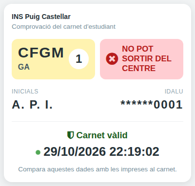
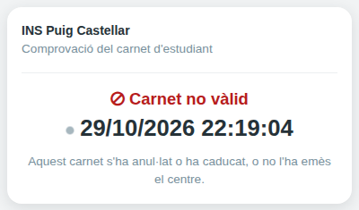

[Català](../../ca/teachers/student-card-check.md) | [Castellano](student-card-check.md) | [English](../../en/teachers/student-card-check.md)

---

# Comprobar un carné de estudiante

En el reverso de cada carné de estudiante hay un código QR. Al escanearlo, ves si el carné es auténtico y si el alumno puede salir del centro en este momento. No hace falta iniciar sesión en EMS.

**Rol necesario:** cualquier persona que tenga el carné en la mano. No hace falta ninguna cuenta de EMS.

---

## Comprobar un carné

1. Escanea el QR del reverso del carné con la cámara del móvil.
2. Abre el enlace que aparece.
3. Compara lo que muestra la página con lo que hay impreso en el carné.

La página muestra:

- El nivel, el estudio y el curso, como en el carné.
- **Pot sortir del centre** (en verde) o **No pot sortir del centre** (en rojo), tal como es ahora, aunque haya cambiado después de imprimir el carné.
- Las iniciales del alumno y los cuatro últimos dígitos del IDALU. Deben coincidir con el nombre y el IDALU impresos en el carné.
- **Carnet vàlid**, con la fecha y la hora de la consulta y un punto que parpadea. Indican que es la propia página y no una captura de pantalla.

Si el nivel, el curso, las iniciales o el IDALU no coinciden con el carné, el carné está manipulado.

---

## Un carné que no es válido

La página muestra **Carnet no vàlid** y ningún dato cuando el carné se ha anulado (perdido o robado), es de un curso académico anterior o es de un alumno que ya no estudia en el centro. Quédate el carné y llévalo a secretaría.

---

[← Volver al índice](index.md)
