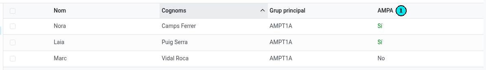
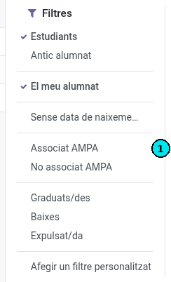

[Català](../../ca/tutors/ampa.md) | [Castellano](ampa.md) | [English](../../en/tutors/ampa.md)

---

# Socios del AMPA de tu alumnado

Puedes ver cuáles de los alumnos que tutorizas son socios del AMPA y sacar la lista, tanto de los que lo son como de los que no.

**Rol necesario:** Tutor. Tu jefe de seminario, tu jefe de departamento y tu jefe de estudios también lo ven para tu alumnado, y la dirección para el de todos los tutores. Secretaría y administración lo ven para todo el alumnado del centro.

---

## Quién es socio del AMPA

Un alumno es socio del AMPA cuando su matrícula confirmada del curso actual incluye la **cuota del AMPA** y se ha **cobrado el primer plazo**, que es donde se factura la cuota.

La cuota se paga una vez por familia: si un hermano es socio (comparte un familiar con el alumno), el alumno también lo es.

## Verlo en la lista de estudiantes

1. Abre **Comunidad educativa → Estudiantes** y cambia a la vista de lista.
2. La columna **AMPA** **(1)** dice **Sí** o **No** para cada alumno.

Si no ves la columna, actívala en el selector de columnas (el icono de la derecha de la cabecera de la lista).

La columna queda vacía para los alumnos que no son de tu alumnado ni de tu área.

## Sacar la lista de los socios o de los que no lo son

1. Abre el menú de filtros del buscador (la flecha de la derecha).
2. Elige **Socio del AMPA** **(1)** para ver solo los socios, o **No socio del AMPA** para ver los que no lo son.

Los filtros se combinan con **Mi alumnado** y con el panel de grupos de la izquierda: por ejemplo, selecciona tu grupo en el panel y aplica **No socio del AMPA**.

## Verlo en la ficha del alumno

En la ficha del alumno, junto a **Beneficios**, la etiqueta **AMPA** dice **Sí** o **No**.

## Si una familia dice que ya ha pagado

El alumno sale como socio cuando el cobro del primer plazo está registrado. Si una familia dice que ha pagado y el alumno sale con **No**, remítela a secretaría.

---

[← Volver al índice de tutores](index.md)
